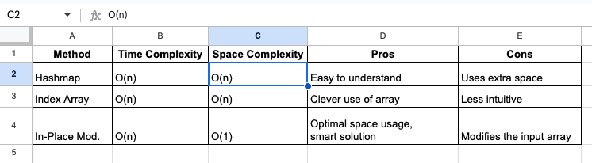

# 3 Types of Approaches w/ Detailed Explanation. O(n) Run-time and O(1) No extra space.

**Author:** muhammadfarhankt
**Votes:** 9
**Link:** [https://leetcode.com/problems/find-all-duplicates-in-an-array/solutions/4921848/](https://leetcode.com/problems/find-all-duplicates-in-an-array/solutions/4921848/)

---



# Approach 1: Using Set in Python & JS (or Hashmap in Golang)

## Intuition:
- The initial intuition for solving this problem involves keeping track of seen elements and identifying duplicates.
- A hashmap (or set) can be utilized to efficiently store seen elements and perform fast lookup to identify duplicates.
## Approach:
- Initialize a Data Structure: Initialize a hashmap (or set) to store seen elements.
- Iterate Through the Array: Traverse through the input array.
- Identify Duplicates: While iterating, check if each element exists in the hashmap (or set).
- Add to Output: If an element already exists in the hashmap (or set), add it to the output as it indicates a duplicate.
- Update Data Structure: If the element doesn't exist in the hashmap (or set), add it to the data structure.
- Return Output: After completing the iteration, return the output containing duplicate elements.

## Complexity:
- Time Complexity: O(n), where n is the size of the input array. We traverse the array once.
- Space Complexity: O(n), as we use a hashmap (or set) to store seen elements, potentially storing all elements of the input array.

# Code

```Javascript []
var findDuplicates = function(nums) {
    const seen = new Set(); // Set to store seen elements
    const output = [];
    
    // Iterate through the array
    for (const num of nums) {
        // Check if the element exists in the set
        if (seen.has(num)) {
            output.push(num); // Duplicate found, add to output
        } else {
            seen.add(num); // Add element to the set
        }
    }
    
    return output;
};
```
```Python []
def findDuplicates(self, nums: List[int]) -> List[int]:
    seen = set()  # Set to store seen elements
    output = []
    
    # Iterate through the array
    for num in nums:
        # Check if the element exists in the set
        if num in seen:
            output.append(num)  # Duplicate found, add to output
        else:
            seen.add(num)  # Add element to the set
    
    return output
```
```Golang []
func findDuplicates(nums []int) []int {
    seen := make(map[int]bool) // Map to store seen elements
    output := make([]int, 0)
    
    // Iterate through the array
    for _, num := range nums {
        // Check if the element exists in the map
        if seen[num] {
            output = append(output, num) // Duplicate found, add to output
        } else {
            seen[num] = true // Add element to the map
        }
    }
    
    return output
}
```

# Approach 2: Using Arrays
## Intuition:
- The numbers in the array range from 1 to n. We can use the numbers themselves to act as indices in a new array.
- We can count occurrences by incrementing values at these corresponding indices in the auxiliary array.  

## Approach:
- Create an array `indexArray` of size n and initialize all elements to 0.
- Iterate over the input array:
   * Increment the count at index `num - 1` in `indexArray` (since the numbers start from 1).
   * Iterate through `indexArray`. If a count at an index is 2, the corresponding value (`index + 1`) is a duplicate.
## Complexity:
- Time Complexity: O(n), where n is the size of the input array. We traverse the array once.
- Space Complexity: O(n), as we use an additional array to mark seen elements.
# Code

```Javascript []
var findDuplicates = function(nums) {
    const output = [];
    const indexArray = new Array(nums.length).fill(0); // Create a new array filled with zeros

    for (const num of nums) {
        indexArray[num - 1]++; // Increment the count at the corresponding index
    }

    for (let i = 0; i < indexArray.length; i++) {
        if (indexArray[i] === 2) {
            output.push(i + 1); // If a count is 2, that value is a duplicate
        }
    }
    return output;
}
```
```Python []
def findDuplicates(self, nums: List[int]) -> List[int]:
    output = []
    index_array = [0] * len(nums)  # Create a new list filled with zeros

    for num in nums:
        index_array[num - 1] += 1  # Increment the count at the corresponding index

    for i, count in enumerate(index_array):
        if count == 2:
            output.append(i + 1)  # If a count is 2, that value is a duplicate
    return output
```
```Golang []
func findDuplicates(nums []int) []int {
    size := len(nums)
    idxArr := make([]int, size)
    output := []int{}
    for _, num := range nums {
        idxArr[num-1]++
        if idxArr[num-1] == 2 {
            output = append(output, num)
        }
    }
    return output
}
```

# Approach 3: Optimized Using Arrays
## Intuition:
- This approach optimizes Approach 2 by directly manipulating the input array instead of using an additional array.
- By using the input array itself to mark elements, we can reduce space complexity to O(1).
## Approach:
- Iterate Through the Array: Traverse through the input array.
- Calculate Index: For each element, calculate its index in the adjusted array (adjusted for 0-based indexing).
- Check Element Status: Check if the value at the calculated index is negative.
- Identify Duplicates: If the value is negative, add its absolute value to the output as it indicates a duplicate.
- Mark Element: If the value is positive, mark the element as seen by negating its value.
- Return Output: After completing the iteration, return the output containing duplicate elements.
## Complexity:
- Time Complexity: O(n), where n is the size of the input array. We traverse the array once.
- Space Complexity: O(1), as we directly manipulate the input array without using any additional space apart from the output slice.

# Code

```Javascript []
var findDuplicates = function(nums) {
    const output = [];
    
    // Iterate through the array
    for (const num of nums) {
        const idx = Math.abs(num) - 1;
        
        // Check if the value at the calculated index is negative
        if (nums[idx] < 0) {
            output.push(Math.abs(num)); // Duplicate found, add to output
        } else {
            nums[idx] = -nums[idx]; // Mark the element as seen
        }
    }
    
    return output;
}
```
```Python []
def findDuplicates(self, nums: List[int]) -> List[int]:
    output = []
    
    # Iterate through the array
    for num in nums:
        idx = abs(num) - 1
        
        # Check if the value at the calculated index is negative
        if nums[idx] < 0:
            output.append(abs(num))  # Duplicate found, add to output
        else:
            nums[idx] = -nums[idx]  # Mark the element as seen
    
    return output
```
```Golang []
func findDuplicates(nums []int) []int {
    output := []int{}
    for _, num := range nums {
        idx := abs(num)
        if nums[idx-1] < 0 {
            output = append(output, idx)
        } else {
            nums[idx-1] *= -1
        }
    }
    return output
}
func abs(num int) int {
    if num < 0 {
        return -num
    }
    return num
}
```

# Pls vote if you liked it.