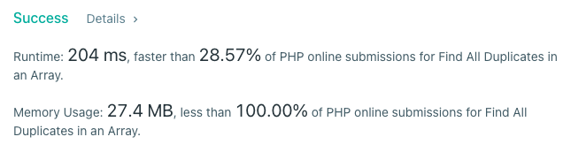

# PHP

**Author:** stuu
**Votes:** 1
**Link:** [https://leetcode.com/problems/find-all-duplicates-in-an-array/solutions/2191208/](https://leetcode.com/problems/find-all-duplicates-in-an-array/solutions/2191208/)

---


```
class Solution
{

  /**
   * @param Integer[] $nums
   * @return Integer[]
   */
  function findDuplicates($nums)
  {
    if (count($nums) === 1) {
      return [];
    }
    $num_counts = array_fill_keys($nums, 0);
    foreach ($nums as $k => $num) {
      if ($num_counts[$num] < 2) {
        $num_counts[$num]++;
      }
    }
    return array_keys($num_counts, 2);
  }
}
