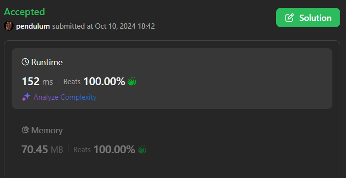

# Time 100%  & Mem 100%

**Author:** rs-pendulum
**Votes:** 0
**Link:** [https://leetcode.com/problems/sequence-reconstruction/solutions/5896224/](https://leetcode.com/problems/sequence-reconstruction/solutions/5896224/)

---



# Intuition
This problem can be solved using topological sorting. We will use the concept of graphs:

1. Each number from org will be represented as a vertex.
2. Each relation from seqs will be represented as an edge defining the order of the numbers.

The goal is to check whether topological sorting can be performed so that the resulting sequence strictly corresponds to ```org```. If so, then the original sequence is the only possible one.


# Approach
### Basic steps:
1. Let's build a graph based on sequences in ```seqs```, where for each pair of numbers ```a -> b``` and add an edge from ```a``` to ```b```.
2. Let's calculate the input degrees of each vertex (how many edges it contains).
3. Let's perform a topological sorting. If at any moment it turns out that there are several possible options for the next number, it means that the sequence cannot be unambiguously restored.
4. At the end, let's check if the resulting sequence matches ```org```.
# Complexity
- Time complexity: $$O(n)$$
- Space complexity: $$O(m + n)$$

# Code
```typescript []
function sequenceReconstruction(org: number[], seqs: number[][]): boolean {
  const graph = new Map<number, Set<number>>();
  const inDegree = new Map<number, number>();

  for (const seq of seqs) {
    for (const num of seq) {
      if (!graph.has(num)) {
        graph.set(num, new Set());
      }
      if (!inDegree.has(num)) {
        inDegree.set(num, 0);
      }
    }
  }
  for (const seq of seqs) {
    for (let i = 1; i < seq.length; i++) {
      const u = seq[i - 1], v = seq[i];
      if (!graph.get(u).has(v)) {
        graph.get(u).add(v);
        inDegree.set(v, inDegree.get(v) + 1);
      }
    }
  }
  if (graph.size !== org.length) {
    return false;
  }
  const queue: number[] = [];
  for (const [node, degree] of inDegree) {
    if (degree === 0) {
      queue.push(node);
    }
  }

  const result: number[] = [];

  while (queue.length === 1) {
    const node = queue.shift()!;
    result.push(node);

    for (const neighbor of graph.get(node)!) {
      inDegree.set(neighbor, inDegree.get(neighbor)! - 1);
      if (inDegree.get(neighbor) === 0) {
        queue.push(neighbor);
      }
    }
  }
  return result.length === org.length 
    && result.every((v, i) => v === org[i]);
}

```