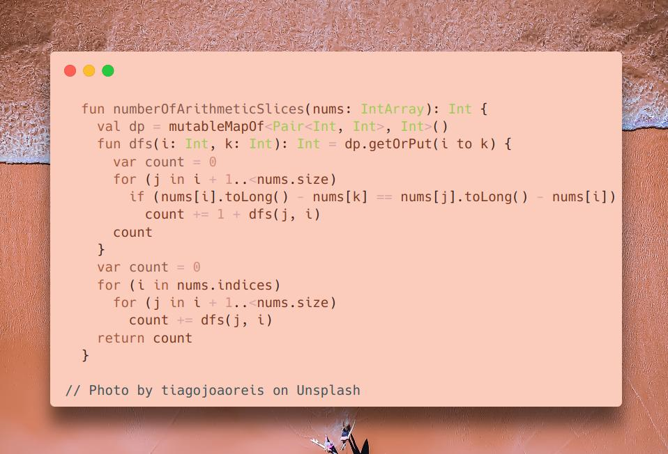

# Kotlin | dp

**Author:** SamoylenkoDmitry
**Votes:** 3
**Link:** [https://leetcode.com/problems/arithmetic-slices-ii-subsequence/solutions/4521808/](https://leetcode.com/problems/arithmetic-slices-ii-subsequence/solutions/4521808/)

---


https://youtu.be/3kFB0lC8oxM
#### Join me on Telegram

https://t.me/leetcode_daily_unstoppable/464

#### Problem TLDR

Count of arithmetic subsequences.

#### Intuition

We can take every pair and search for the third element.
The result is only depends of the `diff` and suffix array position, so can be cached.

#### Approach

* be careful how to count each new element: first add the `1` then add the suffix count. Wrong approach: just count the `1` at the end of the sequence.

#### Complexity

- Time complexity:
$$O(n^2)$$, it looks like n^4, but the `dfs` n^2 part will only go deep once

- Space complexity:
$$O(n^2)$$

#### Code

```kotlin

  fun numberOfArithmeticSlices(nums: IntArray): Int {
    val dp = mutableMapOf<Pair<Int, Int>, Int>()
    fun dfs(i: Int, k: Int): Int = dp.getOrPut(i to k) {
      var count = 0
      for (j in i + 1..<nums.size) 
        if (nums[i].toLong() - nums[k] == nums[j].toLong() - nums[i])
          count += 1 + dfs(j, i)
      count
    }
    var count = 0
    for (i in nums.indices)
      for (j in i + 1..<nums.size)
        count += dfs(j, i)
    return count
  }

```