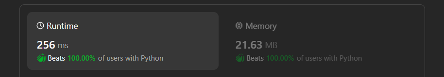

# ✅Beats 100% - Dynamic Programming - Explained with [ Video ] - C++/Java/Python/JS

**Author:** lancertech6
**Votes:** 71
**Link:** [https://leetcode.com/problems/arithmetic-slices-ii-subsequence/solutions/4520405/](https://leetcode.com/problems/arithmetic-slices-ii-subsequence/solutions/4520405/)

---




# YouTube Video Explanation:

<!-- **If you want a video for this question please write in the comments** -->

<!-- https://www.youtube.com/watch?v=ujU-jeO1v-k -->

https://youtu.be/e4lTqe5xdJw

**\uD83D\uDD25 Please like, share, and subscribe to support our channel's mission of making complex concepts easy to understand.**

Subscribe Link: https://www.youtube.com/@leetlogics/?sub_confirmation=1

*Subscribe Goal: 1300 Subscribers*
*Current Subscribers: 1270*

---

# Intuition
<!-- Describe your first thoughts on how to solve this problem. -->
To count the number of arithmetic subsequences, we can leverage dynamic programming to keep track of valid subsequences ending at each index. We can also use a HashMap to efficiently find indices of elements with the same value, allowing us to extend arithmetic subsequences.

# Approach
<!-- Describe your approach to solving the problem. -->
1. Initialize a 2D DP array `dp`, where `dp[i][j]` represents the number of valid arithmetic subsequences ending at index `j` with a common difference equal to `nums[j] - nums[i]`.
2. Use a HashMap (`map`) to store indices of elements with the same value. This will help efficiently find indices for the same values during the iteration.
3. Iterate over pairs of indices `(i, j)` with `i < j`. For each pair, calculate the potential common difference `a = 2 * nums[i] - nums[j]`.
4. If `map` contains `a`, iterate over the indices in `map.get(a)` and check if the index `k` is less than `i`. If true, update `dp[i][j]` with `dp[k][i] + 1` to extend the arithmetic subsequence. Otherwise, break the loop.
5. Accumulate the counts from `dp[i][j]` into the variable `sum`.
6. Return the final value of `sum`.

# Complexity
- Time complexity: `O(n^2)` - The nested loops iterate over pairs of indices.
<!-- Add your time complexity here, e.g. $$O(n)$$ -->

- Space complexity: `O(n)` - Additional space is used for the `dp` array and the `map`.
<!-- Add your space complexity here, e.g. $$O(n)$$ -->

# Code
```java []
class Solution {
 public int numberOfArithmeticSlices(int[] nums) {
        int n = nums.length;
        int[][] dp = new int[n][n];
        HashMap<Long, ArrayList<Integer>> map = new HashMap<>();
        for(int i = 0; i < n; i++){
            long temp = nums[i];
            if(!map.containsKey(temp)){
                map.put(temp, new ArrayList<Integer>());
            }
            map.get(temp).add(i);
        }

        int sum = 0;
        for(int i = 1; i < n; i++){
            for(int j = i + 1; j < n; j++){
                long a = 2L * nums[i] - nums[j];
                if(map.containsKey(a) ){
                    for(int k : map.get(a)){
                        if(k < i){
                            dp[i][j] += dp[k][i] + 1;
                        }else{
                            break;
                        }
                    }
                }
                sum += dp[i][j];
            }
        }
        return sum;
    }
}
```
```C++ []
class Solution {
public:
    int numberOfArithmeticSlices(vector<int>& nums) {
        int n = nums.size();
        vector<vector<int>> dp(n, vector<int>(n, 0));
        unordered_map<long, vector<int>> map;

        for (int i = 0; i < n; i++) {
            long temp = nums[i];
            if (!map.count(temp)) {
                map[temp] = vector<int>();
            }
            map[temp].push_back(i);
        }

        int sum = 0;
        for (int i = 1; i < n; i++) {
            for (int j = i + 1; j < n; j++) {
                long a = 2L * nums[i] - nums[j];
                if (map.count(a)) {
                    for (int k : map[a]) {
                        if (k < i) {
                            dp[i][j] += dp[k][i] + 1;
                        } else {
                            break;
                        }
                    }
                }
                sum += dp[i][j];
            }
        }
        return sum;
    }
};
```
```Python []
class Solution:
    def numberOfArithmeticSlices(self, nums):
        n = len(nums)
        dp = [[0] * n for _ in range(n)]
        map = {}

        for i in range(n):
            temp = nums[i]
            if temp not in map:
                map[temp] = []
            map[temp].append(i)

        total_sum = 0
        for i in range(1, n):
            for j in range(i + 1, n):
                a = 2 * nums[i] - nums[j]
                if a in map:
                    for k in map[a]:
                        if k < i:
                            dp[i][j] += dp[k][i] + 1
                        else:
                            break
                total_sum += dp[i][j]

        return total_sum
```
```JavaScript []
/**
 * @param {number[]} nums
 * @return {number}
 */
var numberOfArithmeticSlices = function(nums) {
    const n = nums.length;
    const dp = Array.from(Array(n), () => Array(n).fill(0));
    const map = new Map();

    for (let i = 0; i < n; i++) {
        const temp = nums[i];
        if (!map.has(temp)) {
            map.set(temp, []);
        }
        map.get(temp).push(i);
    }

    let totalSum = 0;
    for (let i = 1; i < n; i++) {
        for (let j = i + 1; j < n; j++) {
            const a = 2 * nums[i] - nums[j];
            if (map.has(a)) {
                for (const k of map.get(a)) {
                    if (k < i) {
                        dp[i][j] += dp[k][i] + 1;
                    } else {
                        break;
                    }
                }
            }
            totalSum += dp[i][j];
        }
    }

    return totalSum;
};
```

