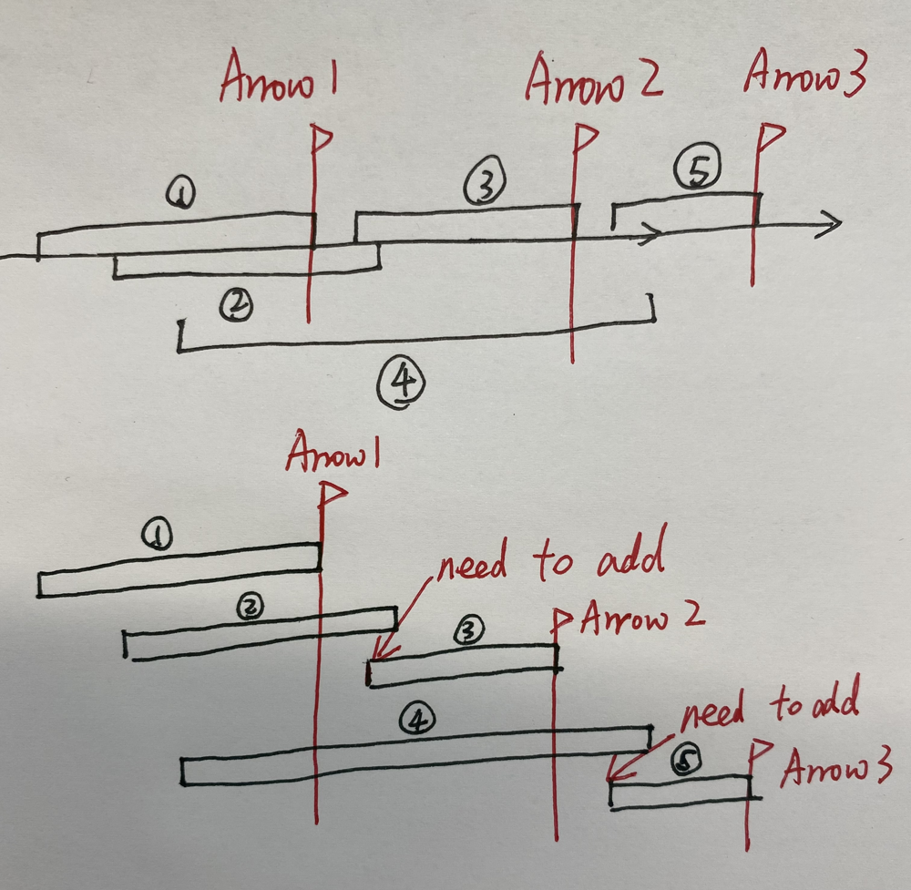

# ✅ [C++/Java/Python] 6 Lines || Sort and Greedy || Image Explanation

**Author:** linfq
**Votes:** 332
**Link:** [https://leetcode.com/problems/minimum-number-of-arrows-to-burst-balloons/solutions/1686627/](https://leetcode.com/problems/minimum-number-of-arrows-to-burst-balloons/solutions/1686627/)

---

**PLEASE UPVOTE if you like** \uD83D\uDE01 **If you have any question, feel free to ask.** 

* Problem Understanding
	* There is some **misleading** in the description of the problem, **`points` are not points but line segments, so I just modify `points` to `segments`.**
	* There are several `segments` on the one-dimensional coordinate axis, find out the minimum number of `arrows` which are orthogonal to the coordinate axis so that each `segment` can be shot through by at least one `arrow`.
* Approch
	* Sort the `segments` by the end
	* put an arrow at the end of the 1-st `segment`
	* from the 2-nd `segment`, we check whether the current arrow pass through the current `segment`, if not add an arrow, put it at the end of the current `segment`




**Python**
```py
class Solution(object):
    def findMinArrowShots(self, segments):
        segments.sort(key=lambda p: p[1])
        ans, arrow = 0, 0
        for [start, end] in segments:
            if ans == 0 or start > arrow:
                ans, arrow = ans + 1, end
        return ans
```

**C++**
```
bool cmp(vector<int>& a, vector<int>& b) {return a[1] < b[1];}
class Solution {
public:  
    int findMinArrowShots(vector<vector<int>>& segments) {
        sort(segments.begin(), segments.end(), cmp);
        int ans = 0, arrow = 0;
        for (int i = 0; i < segments.size(); i ++) {
            if (ans == 0 || segments[i][0] > arrow) {
                ans ++;
                arrow = segments[i][1];
            }
        }
        return ans;
    }
};
```

**Java**
```
class Solution {
    public int findMinArrowShots(int[][] segments) {
        Arrays.sort(segments, (a, b) -> Integer.compare(a[1], b[1]));
        int ans = 0, arrow = 0;
        for (int i = 0; i < segments.length; i ++) {
            if (ans == 0 || segments[i][0] > arrow) {
                ans ++;
                arrow = segments[i][1];
            }
        }
        return ans;
    }
}

```

**PLEASE UPVOTE if you like** \uD83D\uDE01 **If you have any question, feel free to ask.**