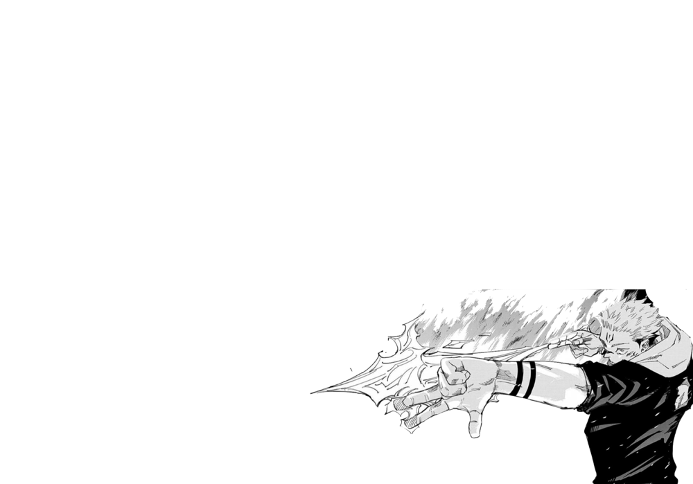
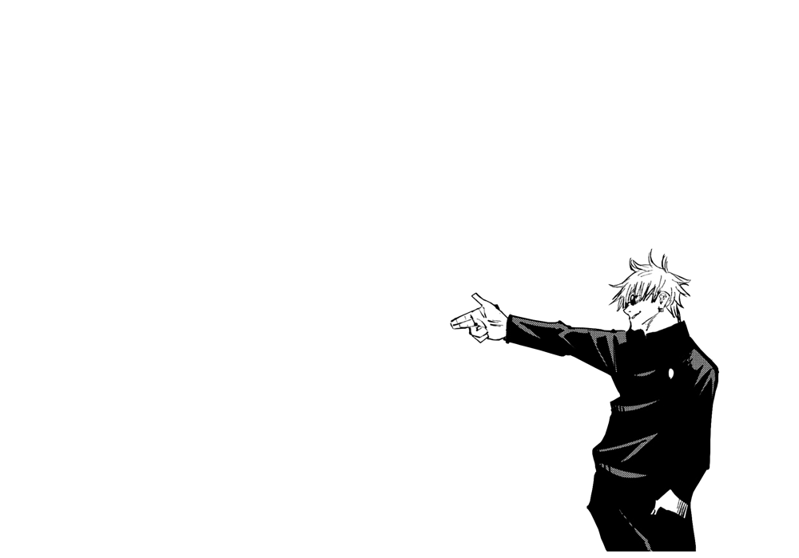
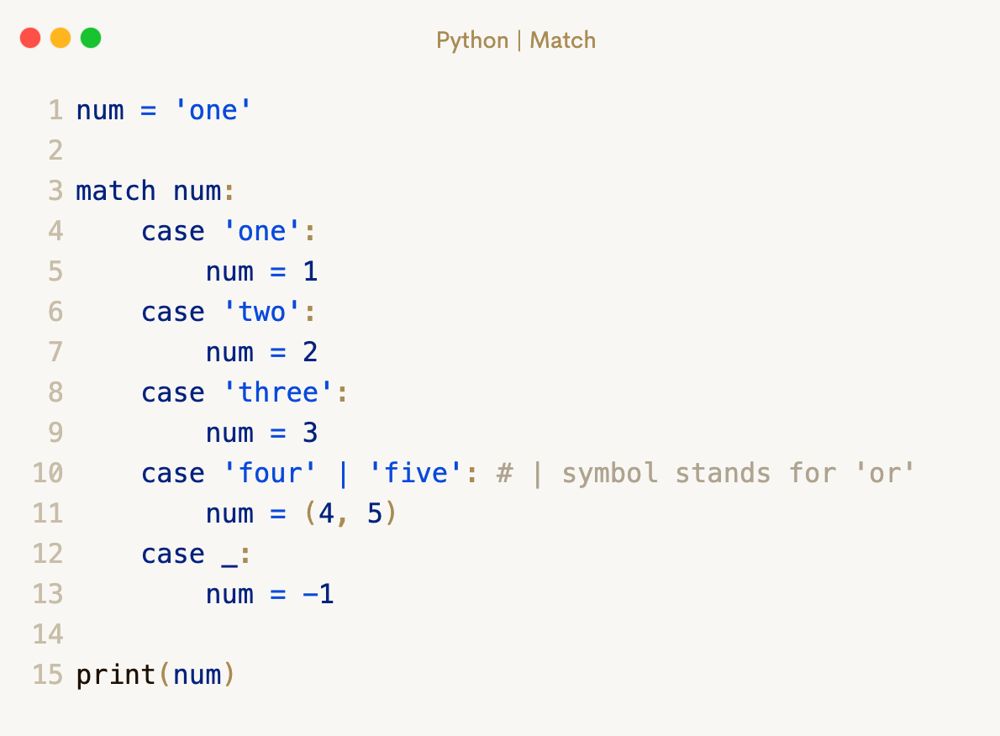

# 🔥✅✅ Beat 93.80% | ✅ Full explanation with pictures ✅✅🔥

**Author:** DevOgabek
**Votes:** 147
**Link:** [https://leetcode.com/problems/minimum-number-of-arrows-to-burst-balloons/solutions/4890366/](https://leetcode.com/problems/minimum-number-of-arrows-to-burst-balloons/solutions/4890366/)

---

## Show your appreciation by clicking the upvote button
### Here is another method. [here](https://leetcode.com/problems/minimum-number-of-arrows-to-burst-balloons/solutions/4890422/easy-91-77-beats-c-java-python-javascript-c)


[](https://leetcode.com/problems/minimum-number-of-arrows-to-burst-balloons/submissions/1206750542?envType=daily-question&envId=Invalid%20Date)








```python []
class Solution(object):
    def findMinArrowShots(self, points):
        points.sort(key=lambda x: x[0])
        arrows = 1
        end = points[0][1]
        
        for balloon in points[1:]:
            if balloon[0] > end: 
                arrows += 1  
                end = balloon[1] 
            else:
                end = min(end, balloon[1])
        
        return arrows
```
```python3 []
class Solution:
    def findMinArrowShots(self, points: List[List[int]]) -> int:
        points.sort(key=lambda x: x[0])
        arrows = 1
        end = points[0][1]
        
        for balloon in points[1:]:
            if balloon[0] > end: 
                arrows += 1  
                end = balloon[1] 
            else:
                end = min(end, balloon[1])
        
        return arrows
```
```C++ []
class Solution {
public:
    int findMinArrowShots(vector<vector<int>>& points) {
        std::sort(points.begin(), points.end(), [](const auto& a, const auto& b) {
            return a[0] < b[0];
        });

        int arrows = 1;
        int end = points[0][1];

        for (size_t i = 1; i < points.size(); ++i) {
            if (points[i][0] > end) {
                arrows++;
                end = points[i][1];
            } else {
                end = std::min(end, points[i][1]);
            }
        }

        return arrows;
    }
};
```
```javascript []
var findMinArrowShots = function(points) {
    points.sort((a, b) => a[0] - b[0]);

    let arrows = 1;
    let end = points[0][1];

    for (let i = 1; i < points.length; i++) {
        if (points[i][0] > end) {
            arrows++;
            end = points[i][1];
        } else {
            end = Math.min(end, points[i][1]);
        }
    }

    return arrows;
};
```


### Who did not know ?
