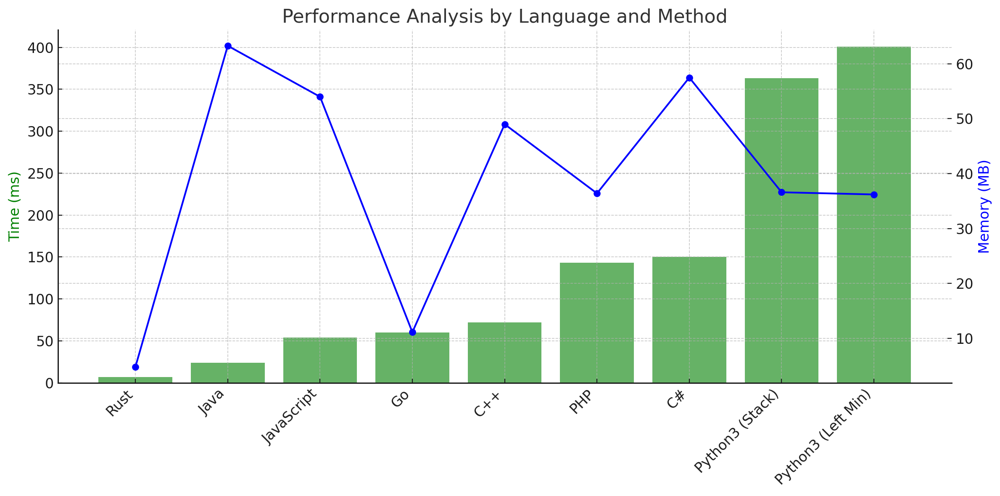

# ✅ 99.35% Stack & Left Approach & Binary Search

**Author:** vanAmsen
**Votes:** 138
**Link:** [https://leetcode.com/problems/132-pattern/solutions/4107421/](https://leetcode.com/problems/132-pattern/solutions/4107421/)

---

# Comprehensive Guide to Solving "132 Pattern": Detecting the Sneaky Subsequence

## Introduction & Problem Statement

Hello, fellow code enthusiasts! Today, we're diving deep into the realm of number patterns. Specifically, we're tackling the "132 Pattern" problem. The task is to determine if there exists a subsequence of three integers in a given array such that the numbers follow the pattern: `nums[i] < nums[k] < nums[j]` with `i < j < k`. Sounds intriguing, right? Let's unwrap the intricacies of this problem and decode the solutions.

## Key Concepts and Constraints

### Why is This Problem Unique?

1. **Subsequence Challenge**: 
   Unlike other problems where you might need to find contiguous subsequences, here you're looking for any subsequence that matches the pattern.
  
2. **Dual Approach**: 
   We have two intriguing methods to solve this challenge, both with their unique mechanisms.

3. **Constraints**: 
   - The length of the array, `n`, is between $$1$$ and $$2 \	imes 10^5$$.
   - Array elements are integers between $$-10^9$$ and $$10^9$$.

### Strategies to Tackle the Problem

1. **Stack-Based Approach**:  
   Using a stack, we can traverse the array in reverse and efficiently check for the pattern.
   
2. **Minimum from the Left (MinLeft) Approach**:  
   By keeping track of the minimum value from the left for each element, we can employ another efficient method to detect the pattern.

3. **Binary Search Approach**:
   While not the most optimal, this approach offers a unique perspective on the problem. Leveraging binary search, we maintain a sorted list of numbers encountered so far. This method systematically detects the 132 pattern and showcases the versatility of binary search in algorithmic challenges beyond traditional searching.

---

## Live Coding + Explenation of Stack-Based Approach
https://youtu.be/PTn6ec9r5Jk?si=2y64rDvBTNYJUCiS

## Stack-Based Approach Explained

### The Mechanics of the Stack Approach

1. **Initialize Stack and Third Variable**:  
   Begin by initializing an empty stack and a variable `third` with a value of negative infinity. The `third` variable will store the value of our `nums[k]` when we find it.
  
2. **Reverse Iteration**:
   Traverse the array in reverse. For each number:
   
   - If it's smaller than `third`, you've found the pattern and can return `True`.
   - While the stack is not empty and the top of the stack is smaller than the current number, pop the stack and assign the popped value to `third`.
   - Push the current number onto the stack.
  
3. **End of Iteration**:
   If the iteration completes without finding the pattern, return `False`.

### Time and Space Complexity

- **Time Complexity**: $$O(n)$$, as we make a single pass through the array.
- **Space Complexity**: $$O(n)$$, due to the use of the stack.


# Code Stack
``` Python []
class Solution:
    def find132pattern(self, nums: List[int]) -> bool:
        stack, third = [], float('-inf')
        
        for num in reversed(nums):
            if num < third:
                return True
            while stack and stack[-1] < num:
                third = stack.pop()
            stack.append(num)
        return False
```
``` C++ []
class Solution {
public:
    bool find132pattern(vector<int>& nums) {
        stack<int> s;
        int third = INT_MIN;

        for (int i = nums.size() - 1; i >= 0; i--) {
            if (nums[i] < third) return true;
            while (!s.empty() && s.top() < nums[i]) {
                third = s.top();
                s.pop();
            }
            s.push(nums[i]);
        }
        return false;
    }
};
```
``` Java []
public class Solution {
    public boolean find132pattern(int[] nums) {
        Stack<Integer> stack = new Stack<>();
        int third = Integer.MIN_VALUE;

        for (int i = nums.length - 1; i >= 0; i--) {
            if (nums[i] < third) return true;
            while (!stack.isEmpty() && stack.peek() < nums[i]) {
                third = stack.pop();
            }
            stack.push(nums[i]);
        }
        return false;
    }
}
```
``` Rust []
impl Solution {
    pub fn find132pattern(nums: Vec<i32>) -> bool {
        let mut stack: Vec<i32> = Vec::new();
        let mut third = i32::MIN;

        for &num in nums.iter().rev() {
            if num < third {
                return true;
            }
            while let Some(&top) = stack.last() {
                if top < num {
                    third = stack.pop().unwrap();
                } else {
                    break;
                }
            }
            stack.push(num);
        }
        false
    }
}
```
``` JavaScript []
/**
 * @param {number[]} nums
 * @return {boolean}
 */
var find132pattern = function(nums) {
    let stack = [];
    let third = Number.MIN_SAFE_INTEGER;

    for (let i = nums.length - 1; i >= 0; i--) {
        if (nums[i] < third) return true;
        while (stack.length && stack[stack.length - 1] < nums[i]) {
            third = stack.pop();
        }
        stack.push(nums[i]);
    }
    return false;
};
```
``` PHP []
class Solution {
    function find132pattern($nums) {
        $stack = [];
        $third = PHP_INT_MIN;

        for ($i = count($nums) - 1; $i >= 0; $i--) {
            if ($nums[$i] < $third) return true;
            while (count($stack) && end($stack) < $nums[$i]) {
                $third = array_pop($stack);
            }
            $stack[] = $nums[$i];
        }
        return false;
    }
}
```
``` C# []
public class Solution {
    public bool Find132pattern(int[] nums) {
        Stack<int> stack = new Stack<int>();
        int third = int.MinValue;

        for (int i = nums.Length - 1; i >= 0; i--) {
            if (nums[i] < third) return true;
            while (stack.Count > 0 && stack.Peek() < nums[i]) {
                third = stack.Pop();
            }
            stack.Push(nums[i]);
        }
        return false;
    }
}
```
``` Go []
import "math"

func find132pattern(nums []int) bool {
    var stack []int
    third := math.MinInt32

    for i := len(nums) - 1; i >= 0; i-- {
        if nums[i] < third {
            return true
        }
        for len(stack) > 0 && stack[len(stack)-1] < nums[i] {
            third = stack[len(stack)-1]
            stack = stack[:len(stack)-1]
        }
        stack = append(stack, nums[i])
    }
    return false
}
```

---

## Minimum from the Left (MinLeft) Approach Explained

### The Intricacies of the MinLeft Approach

1. **Compute MinLeft Array**:  
   Construct an array, `minFromLeft`, such that for every element in the original array, `minFromLeft[i]` represents the minimum value from index `0` to `i-1`.
  
2. **Initialize a Stack**: 
   This stack will assist in checking for the existence of the `132` pattern.
   
3. **Reverse Iteration**:
   Traverse the array in reverse. For each number:
   
   - If the current number is greater than its corresponding value in `minFromLeft`, it means we have a potential `nums[i]` and `nums[j]` pair. Now, we aim to find a `nums[k]` such that `minFromLeft[j] < nums[k] < nums[j]`.
   - While the stack is not empty and the top of the stack is less than or equal to `minFromLeft[j]`, pop the stack.
   - If there's still a number in the stack and it's less than the current number, we've found our pattern and can return `True`.
   - Push the current number onto the stack.
  
4. **End of Iteration**:
   If the iteration completes without finding the pattern, return `False`.

### Time and Space Complexity

- **Time Complexity**: $$O(n)$$, as we make a single pass through the array.
- **Space Complexity**: $$O(n)$$, due to the use of the `minFromLeft` array and the stack.

# Code MinLeft
``` Python []
class Solution:
    def find132pattern(self, nums: List[int]) -> bool:
        n = len(nums)
        
        minFromLeft = [nums[0]]
        for i in range(1, n):
            minFromLeft.append(min(minFromLeft[i-1], nums[i]))
        
        stack = [] 
        
        for j in range(n-1, -1, -1):
            if nums[j] > minFromLeft[j]:
                while stack and stack[-1] <= minFromLeft[j]:
                    stack.pop()
                if stack and stack[-1] < nums[j]:
                    return True
                stack.append(nums[j])
        
        return False
```

---

## Binary Search Approach Explained

### The Mechanism of the Binary Search Approach

1. **Pre-compute Running Minimum**:
   Create an array, `min_i`, where each entry `min_i[j]` denotes the minimum value in the array `nums` from index `0` to `j`. This helps us quickly identify the smallest value before our current index  `j` in constant time.

2. **Maintain a Sorted `afters` List**:
   As we traverse the array in reverse, this list keeps track of the numbers we've seen so far in a sorted manner. This allows us to efficiently search for potential $$ \	ext{nums}[k] $$ values for each $$ \	ext{nums}[j] $$ using binary search.

3. **Reverse Iteration**:
   Traverse the array from the end to the start:
   
   - If the current number $$ \	ext{nums}[j] $$ is greater than the running minimum up to  `j` , it indicates a potential increasing pattern.
   - We perform a binary search in the `afters` list to identify a potential $$ \	ext{nums}[k] $$ that's less than $$ \	ext{nums}[j] $$ but greater than the running minimum. If such a value exists, we've found our 132 pattern.
   - Insert the current number $$ \	ext{nums}[j] $$ into the `afters` list, ensuring it remains sorted.
   
4. **Completion of Iteration**:
   If we traverse the entire array without detecting the 132 pattern, we return `False`.

### Time and Space Complexity

- **Time Complexity**: $$O(n \\log n)$$. While we do traverse the array in $$O(n)$$ time, the insertion into a sorted list takes $$O(\\log n)$$ time due to the binary search. Thus, the overall time complexity is $$O(n \\log n)$$.
- **Space Complexity**: $$O(n)$$. We use additional space for the `min_i` array and the `afters` list. Both of these are of length $$ n $$ in the worst case.

# Code Binary Search
``` Python []
class Solution:
    def find132pattern(self, nums: List[int]) -> bool:
        if not nums:
            return False
        
        afters = []
        
        min_i = [nums[0]]
        for i in range(1, len(nums)):
            min_i.append(min(min_i[-1], nums[i]))
        
        for j in reversed(range(len(nums))):
            if nums[j] > min_i[j]:
                index = bisect.bisect_left(afters, nums[j])
                if index > 0 and afters[index - 1] > min_i[j]:
                    return True
                bisect.insort_left(afters, nums[j])
        
        return False
```

## Code Highlights and Best Practices

- **Stack-Based Approach**: 
  This method is straightforward yet powerful. By cleverly using a stack, the solution efficiently checks for the 132 pattern in reverse, making it a favorite for many due to its simplicity and effectiveness.

- **MinLeft Approach**: 
  This technique offers a different lens to view the problem. By keeping track of the minimum value from the left for each element, it effectively checks for the pattern's existence. The approach underscores the usefulness of pre-computation and data preparation in problem-solving.

- **Binary Search Approach**: 
  This is a more intricate method that leverages the power of binary search. By maintaining a sorted list of numbers encountered so far and using binary search to find potential matches, it offers a unique and systematic way to detect the 132 pattern. While it might be a tad more involved than the other two methods, it demonstrates the versatility of binary search in problems beyond mere searching.

## Performance

| Language     | Time (ms) | Memory (MB) | Method          |
|--------------|-----------|-------------|-----------------|
| Rust         | 7         | 4.8         | Stack           |
| Java         | 24        | 63.3        | Stack           |
| JavaScript   | 54        | 54          | Stack           |
| Go           | 60        | 11.1        | Stack           |
| C++          | 72        | 49          | Stack           |
| PHP          | 143       | 36.4        | Stack           |
| C#           | 150       | 57.5        | Stack           |
| Python3      | 359       | 36.6        | Stack           |
| Python3      | 401       | 36.2        | Left Min        |
| Python3      | 3406      | 36.2        | Binary Search   |




By understanding and mastering these three techniques, coders can not only tackle this particular problem efficiently but also gain insights that can be applied to a plethora of other algorithmic challenges. Being equipped with multiple approaches for a single problem is always advantageous, especially in situations like coding interviews or competitions where thinking on one's feet is paramount.