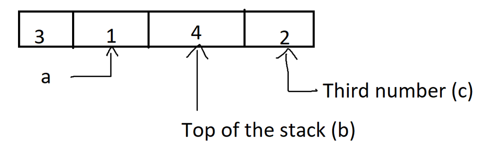

# 🚀  99.01% || Stack Solution || Commented Code🚀

**Author:** MohamedMamdouh20
**Votes:** 75
**Link:** [https://leetcode.com/problems/132-pattern/solutions/4107589/](https://leetcode.com/problems/132-pattern/solutions/4107589/)

---

# Problem Description

Given an array of integers, `nums`, of length `n`. A **132 pattern** is a subsequence of three integers, `nums[i]`, `nums[j]`, and `nums[k]`, where `i < j < k` and `nums[i] < nums[k] < nums[j]`.

Determine whether the given array contains a **132 pattern**. Return **true** if a **132 pattern** exists; otherwise, return **false**.

- **Constraints:**
    - `n == nums.length`
    - `1 <= n <= 2 * 10e5`
    - `-10e9 <= nums[i] <= 10e9`


---


# Intuition
Hi there, \uD83D\uDE00

Let's take a look on our today's tough problem. \uD83D\uDCAA
In today's problem, we must determine if an array has **132 pattern** or not.

**First solution** that would pop into mind is to use **Brute Force**.\uD83D\uDCAA
Use **three for loop** to get what you want but unfortunately, it will throw `TLE` error. \uD83D\uDE22
even if we lower them to **two for loops** it will also give us `TLE` error. \uD83D\uDE22

Seems challenging problem. \uD83D\uDE20
But we can solve it. \uD83D\uDCAA\uD83D\uDE80

let's revise the **Brute Force** Solutions
For the **three loops** solution, We can loop on all the array elements to get the subsequence that satisfies the **132 pattern**.
```
for (size_t i = 0; i < nums.size() - 2; i++) {
            for (size_t j = i + 1; j < nums.size() - 1; j++) {
                for (size_t k = j + 1; k < nums.size(); k++) {
                    if (nums[k] > nums[i] and nums[j] > nums[k]) {
                        return true;
                    }
                }
            }
        }
```

For the **two loops** solution, We can maintain the **minimum** number before our **current** number and simply add **second** loop to search for a number that is between the current number and minimum number.
```
for (size_t j = 0; j < nums.size() - 1; j++) {
            min_i = min(min_i, nums[j]);
            for (size_t k = j + 1; k < nums.size(); k++) {
                if (nums[k] < nums[j] and min_i < nums[k]) {
                    return true;
                }
            }
        }
```

Till now, everything looks great but how can we make the solution only **one** for loop? \uD83E\uDD14
We can realize here that our **problem** in the two for loop solution is the **third** number which is the **middle-value** in **132 pattern** and we need a way to find it without for loop. \uD83E\uDD29

Why not **reverse traversal** the array ? \uD83E\uDD14
Since this number is always the **third** then simply **reverse traversal** and **cache** every number that you encounter in some way.

what would be that way ?\uD83E\uDD14
Soooooooo, in the **132 pattern** we need to find three numbers 1-valued call it `a`, 3-valued call it `b` and 2-valued call it `c`.

we can **cache** `c` element easy in some variable.
what about `b` element ?
Here comes the hero of the day **THE STACK** \uD83E\uDDB8\u200D\u2642\uFE0F.

- We can use the stack for to things
    - Obviously to **store** all numbers from the end of the array
    - When you encouter number **bigger** than the **top** of the stack simply **pop** the top of the stack and put this number in the variable for `c`
    - push that **bigger** number into the stack

Why did we do the last two steps ? \uD83E\uDD14
if the number we encoutered is **bigger** than the top of the stack then pop any number from the stack, **consider** the popped number as `c` the **encountered** number as `b`.
- And we are sure from two values:
    - `b` which is in the top of the stack.
    - `c` which is in the cached variable.
    
the only remaining step is to find `a` and that what we will maintaining by continue the looping.
  



---


# Approach
1. Create a stack `decreasingStack` to keep track of decreasing elements.
2. Initialize `maxThirdElement` to the minimum possible value.
3. **Traverse** the Array from Right to Left and for each element in the array:
    - If the **current** element is **less** than `maxThirdElement`, return **true** (found a 132 pattern).
    - While the **stack** is not empty and the top element of the stack is **less** than the current element:
        - **Update** `maxThirdElement` to the top element of the stack.
        - **Pop** the top element from the stack.
    - **Push** the Current Element onto the Stack.
4. If no `132 pattern` is found after traversing the array, return **false**.

## Complexity
- **Time complexity:** $$O(N)$$
Since we are iterating the array from right to left then it is **linear** time and all the operations inside the loop are `O(1)` then final complexity is `O(N)`.
- **Space complexity:** $$O(N)$$
Since we are maintaining a stack that at any point can have elements equal the elements of the array so complexity is `O(N)`.

---

# Code
## Stack
```C++ []
class Solution {
public:
    bool find132pattern(vector<int>& nums) {
        int length = nums.size();

        // Check if the array has less than 3 elements
        if (length < 3)
            return false;

        // Stack to keep track of decreasing elements.
        stack<int> decreasingStack;

        // Maximum value of the third element in the 132 pattern.
        int maxThirdElement = INT_MIN;

        // Traverse the array from right to left
        for (int i = length - 1; i >= 0; i--) {
            int currentNumber = nums[i];

            // Check for 132 pattern
            if (currentNumber < maxThirdElement)
                return true;  // Found a 132 pattern.

            // Maintain the stack with decreasing elements
            while (!decreasingStack.empty() && decreasingStack.top() < currentNumber) {
                maxThirdElement = decreasingStack.top();
                decreasingStack.pop();
            }

            // Push the current element onto the stack.
            decreasingStack.push(currentNumber);
        }

        return false; // No 132 pattern found
    }
};
```
```Java []
public class Solution {
    public boolean find132pattern(int[] nums) {
        int length = nums.length;
        
        // Check if the array has less than 3 elements
        if (length < 3)
            return false;

        // Stack to keep track of decreasing elements.
        Deque<Integer> decreasingStack = new ArrayDeque<>(length);

        // Maximum value of the third element in the 132 pattern.
        int maxThirdElement = Integer.MIN_VALUE;

        // Traverse the array from right to left
        for (int i = length - 1; i >= 0; i--) {
            int currentNumber = nums[i];

            // Check for 132 pattern
            if (currentNumber < maxThirdElement)
                return true;  // Found a 132 pattern.

            // Maintain the stack with decreasing elements
            while (!decreasingStack.isEmpty() && decreasingStack.peek() < currentNumber) {
                maxThirdElement = decreasingStack.pop();
            }

            // Push the current element onto the stack.
            decreasingStack.push(currentNumber);
        }

        return false; // No 132 pattern found
    }
}
```
```Python []
class Solution:
    def find132pattern(self, nums: List[int]) -> bool:
        length = len(nums)

        # Check if the array has less than 3 elements
        if length < 3:
            return False

        # Stack to keep track of decreasing elements
        decreasing_stack = deque()

        # Maximum value of the third element in the 132 pattern
        max_third_element = float('-inf')

        # Traverse the array from right to left
        for i in range(length - 1, -1, -1):
            current_number = nums[i]

            # Check for 132 pattern
            if current_number < max_third_element:
                return True  # Found a 132 pattern

            # Maintain the stack with decreasing elements
            while decreasing_stack and decreasing_stack[0] < current_number:
                max_third_element = decreasing_stack.popleft()

            # Push the current element onto the stack
            decreasing_stack.appendleft(current_number)

        return False  # No 132 pattern found
```


