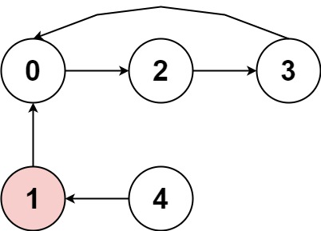
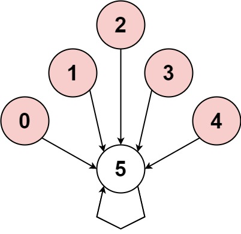
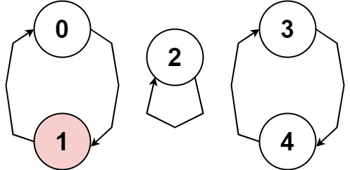

# [457. Circular Array Loop](https://leetcode.com/problems/circular-array-loop/)

| Category | Difficulty | Likes | Dislikes |
| :------: | :--------: | :---: | :------: |
| Algorithms | Medium | 800 | 881 |

**Tags:** [`array`](https://leetcode.com/tag/array), [`hash-table`](https://leetcode.com/tag/hash-table), [`two-pointers`](https://leetcode.com/tag/two-pointers)

**Companies:** `microsoft`, `amazon`

## Description

You are playing a game involving a **circular** array of non-zero integers `nums`. Each `nums[i]` denotes the number of indices forward/backward you must move if you are located at index `i`:

	- If `nums[i]` is positive, move `nums[i]` steps **forward**, and

	- If `nums[i]` is negative, move `abs(nums[i])` steps **backward**.

Since the array is **circular**, you may assume that moving forward from the last element puts you on the first element, and moving backwards from the first element puts you on the last element.

A **cycle** in the array consists of a sequence of indices `seq` of length `k` where:

	- Following the movement rules above results in the repeating index sequence `seq[0] -> seq[1] -> ... -> seq[k - 1] -> seq[0] -> ...`

	- Every `nums[seq[j]]` is either **all positive** or **all negative**.

	- `k > 1`

Return `true`* if there is a **cycle** in *`nums`*, or *`false`* otherwise*.

 

**Example 1:**


```

Input: nums = [2,-1,1,2,2]
Output: true
Explanation: The graph shows how the indices are connected. White nodes are jumping forward, while red is jumping backward.
We can see the cycle 0 --&gt; 2 --&gt; 3 --&gt; 0 --&gt; ..., and all of its nodes are white (jumping in the same direction).

```

**Example 2:**


```

Input: nums = [-1,-2,-3,-4,-5,6]
Output: false
Explanation: The graph shows how the indices are connected. White nodes are jumping forward, while red is jumping backward.
The only cycle is of size 1, so we return false.

```

**Example 3:**


```

Input: nums = [1,-1,5,1,4]
Output: true
Explanation: The graph shows how the indices are connected. White nodes are jumping forward, while red is jumping backward.
We can see the cycle 0 --&gt; 1 --&gt; 0 --&gt; ..., and while it is of size &gt; 1, it has a node jumping forward and a node jumping backward, so it is not a cycle.
We can see the cycle 3 --&gt; 4 --&gt; 3 --&gt; ..., and all of its nodes are white (jumping in the same direction).

```

 

**Constraints:**

	- `1 <= nums.length <= 5000`

	- `-1000 <= nums[i] <= 1000`

	- `nums[i] != 0`

 

**Follow up:** Could you solve it in `O(n)` time complexity and `O(1)` extra space complexity?

---

**Links:** [Submissions](https://leetcode.com/problems/circular-array-loop/) | [Solutions](https://leetcode.com/problems/circular-array-loop/)
