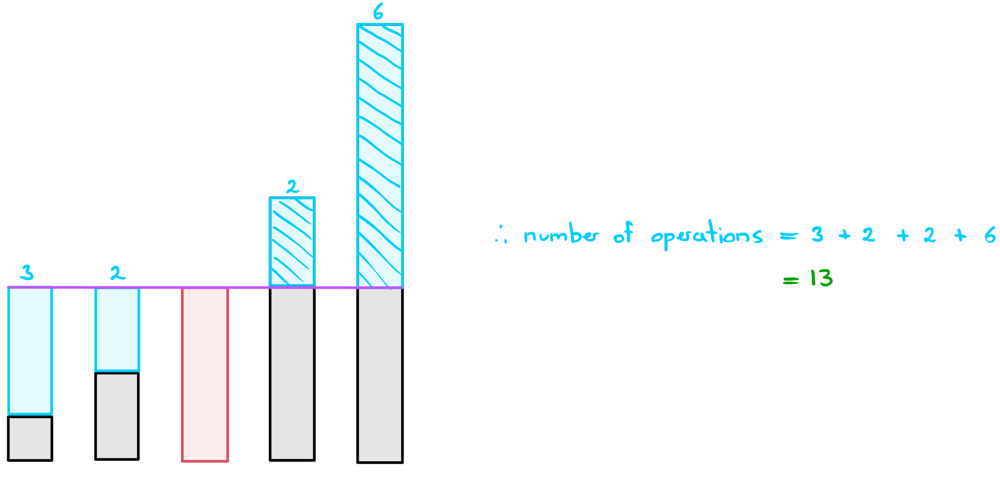

# Visual Explanation + Interview Tips | JAVA

**Author:** ciote
**Votes:** 231
**Link:** [https://leetcode.com/problems/minimum-moves-to-equal-array-elements-ii/solutions/2215782/](https://leetcode.com/problems/minimum-moves-to-equal-array-elements-ii/solutions/2215782/)

---

### Logic:
Yes, this is a mathematics problem at its core. The basic idea here is that we can quite easily find the number of operations needed to perform if we know what the <ins>median of the array values</ins> is. Let's use the below example to detail this process:


___
### Example:
First, let's just try and understand why finding the median leads to the solution. The above example is conveniently sorted for us which allows us to observe the median more clearly:


Alright, our target is 4, which is our median. All we need to do now is find out how many operations are needed to change each number to 4 (keeping in mind that operations could include deletions as well):



And it looks like we've obtained the expected answer here. 

<ins>Why did this work?</ins>
There is a thorough mathematic proof to this but I'll just try to explain this to you intuitively since you probably won't be able to spew out mathematical reasoning to this during an interview.
* Let's first imagine we picked the smallest element as our target. What happens in this situation is we end up maximising the number of operations needed to get the largest element down to the target. If the largest number is really large or there are a lot of larger numbers, then this can end up totalling to a lot of operations.
* If we instead picked the largest element as our target, the same thing happens but for smaller elements. 
* Therefore, intuitively, it's reasonable to suggest that if we picked the median element, we'll get the best of both worlds. 

<ins>Why doesn't taking the mean work?</ins>
This is mainly due to convergence. Taking a mean could put you in a situation where all the numbers would have to change when perhaps only a few of them do.
The input `nums = [0,0,0,0,0,0,0,0,0,0,0,0,0,0,0,0,0,0,0,0,0,0,0,0,0,0,999999]` for example would have this issue.
* The mean here is 37037. If this was our target; we would need 1,025,924 total operations.
* The median is 0. If this was our target, we would need 999,999 operations in total which is less than the above.

___
### Finding the Median:
There are a few ways to find the median. In this post, we'll go through the two main ways that you might be expected to bring up in an interview.

**Approach 1: Sorting the array**
> This is fairly straight forward. If we simply sort the `nums` array, we can obtain the median by simply accessing the middle element. This allows us to find the median in `O(nlogn)` time. Keep in mind that if the array is of even length, we can just pick either of the two middle values as our median.

**Approach 2: Quick Select**
> The sorting method is inefficient because it sorts the entire array. All we really need to do is put the median element where it's supposed to be; we don't care about where the other elements end up. Sound familiar? Well turns out we can do exactly that using quick select. In quick select, we'll just select the middle element; `n/2` and retrieve the value at that position. This allows us to find the median element in `O(n)` time on average. 
> 
> If you're unfamiliar with quick select, I highly recommend reading [this guide](https://leetcode.com/problems/kth-largest-element-in-an-array/discuss/2180600/A-Guide-to-Quick-Select-or-JAVA) that I wrote which explains the entire process in detail, including explanations for time complexity.

___
### Interview Tips:
The thing about this question is that it's not necessarily easy to prove that the algorithm is going to work for every test case. This is especially true during an interview. 

**Interview tip:** If you have a solution in mind but you're unclear whether or not the algorithm is always going to work, just show it working on a few distinct examples.
 
> It's important to remember that your interviewer knows the strategies needed to solve the question quite well. Even if *you* don't know whether the solution is going to work, you could probably get that information from the interviewer. Just show your interview that the algorithm works for a couple distinct examples. If your interviewer seems happy with your approach, they'll display positive signals which should be a sign to you that it's okay to move forward with that strategy. On the other hand, if they're expressing scepticism, then assume that your solution is probably not what they're looking for.

Even once you've confirmed the strategy, you might run into another split on the road... what algorithms should you use to find the median? Chances are, you probably don't have quick select memorized. So, what should you do?

**Interview tip:** If there are multiple algorithms you could apply, pick the simplest one to implement and just mention the other approaches.

> The truth of the matter is that it's better to have sub-optimal code that works than have a failed attempt at an optimal solution. What I recommend you do is just check with your interviewer whether it's alright to just implement the sorting algorithm in this case. However, bonus points if you can mention that the quick select strategy exists and that it would be a significant improvement to sorting. I suggest that you at least familiarise yourself with the quick select pseudocode and the pivot strategy so that you're at least able to explain it suffficiently.

Hope this helps!
___
### Code:
If you have any questions, suggestions or improvements, feel free to let me know!

**Approach 1: Sort**
> Time complexity: `O(nlogn)`
> Space complexity: `O(1)`
```java
public int minMoves2(int[] nums) {
	Arrays.sort(nums);
	int operations = 0, mid = nums[nums.length/2];
	for (int num: nums) operations += Math.abs(mid - num);
	return operations;
}
```

**Approach 2: Quick Select**
> Time complexity: `O(n)` average case (read this [Guide for Quick Select](https://leetcode.com/problems/kth-largest-element-in-an-array/discuss/2180600/A-Guide-to-Quick-Select-or-JAVA))
> Space complexity: `O(logn)`
```java
class Solution {
    public int minMoves2(int[] nums) {
        int operations = 0, mid = quickSelect(nums, 0, nums.length-1, nums.length/2);
        for (int num: nums) operations += Math.abs(mid - num);
        return operations;
    }
    
    private int quickSelect(int[] nums, int left, int right, int k) {
        if (left == right) return nums[left];

        int pIndex = new Random().nextInt(right - left + 1) + left;
        pIndex = partition(nums, left, right, pIndex);

        if (pIndex == k) return nums[k];
        else if (pIndex < k) return quickSelect(nums, pIndex+1, right, k);
        return quickSelect(nums, left, pIndex-1, k);
    }

    private int partition(int[] nums, int left, int right, int pIndex) {
        int pivot = nums[pIndex];
        swap(nums, pIndex, right);
        pIndex = left;

        for (int i=left; i<=right; i++) 
            if (nums[i] <= pivot) swap(nums, i, pIndex++);

        return pIndex - 1;
    }

    private void swap(int[] nums, int x, int y) {
        int temp = nums[x];
        nums[x] = nums[y];
        nums[y] = temp;
    }
}
```