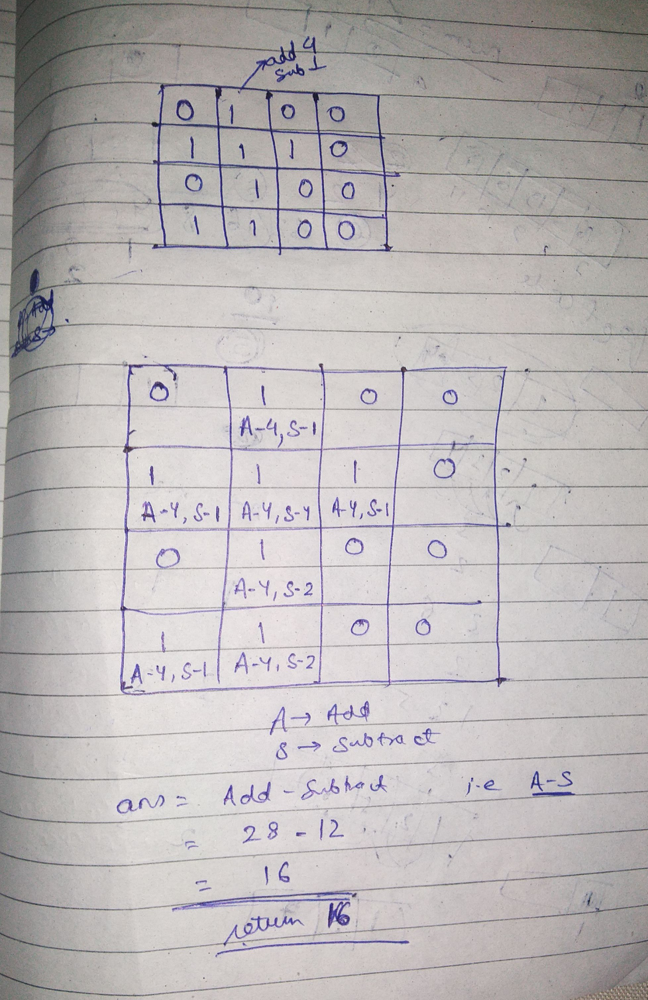

# cpp very easy solution with explaination No dfs

**Author:** ankitkum20
**Votes:** 155
**Link:** [https://leetcode.com/problems/island-perimeter/solutions/624178/](https://leetcode.com/problems/island-perimeter/solutions/624178/)

---



**the approach i used in code is **
1) count all "1". suppose the number of 1 in grid is "t"
2) ans = t*4 
3) now subtract the number of neighbour from it for each 1;


```
class Solution {
public:
    int islandPerimeter(vector<vector<int>>& grid) {
        int m = grid.size(); //row
        int n = grid[0].size(); //column
        int ans =0;
        for(int i =0;i<m;i++)
        {
            for(int j = 0;j<n;j++)
            {
                if(grid[i][j] == 1)
                { ans+=4; 
                     
                 
                   if( i+1 <m  && grid[i+1][j] == 1  )  // if down neighbour is there
                   {        ans--;}
                 if(   i-1 >=0 && grid[i-1][j] == 1 ) // if upward neighbour is there
                 { ans--;}
                   if(   j-1>=0  && grid[i][j-1] == 1)  // if left neighbour is there
                   {     ans--;}
                 if(  j+1<n && grid[i][j+1] == 1 ) // if right neighbour is there
                 { ans--;}
                }
            }
        }
        return ans;
    }
};
```*

ask in comment if u have any doubt in any line of this code..
and pls upvote it (upvoting it will motivate me to come with more better solution) if u found it useful\u263A\uFE0F 
thankyou
