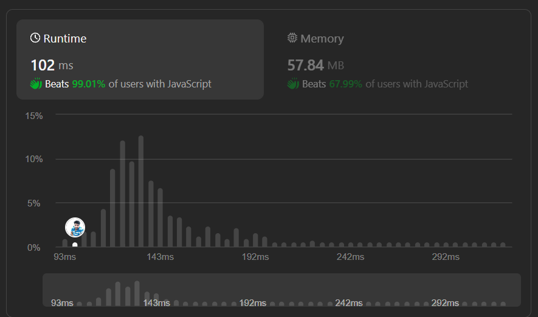

# 💯Iterative Approach🎯✅ | 99.01%🔥| DRY RUN Explained 🎯| Simple (10 line) to understand💯Explained

**Author:** Prathamesh18X
**Votes:** 7
**Link:** [https://leetcode.com/problems/island-perimeter/solutions/5039649/](https://leetcode.com/problems/island-perimeter/solutions/5039649/)

---

# Intuition
### Iterative Approach with Counting Borders\u2600\uFE0F
Dont Forget to vote\u2B06\uFE0F\uD83D\uDC96



# Code \uD83D\uDCAF
```javascript []
var islandPerimeter = function (grid) {
    let row = grid.length, col = grid[0].length;
    var perimeter = 0;
    for (let r = 0; r < row; r++) {
        for (let c = 0; c < col; c++) {
            if (grid[r][c] == 1) {
                perimeter += 4;
                if (r > 0 && grid[r - 1][c] == 1) { //Check up
                    perimeter -= 2;
                }
                if (c > 0 && grid[r][c - 1] == 1) { //Check left
                    perimeter -= 2;
                }
            }
        }
    }
    return perimeter;
};
```
```python []
def islandPerimeter(grid):
    row, col = len(grid), len(grid[0])
    perimeter = 0
    for r in range(row):
        for c in range(col):
            if grid[r][c] == 1:
                perimeter += 4
                if r > 0 and grid[r - 1][c] == 1: # Check up
                    perimeter -= 2
                if c > 0 and grid[r][c - 1] == 1: # Check left
                    perimeter -= 2
    return perimeter
```
```cpp []
#include <vector>
using namespace std;

int islandPerimeter(vector<vector<int>>& grid) {
    int row = grid.size(), col = grid[0].size();
    int perimeter = 0;
    for (int r = 0; r < row; r++) {
        for (int c = 0; c < col; c++) {
            if (grid[r][c] == 1) {
                perimeter += 4;
                if (r > 0 && grid[r - 1][c] == 1) { // Check up
                    perimeter -= 2;
                }
                if (c > 0 && grid[r][c - 1] == 1) { // Check left
                    perimeter -= 2;
                }
            }
        }
    }
    return perimeter;
}

```
```java []
public class Solution {
    public int islandPerimeter(int[][] grid) {
        int row = grid.length, col = grid[0].length;
        int perimeter = 0;
        for (int r = 0; r < row; r++) {
            for (int c = 0; c < col; c++) {
                if (grid[r][c] == 1) {
                    perimeter += 4;
                    if (r > 0 && grid[r - 1][c] == 1) { // Check up
                        perimeter -= 2;
                    }
                    if (c > 0 && grid[r][c - 1] == 1) { // Check left
                        perimeter -= 2;
                    }
                }
            }
        }
        return perimeter;
    }
}
```
```kotlin []
fun islandPerimeter(grid: Array<IntArray>): Int {
    val row = grid.size
    val col = grid[0].size
    var perimeter = 0
    for (r in 0 until row) {
        for (c in 0 until col) {
            if (grid[r][c] == 1) {
                perimeter += 4
                if (r > 0 && grid[r - 1][c] == 1) { // Check up
                    perimeter -= 2
                }
                if (c > 0 && grid[r][c - 1] == 1) { // Check left
                    perimeter -= 2
                }
            }
        }
    }
    return perimeter
}
```
```ruby []
def island_perimeter(grid)
    row = grid.length
    col = grid[0].length
    perimeter = 0
    (0...row).each do |r|
        (0...col).each do |c|
            if grid[r][c] == 1
                perimeter += 4
                perimeter -= 2 if r > 0 && grid[r - 1][c] == 1 # Check up
                perimeter -= 2 if c > 0 && grid[r][c - 1] == 1 # Check left
            end
        end
    end
    perimeter
end
```
# FAQ : why we are subtracting`2`from perimeter rather than`1`?
   ##### ANS : 
  - using (`grid[r - 1][c]`) for  above \uD83D\uDC46\uD83C\uDFFD land, we subtract `1`,
  - similarly ! (`grid[r - 1][c]`) for  left \uD83D\uDC48\uD83C\uDFFD adjacent land, we subtract `1` from the perimeter.
##### But, we ensures that `perimeter` count shares land sides twice when encountering adjacent land cells, so to eliminate that we are subtracting with `-= 2`
# DRY RUN (Table)
Example :

```javascript
const grid = [
  [0, 1, 0, 0],
  [1, 1, 1, 0],
  [0, 1, 0, 0],
  [1, 1, 0, 0]
];
```

Here's the dry run for above Example :

| Iteration | Grid Value | Action          | Perimeter |
|-----------|------------|-----------------|-----------|
| Initial   |            |                 | 0         |
| 1         | 1          | Add 4           | 4         |
| 2         | 1          | Add 4           | 8         |
| 3         | 1          | Add 4           | 12        |
|           |            | Check up        | 10        |
|           |            | Check left      | 8         |
| 4         | 1          | Add 4           | 12        |
|           |            | Check left      | 10        |
| 5         | 1          | Add 4           | 14        |
|           |            | Check up        | 12        |
| 6         | 1          | Add 4           | 16        |
| 7         | 1          | Add 4           | 20        |
|           |            | Check up        | 18        |
|           |            | Check left      | 16        |


# Approach
1. **Iterating Through the Grid**:
   - Use two nested `for` loops to iterate through each cell of the grid. The outer loop  over the rows (`r`), and the inner loop  over the columns (`c`).

2. **Checking for Land**:
   - For each cell in the grid, we check if it represents land (denoted by the value `1`).
   - If the current cell is land,  increment the perimeter by `4`, because every square unit has `4` dimensions.

3. **Checking Adjacent Cells**:
   - We then check the adjacent cells (`up` and `left`) to see if they are also land cells and subtract(`-= 2`) two from existing perimeter.
    

4. **Returning the Perimeter**:
   - After iterating through all cells in the grid, we return the final value of the perimeter, which represents the total perimeter of the island.

# Complexity
- Time complexity: `O(n.n)` ~  `O(n^2)`

