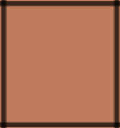
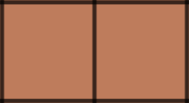

# [python] Straight forward approach - beats 98.69% submissions

**Author:** Hariharan-SV
**Votes:** 57
**Link:** [https://leetcode.com/problems/island-perimeter/solutions/1502532/](https://leetcode.com/problems/island-perimeter/solutions/1502532/)

---

Take the following single block as an example

It has four sides. So perimeter of one block is 4.

Now take a look when two blocks intersect

Here these blocks and they intersect at one edge. So perimeter(4+4=8) will be reduced by 2 (removing intersected edge at each square) upon each intersection. Each block in the land has four neighbours. We need to check whether the neighbour is land or not and decrement perimeter based on intersections.

The algorithm is simple as follows
1. Traverse the grid block by block
2. If the block is land increment perimeter by 4 and check it's top and left neighbours. If the neighbours are land blocks decrement perimeter by 2 per intersection.
3.  Repeat the process until the whole grid is traversed

Time Complexity: O(n^2)
Space Complexity: O(1)

```
def islandPerimeter(self, grid: List[List[int]]) -> int:
	  R,C = len(grid), len(grid[0])
      perimeter = 0
	  # Traverse the grid
      for i in range(R):
        for j in range(C):
		  # If it is a land block increment perimeter by 4
          if grid[i][j] == 1:
            perimeter += 4
			# Check whether top neighbour is a land and decrement it by 2
			# as it intersects
            if i>0 and grid[i-1][j] == 1:
              perimeter -= 2
			# Check left neighbour is a land and decrement it by 2
			# as it intersects
            if j>0 and grid[i][j-1] == 1:
              perimeter -= 2
      return perimeter
```


Thanks for reading. If this post had helped you kindly upvote :)