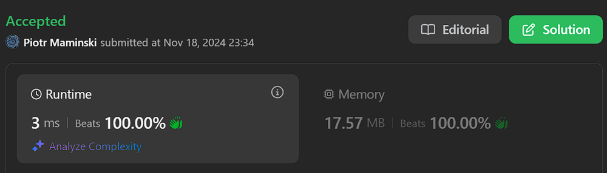

# ✅Video | Beats 100%

**Author:** Piotr_Maminski
**Votes:** 0
**Link:** [https://leetcode.com/problems/optimal-account-balancing/solutions/6060068/](https://leetcode.com/problems/optimal-account-balancing/solutions/6060068/)

---




https://youtu.be/B8pPWgLa2lQ?si=asK_S8gF4zbqO55k

# Dynamic Programming DFS + Greedy
```python3 []
class Solution:
    def minTransfers(self, transactions: List[List[int]]) -> int:
        # Calculate net balance for each person
        balance = defaultdict(int)
        for giver, taker, amount in transactions:
            balance[giver] -= amount
            balance[taker] += amount
        
        # Create initial state with non-zero balances
        state = tuple(sorted(bal for bal in balance.values() if bal != 0))
        memo = {}
        
        def dfs(state):
            # Base case: all balances settled
            if not state:
                return 0
                
            # Return memoized result if available
            if state in memo:
                return memo[state]
            
            balance_set = set(state)
            balance_list = list(state)
            first_balance = balance_list[0]
            
            # If we can settle the first balance directly
            if -first_balance in balance_set:
                balance_list.remove(-first_balance)
                new_state = tuple(balance_list[1:])
                memo[state] = 1 + dfs(new_state)
                return memo[state]
            
            # Try settling first balance with other balances
            min_transfers = float('inf')
            for j in range(1, len(balance_list)):
                # Only consider balances with opposite signs
                if balance_list[j] * first_balance < 0:
                    new_balance_list = balance_list[:]
                    new_balance_list[j] += first_balance
                    new_state = tuple(sorted(new_balance_list[1:]))
                    min_transfers = min(min_transfers, 1 + dfs(new_state))
            
            memo[state] = min_transfers
            return min_transfers
        
        return dfs(state)

```
```cpp []
class Solution {
private:
    unordered_map<string, int> memo;
    
    string stateToString(const vector<int>& state) {
        string result;
        for (int val : state) {
            result += to_string(val) + ",";
        }
        return result;
    }
    
    int dfs(vector<int>& state) {
        // Base case: all balances settled
        if (state.empty()) {
            return 0;
        }
        
        // Sort state for consistent representation
        sort(state.begin(), state.end());
        string stateStr = stateToString(state);
        
        // Return memoized result if available
        if (memo.count(stateStr)) {
            return memo[stateStr];
        }
        
        int firstBalance = state[0];
        unordered_set<int> balanceSet(state.begin(), state.end());
        
        // If we can settle the first balance directly
        if (balanceSet.count(-firstBalance)) {
            vector<int> newState;
            bool foundNegative = false;
            for (int i = 1; i < state.size(); i++) {
                if (!foundNegative && state[i] == -firstBalance) {
                    foundNegative = true;
                    continue;
                }
                newState.push_back(state[i]);
            }
            memo[stateStr] = 1 + dfs(newState);
            return memo[stateStr];
        }
        
        // Try settling first balance with other balances
        int minTransfers = INT_MAX;
        for (int j = 1; j < state.size(); j++) {
            // Only consider balances with opposite signs
            if (state[j] * firstBalance < 0) {
                vector<int> newState;
                for (int i = 1; i < state.size(); i++) {
                    if (i == j) {
                        newState.push_back(state[i] + firstBalance);
                    } else {
                        newState.push_back(state[i]);
                    }
                }
                minTransfers = min(minTransfers, 1 + dfs(newState));
            }
        }
        
        memo[stateStr] = minTransfers;
        return minTransfers;
    }
    
public:
    int minTransfers(vector<vector<int>>& transactions) {
        // Calculate net balance for each person
        unordered_map<int, int> balance;
        for (const auto& trans : transactions) {
            balance[trans[0]] -= trans[2];
            balance[trans[1]] += trans[2];
        }
        
        // Create initial state with non-zero balances
        vector<int> state;
        for (const auto& [person, amount] : balance) {
            if (amount != 0) {
                state.push_back(amount);
            }
        }
        sort(state.begin(), state.end());
        
        return dfs(state);
    }
};
```
```java []
import java.util.*;

class Solution {
    private Map<List<Integer>, Integer> memo;
    
    public int minTransfers(int[][] transactions) {
        // Calculate net balance for each person
        Map<Integer, Integer> balance = new HashMap<>();
        for (int[] t : transactions) {
            balance.merge(t[0], -t[2], Integer::sum);
            balance.merge(t[1], t[2], Integer::sum);
        }
        
        // Create initial state with non-zero balances
        List<Integer> nonZeroBalances = balance.values().stream()
            .filter(b -> b != 0)
            .sorted()
            .collect(Collectors.toList());
            
        memo = new HashMap<>();
        return dfs(nonZeroBalances);
    }
    
    private int dfs(List<Integer> state) {
        // Base case: all balances settled
        if (state.isEmpty()) {
            return 0;
        }
        
        // Return memoized result if available
        if (memo.containsKey(state)) {
            return memo.get(state);
        }
        
        int firstBalance = state.get(0);
        Set<Integer> balanceSet = new HashSet<>(state);
        
        // If we can settle the first balance directly
        if (balanceSet.contains(-firstBalance)) {
            List<Integer> newState = new ArrayList<>(state.subList(1, state.size()));
            newState.remove(Integer.valueOf(-firstBalance));
            Collections.sort(newState);
            int result = 1 + dfs(newState);
            memo.put(state, result);
            return result;
        }
        
        // Try settling first balance with other balances
        int minTransfers = Integer.MAX_VALUE;
        for (int j = 1; j < state.size(); j++) {
            // Only consider balances with opposite signs
            if (state.get(j) * firstBalance < 0) {
                List<Integer> newState = new ArrayList<>(state.subList(1, state.size()));
                newState.set(j - 1, newState.get(j - 1) + firstBalance);
                Collections.sort(newState);
                minTransfers = Math.min(minTransfers, 1 + dfs(newState));
            }
        }
        
        memo.put(state, minTransfers);
        return minTransfers;
    }
}

```
```csharp []
public class Solution {
    private Dictionary<string, int> memo = new Dictionary<string, int>();
    
    public int MinTransfers(int[][] transactions) {
        Dictionary<int, int> balance = new Dictionary<int, int>();
        foreach (var t in transactions) {
            balance[t[0]] = balance.GetValueOrDefault(t[0], 0) - t[2];
            balance[t[1]] = balance.GetValueOrDefault(t[1], 0) + t[2];
        }
        
        var nonZeroBalances = balance.Values.Where(b => b != 0).ToList();
        return DFS(0, nonZeroBalances);
    }
    
    private int DFS(int start, List<int> balances) {
        while (start < balances.Count && balances[start] == 0) {
            start++;
        }
        
        if (start == balances.Count) {
            return 0;
        }
        
        int minTransfers = int.MaxValue;
        for (int i = start + 1; i < balances.Count; i++) {
            if (balances[i] * balances[start] < 0) {
                balances[i] += balances[start];
                minTransfers = Math.Min(minTransfers, 1 + DFS(start + 1, balances));
                balances[i] -= balances[start];
            }
        }
        
        return minTransfers == int.MaxValue ? 0 : minTransfers;
    }
}

```
```golang []
func minTransfers(transactions [][]int) int {
    // Calculate net balance for each person
    balance := make(map[int]int)
    for _, t := range transactions {
        balance[t[0]] -= t[2]
        balance[t[1]] += t[2]
    }
    
    // Create initial state with non-zero balances
    var state []int
    for _, bal := range balance {
        if bal != 0 {
            state = append(state, bal)
        }
    }
    sort.Ints(state)
    
    memo := make(map[string]int)
    
    var dfs func([]int) int
    dfs = func(state []int) int {
        // Base case: all balances settled
        if len(state) == 0 {
            return 0
        }
        
        // Create key for memoization
        key := fmt.Sprintf("%v", state)
        if val, exists := memo[key]; exists {
            return val
        }
        
        firstBalance := state[0]
        balanceSet := make(map[int]bool)
        for _, bal := range state {
            balanceSet[bal] = true
        }
        
        // If we can settle the first balance directly
        if balanceSet[-firstBalance] {
            newState := make([]int, 0)
            found := false
            for _, bal := range state[1:] {
                if bal == -firstBalance && !found {
                    found = true
                    continue
                }
                newState = append(newState, bal)
            }
            sort.Ints(newState)
            memo[key] = 1 + dfs(newState)
            return memo[key]
        }
        
        // Try settling first balance with other balances
        minTransfers := math.MaxInt32
        for j := 1; j < len(state); j++ {
            // Only consider balances with opposite signs
            if state[j]*firstBalance < 0 {
                newBalanceList := make([]int, len(state)-1)
                copy(newBalanceList, state[1:])
                newBalanceList[j-1] += firstBalance
                sort.Ints(newBalanceList)
                minTransfers = min(minTransfers, 1+dfs(newBalanceList))
            }
        }
        
        memo[key] = minTransfers
        return minTransfers
    }
    
    return dfs(state)
}

func min(a, b int) int {
    if a < b {
        return a
    }
    return b
}
```
```swift []
class Solution {
    func minTransfers(_ transactions: [[Int]]) -> Int {
        // Calculate net balance for each person
        var balance: [Int: Int] = [:]
        for transaction in transactions {
            let giver = transaction[0]
            let taker = transaction[1]
            let amount = transaction[2]
            balance[giver, default: 0] -= amount
            balance[taker, default: 0] += amount
        }
        
        // Create initial state with non-zero balances
        let state = balance.values.filter { $0 != 0 }.sorted()
        var memo: [String: Int] = [:]
        
        func dfs(_ state: [Int]) -> Int {
            // Base case: all balances settled
            if state.isEmpty {
                return 0
            }
            
            // Create key for memoization
            let stateKey = state.map(String.init).joined(separator: ",")
            
            // Return memoized result if available
            if let cached = memo[stateKey] {
                return cached
            }
            
            let balanceSet = Set(state)
            let firstBalance = state[0]
            
            // If we can settle the first balance directly
            if balanceSet.contains(-firstBalance) {
                var balanceList = state
                balanceList.remove(at: balanceList.firstIndex(of: -firstBalance)!)
                let newState = Array(balanceList[1...])
                let result = 1 + dfs(newState)
                memo[stateKey] = result
                return result
            }
            
            // Try settling first balance with other balances
            var minTransfers = Int.max
            for j in 1..<state.count {
                // Only consider balances with opposite signs
                if state[j] * firstBalance < 0 {
                    var newBalanceList = state
                    newBalanceList[j] += firstBalance
                    let newState = Array(newBalanceList[1...]).sorted()
                    minTransfers = min(minTransfers, 1 + dfs(newState))
                }
            }
            
            memo[stateKey] = minTransfers
            return minTransfers
        }
        
        return dfs(state)
    }
}

```
```javascript [JS]
// JavaScript

function minTransfers(transactions) {
    // Calculate net balance for each person
    const balance = new Map();
    for (const [giver, taker, amount] of transactions) {
        balance.set(giver, (balance.get(giver) || 0) - amount);
        balance.set(taker, (balance.get(taker) || 0) + amount);
    }
    
    // Create initial state with non-zero balances
    const state = [...balance.values()]
        .filter(bal => bal !== 0)
        .sort((a, b) => a - b);
    const memo = new Map();
    
    const dfs = (state) => {
        // Base case: all balances settled
        if (state.length === 0) {
            return 0;
        }
        
        // Return memoized result if available
        const stateKey = state.toString();
        if (memo.has(stateKey)) {
            return memo.get(stateKey);
        }
        
        const balanceSet = new Set(state);
        const firstBalance = state[0];
        
        // If we can settle the first balance directly
        if (balanceSet.has(-firstBalance)) {
            const balanceList = [...state];
            balanceList.splice(balanceList.indexOf(-firstBalance), 1);
            const newState = balanceList.slice(1);
            const result = 1 + dfs(newState);
            memo.set(stateKey, result);
            return result;
        }
        
        // Try settling first balance with other balances
        let minTransfers = Infinity;
        for (let j = 1; j < state.length; j++) {
            // Only consider balances with opposite signs
            if (state[j] * firstBalance < 0) {
                const newBalanceList = [...state];
                newBalanceList[j] += firstBalance;
                const newState = newBalanceList
                    .slice(1)
                    .sort((a, b) => a - b);
                minTransfers = Math.min(minTransfers, 1 + dfs(newState));
            }
        }
        
        memo.set(stateKey, minTransfers);
        return minTransfers;
    };
    
    return dfs(state);
}
```
```typescript [TS]
// TypeScript

function minTransfers(transactions: number[][]): number {
        // Calculate net balance for each person
        const balance = new Map<number, number>();
        for (const [giver, taker, amount] of transactions) {
            balance.set(giver, (balance.get(giver) || 0) - amount);
            balance.set(taker, (balance.get(taker) || 0) + amount);
        }
        
        // Create initial state with non-zero balances
        const state = [...balance.values()]
            .filter(bal => bal !== 0)
            .sort((a, b) => a - b);
        const memo = new Map<string, number>();
        
        const dfs = (state: number[]): number => {
            // Base case: all balances settled
            if (state.length === 0) {
                return 0;
            }
            
            // Return memoized result if available
            const stateKey = state.toString();
            if (memo.has(stateKey)) {
                return memo.get(stateKey)!;
            }
            
            const balanceSet = new Set(state);
            const firstBalance = state[0];
            
            // If we can settle the first balance directly
            if (balanceSet.has(-firstBalance)) {
                const balanceList = [...state];
                balanceList.splice(balanceList.indexOf(-firstBalance), 1);
                const newState = balanceList.slice(1);
                const result = 1 + dfs(newState);
                memo.set(stateKey, result);
                return result;
            }
            
            // Try settling first balance with other balances
            let minTransfers = Infinity;
            for (let j = 1; j < state.length; j++) {
                // Only consider balances with opposite signs
                if (state[j] * firstBalance < 0) {
                    const newBalanceList = [...state];
                    newBalanceList[j] += firstBalance;
                    const newState = newBalanceList
                        .slice(1)
                        .sort((a, b) => a - b);
                    minTransfers = Math.min(minTransfers, 1 + dfs(newState));
                }
            }
            
            memo.set(stateKey, minTransfers);
            return minTransfers;
        };
        
        return dfs(state);
    }
```
```ruby []
def min_transfers(transactions)
    # Calculate net balance for each person
    balance = Hash.new(0)
    transactions.each do |from, to, amount|
        balance[from] -= amount
        balance[to] += amount
    end
    
    # Create initial state with non-zero balances
    state = balance.values.select { |bal| bal != 0 }.sort
    
    memo = {}
    
    def dfs(state, memo)
        return 0 if state.empty?
        
        # Create key for memoization
        key = state.join(',')
        return memo[key] if memo.key?(key)
        
        first_balance = state[0]
        balance_set = state.to_h { |bal| [bal, true] }
        
        # If we can settle the first balance directly
        if balance_set[-first_balance]
            new_state = []
            found = false
            state[1..-1].each do |bal|
                if bal == -first_balance && !found
                    found = true
                    next
                end
                new_state << bal
            end
            new_state.sort!
            memo[key] = 1 + dfs(new_state, memo)
            return memo[key]
        end
        
        # Try settling first balance with other balances
        min_transfers = Float::INFINITY
        (1...state.length).each do |j|
            # Only consider balances with opposite signs
            if state[j] * first_balance < 0
                new_balance_list = state[1..-1].dup
                new_balance_list[j-1] += first_balance
                new_balance_list.sort!
                min_transfers = [min_transfers, 1 + dfs(new_balance_list, memo)].min
            end
        end
        
        memo[key] = min_transfers
        min_transfers
    end
    
    dfs(state, memo)
end
```

- Complexity: Time O(n! * n) & Space O(n! * n)


