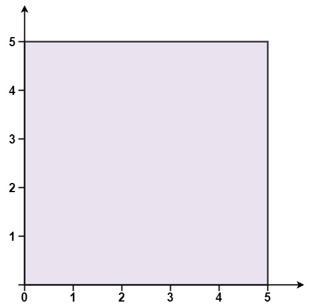
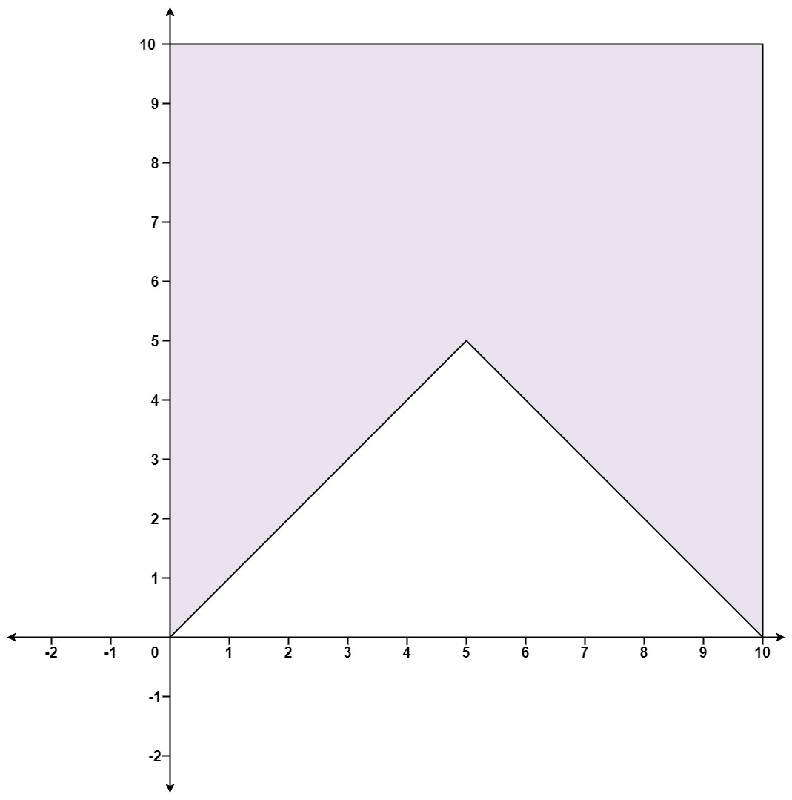

# [469. Convex Polygon](https://leetcode.com/problems/convex-polygon/)

| Category | Difficulty | Likes | Dislikes |
| :------: | :--------: | :---: | :------: |
| Algorithms | Medium | 102 | 242 |

**Tags:** [`array`](https://leetcode.com/tag/array), [`math`](https://leetcode.com/tag/math), [`geometry`](https://leetcode.com/tag/geometry)

**Companies:** `google`

## Description

You are given an array of points on the **X-Y** plane `points` where `points[i] = [x_i, y_i]`. The points form a polygon when joined sequentially.

Return `true` if this polygon is convex and `false` otherwise.

You may assume the polygon formed by given points is always a simple polygon. In other words, we ensure that exactly two edges intersect at each vertex and that edges otherwise don't intersect each other.

 

**Example 1:**


```

Input: points = [[0,0],[0,5],[5,5],[5,0]]
Output: true

```

**Example 2:**


```

Input: points = [[0,0],[0,10],[10,10],[10,0],[5,5]]
Output: false

```

 

**Constraints:**

	- `3 <= points.length <= 10^4`

	- `points[i].length == 2`

	- `-10^4 <= x_i, y_i <= 10^4`

	- All the given points are **unique**.

---

**Links:** [Submissions](https://leetcode.com/problems/convex-polygon/) | [Solutions](https://leetcode.com/problems/convex-polygon/)
