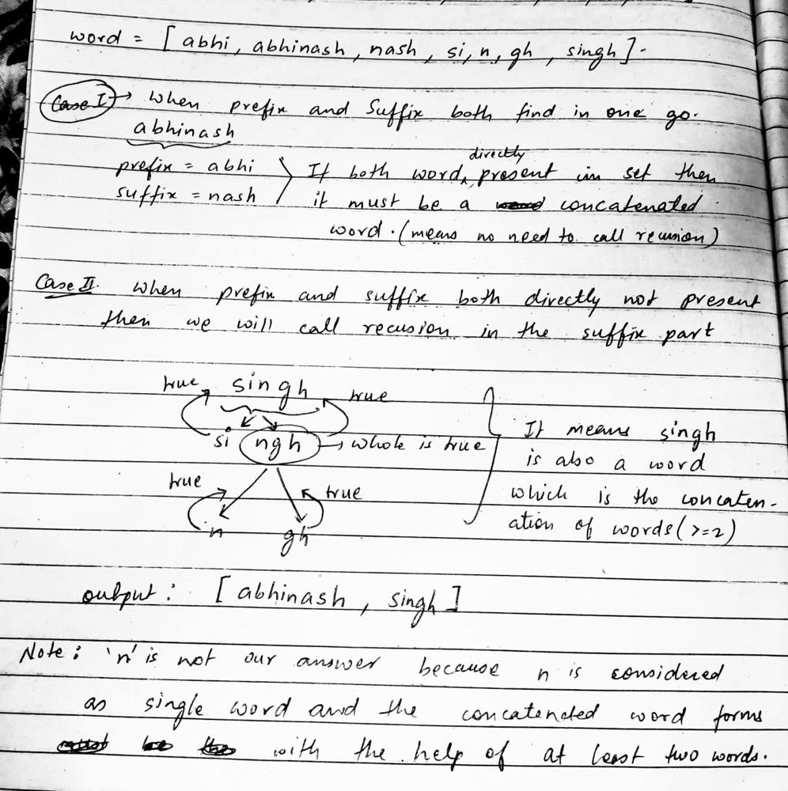

# Day 27 || Simple Recursion - DFS || Easiest Beginner Friendly Sol

**Author:** singhabhinash
**Votes:** 139
**Link:** [https://leetcode.com/problems/concatenated-words/solutions/3103568/](https://leetcode.com/problems/concatenated-words/solutions/3103568/)

---

# Intuition of this Problem:
We can solve this problem using various methods:
- Trie data strucutre
- dynamic programming

But I solved this problem using simple recursion - dfs.



<!-- Describe your first thoughts on how to solve this problem. -->
**NOTE - PLEASE READ APPROACH FIRST THEN SEE THE CODE. YOU WILL DEFINITELY UNDERSTAND THE CODE LINE BY LINE AFTER SEEING THE APPROACH.**

# Approach for this Problem:
1. Create an empty set 's' to store all the words in the given array of strings.
2. Iterate through the array of strings and insert each word into the set 's'.
3. Create an empty vector 'concatenateWords' to store all the concatenated words.
4. Iterate through the array of strings again, for each word, check if it is a concatenated word using the function 'checkConcatenate(word)'.
5. In the 'checkConcatenate(word)' function, use a for loop to iterate through each substring of the word, starting from index 1 to the second last index of the word.
6. For each substring, check if the prefix and suffix of the substring exists in the set 's'.
7. If the prefix and suffix both exist in the set 's', then return true, indicating that the word is a concatenated word.
8. If the function 'checkConcatenate(word)' returns true, then insert the word into the 'concatenateWords' vector.
9. Return the 'concatenateWords' vector.
<!-- Describe your approach to solving the problem. -->


# Code:
```C++ []
class Solution {
public:
    set<string> s;
    bool checkConcatenate(string word) {
        for(int i = 1; i < word.length(); i++) {
            string prefixWord = word.substr(0, i);
            string suffixWord = word.substr(i, word.length()-i);
            if(s.find(prefixWord) != s.end() && (s.find(suffixWord) != s.end() || checkConcatenate(suffixWord)))
                return true;
        }
        return false;
    }
    vector<string> findAllConcatenatedWordsInADict(vector<string>& words) {
        vector<string> concatenateWords;
        for(string word : words)
            s.insert(word);
        for(string word : words) {
            if(checkConcatenate(word) == true)
                concatenateWords.push_back(word);
        }
        return concatenateWords;
    }
};
```
```Java []
class Solution {
    public List<String> findAllConcatenatedWordsInADict(String[] words) {
        Set<String> s = new HashSet<>();
        List<String> concatenateWords = new ArrayList<>();
        for(String word : words)
            s.add(word);
        for(String word : words) {
            if(checkConcatenate(word, s) == true)
                concatenateWords.add(word);
        }
        return concatenateWords;
    }
    public boolean checkConcatenate(String word, Set<String> s) {
        for(int i = 1; i < word.length(); i++) {
            String prefixWord = word.substring(0, i);
            String suffixWord = word.substring(i, word.length());
            if(s.contains(prefixWord) && (s.contains(suffixWord) || checkConcatenate(suffixWord, s)))
                return true;
        }
        return false;
    }
}

```
```Python []
class Solution:
    def findAllConcatenatedWordsInADict(self, words: List[str]) -> List[str]:
        s = set()
        concatenateWords = []
        for word in words:
            s.add(word)
        for word in words:
            if self.checkConcatenate(word, s) == True:
                concatenateWords.append(word)
        return concatenateWords
    def checkConcatenate(self, word: str, s: set) -> bool:
        for i in range(1, len(word)):
            prefixWord = word[:i]
            suffixWord = word[i:]
            if prefixWord in s and (suffixWord in s or self.checkConcatenate(suffixWord, s)):
                return True
        return False

```

# Time Complexity and Space Complexity:
- Time complexity: **O(n^2*m)** //where n is the number of words in the input array and m is the average length of the words.

The checkConcatenate() function is called for each word in the input array, and for each call, it iterates through the word to check for possible concatenation, which takes O(m) time. The find() function of the set data structure takes O(log(n)) time on average. So, the total time complexity of the checkConcatenate() function is **O(n*m*log(n))**. Since this function is called for each word in the input array, the total time complexity of the findAllConcatenatedWordsInADict() function is **O(n^2*m*log(n))**.
<!-- Add your time complexity here, e.g. $$O(n)$$ -->

- Space complexity: **O(n*m)** //where n is the number of words in the input array and m is the average length of the words.

The space complexity **O(nm)**, where n is the number of words in the input array and m is the average length of the words. The set data structure is used to store all the words in the input array, which takes O(nm) space.
<!-- Add your space complexity here, e.g. $$O(n)$$ -->
Reference Video Link - https://www.youtube.com/watch?v=RLc0SyvDjrI