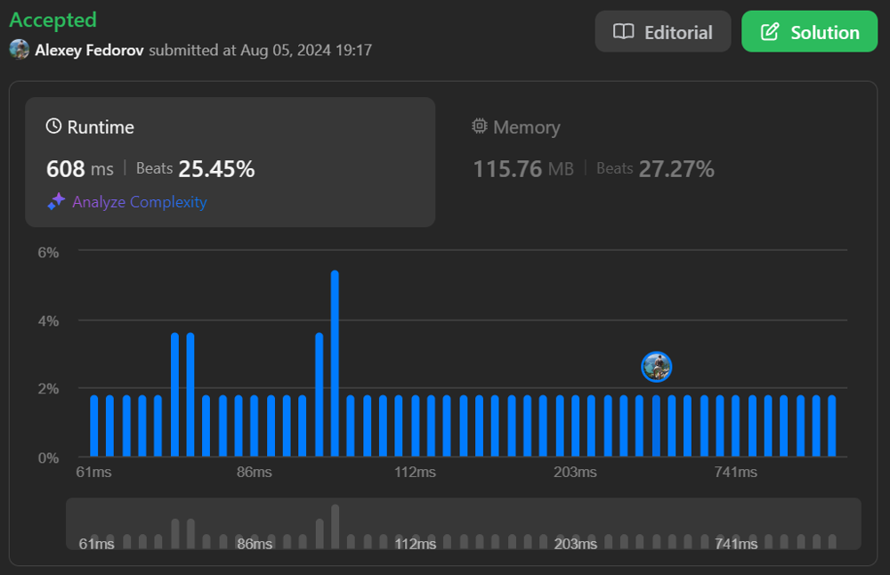

# Slow but easy to understand recursive solution | 608 ms

**Author:** alexeyfv
**Votes:** 0
**Link:** [https://leetcode.com/problems/ones-and-zeroes/solutions/5592597/](https://leetcode.com/problems/ones-and-zeroes/solutions/5592597/)

---

# Approach

The algorithm uses a "pick/no pick" approach. It checks all possible subsets of the given set of strings strs. To avoid doing the same calculations multiple times:

1. Use memoization.
2. Check if we reach the limits with the count of zeros and ones in the subsets.

# Approach




# Complexity
- Time complexity: $O(n \u22C5 n \u22C5 strs.Length)$
- Space complexity: $O(m \u22C5 n \u22C5 strs.Length)$

# Code
```
public class Solution {
    public int FindMaxForm(string[] strs, int m, int n) {
        
        var dp = new Dictionary<Key, int>(m * n * strs.Length);

        int Solve(int i, int m, int n) {

            if (i == strs.Length) return 0;
            
            var key = new Key(i, m, n);

            if (dp.TryGetValue(key, out var cached)) return cached;

            var (zeros, ones) = (0, 0);

            foreach (var c in strs[i]) {
                if (c == '1') ones++;
                else zeros++;
            }

            // `skip`
            var min = Solve(i + 1, m, n);

            // check `pick` only if we don't reach the limits
            if (zeros <= m && ones <= n) {
                min = Math.Max(min, 1 + Solve(i + 1, m - zeros, n - ones));
            }

            dp[key] = min;
            return min;
        }

        return Solve(0, m, n);
    }
}

record struct Key(int i, int m, int n);
```