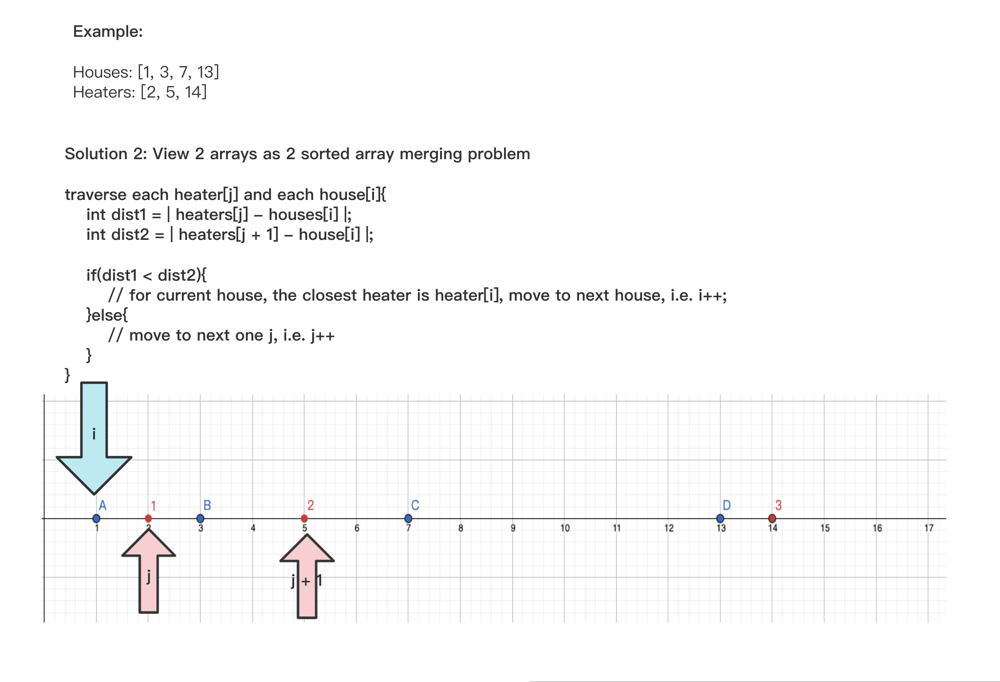
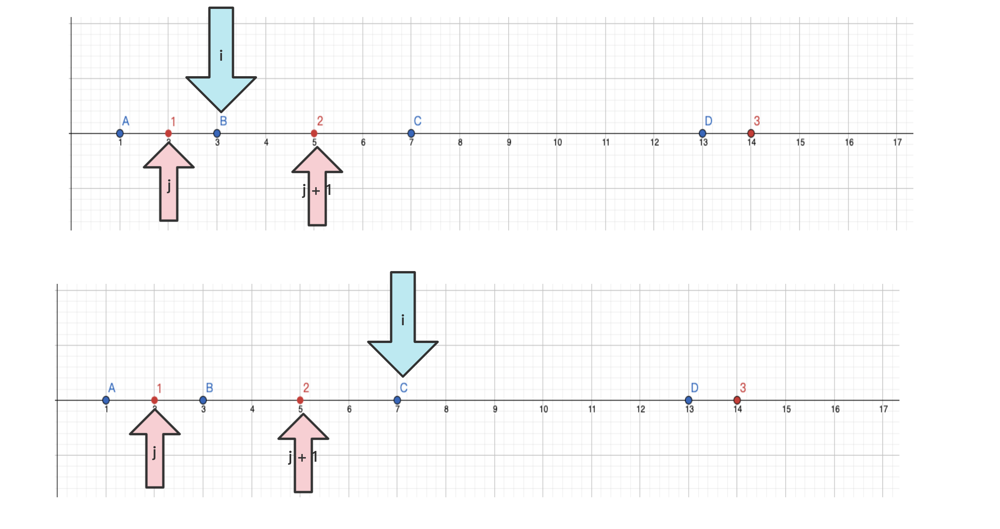
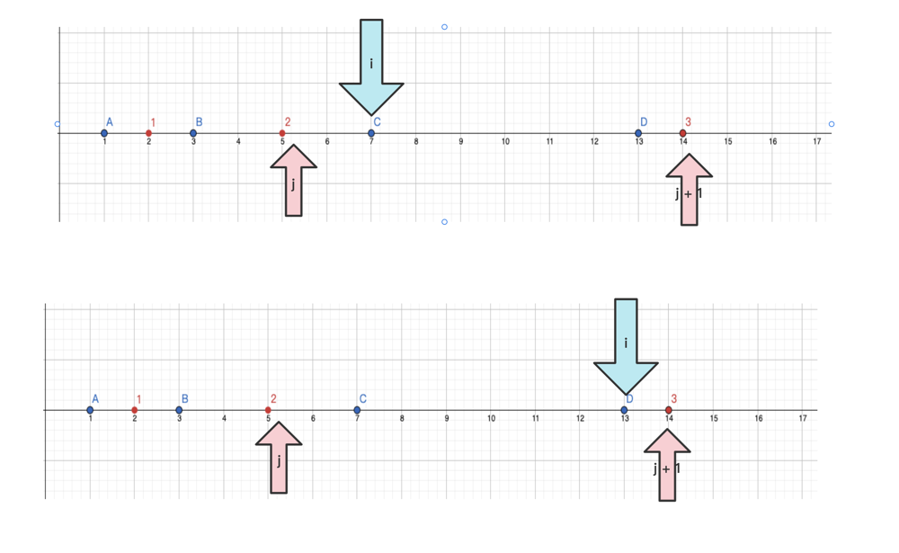
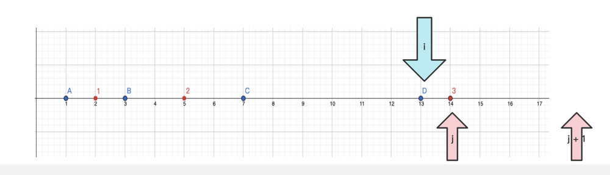

# Java || Sort + Two Pointers (Clean) || With Picture Briefly Explained

**Author:** cooper--
**Votes:** 11
**Link:** [https://leetcode.com/problems/heaters/solutions/1686074/](https://leetcode.com/problems/heaters/solutions/1686074/)

---







```java
class Solution {
    public int findRadius(int[] houses, int[] heaters) {
        if(houses == null || houses.length == 0 || heaters == null || heaters.length == 0){
            return 0;
        }
        
        Arrays.sort(houses);
        Arrays.sort(heaters);
        
        int n = houses.length;
        int m = heaters.length; 
        
        int i = 0;
        int j = 0;
        
        int res = 0;
        while(i < n && j < m){
            // for each heaters[j],  compare to heaters[j + 1]
            int dist1 = Math.abs(heaters[j] - houses[i]);
            int dist2 = Integer.MAX_VALUE;
            if(j + 1 < m){
                dist2 = Math.abs(heaters[j + 1] - houses[i]);
            }
            // if j closer to i than j + 1, settle and i ++;
            if(dist1 < dist2){
                res = Math.max(res, dist1);
                i++;
            // else j++;
            }else{
                j++;
            }
        }
        
        return res;
        
    }
}
```