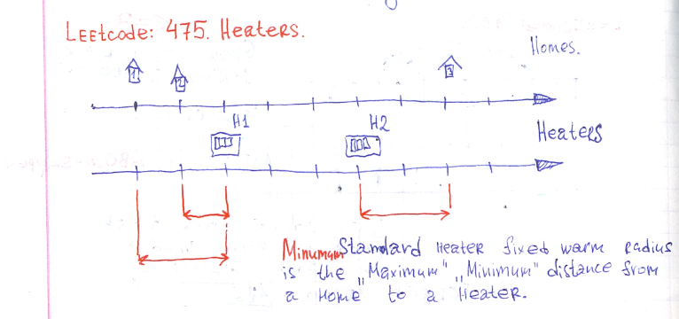
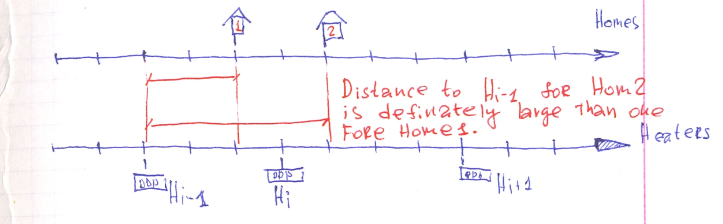

# Detailed explanation with pictures. Ruby solution 100%.

**Author:** user9697N
**Votes:** 2
**Link:** [https://leetcode.com/problems/heaters/solutions/515168/](https://leetcode.com/problems/heaters/solutions/515168/)

---

## What do we looking for?

When starting to solve a task, important part is to define what we really need to fine. And in this case we need to find maximum value of minimum distance from a home to a header. Each home has it own nearest heater. So what we need is to find maximum distance to such heater among all houses.

On the picture nearest heater fro houses #1 and #2 is `H1` and nearest for home three is `H2`.  Shortest Distance from Home1 to `H1` is 2, from Home2 to `H1` is 1, and from Home3 to `H2` is 2 again. So maximum nearest heater to a house stays in 2 point, this is the answer.




## Some interesting rule.

For example nearest heater `Hi` found for a house1. The distance till `Hi` is smaller for house1 then distance till left one `Hi-1`, and right one `Hi+1` heaters.  So for the next house: house2, as a nearest heaters we need to consider only `Hi` and heaters that stay further right way. Because as house2 has moved forward from house1 distance between house2 and `Hi-1` even greater than distance between house1 and `Hi-1` so we can eliminate `Hi-1` from consideration.



## The algorithm is ready.

1. Get minimum distance till a header from each home to a heaters.
2. Select maximum value from all this distance.

It possible to do in `O(N+M)` where `N` is number of houses and `M` is number of heaters. Need to involve two pointers `i` for homes, and `j` for heaters. When we considering home pointed by `i` pointer, we seeking heater on minimum distance moving `j` right. When such heater is found, and we switched to a next home we continuing search for nearest heater from the same position of `j` pointer.

```Ruby
# 475. Heaters
# https://leetcode.com/problems/heaters/
# Runtime: 80 ms, faster than 100.00% of Ruby online submissions for Heaters.
# Memory Usage: 11.3 MB, less than 100.00% of Ruby online submissions for Heaters.
# @param {Integer[]} houses
# @param {Integer[]} heaters
# @return {Integer}
def find_radius(houses, heaters)
    houses.sort!
    heaters.sort!
    heaters.push(Float::INFINITY)
    max_min_distance = 0
    j = 0 # heater pointer
    (0...houses.size).each do |i|
        distance = (heaters[j] - houses[i]).abs
        while j+1 < heaters.size 
            new_distance = (heaters[j+1] - houses[i]).abs
            break if new_distance > distance
            j += 1
            distance = new_distance
        end
        max_min_distance = distance if distance > max_min_distance
    end
    max_min_distance
    
end
```