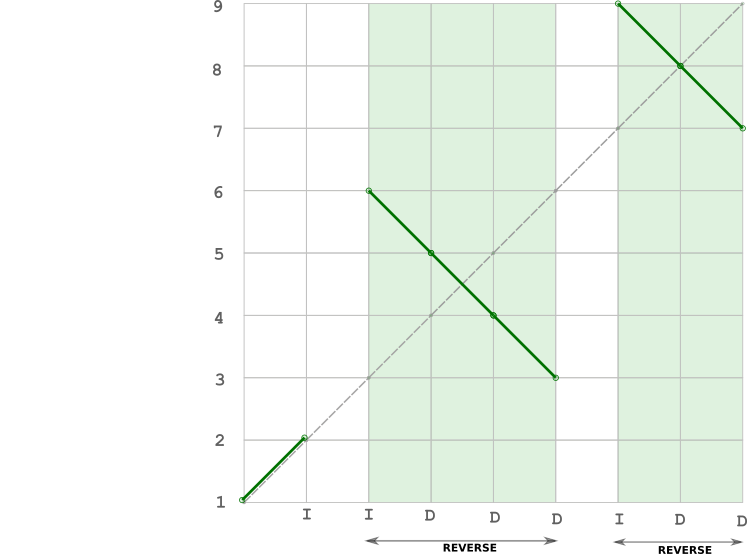

# reverse 𝒹's ^^

**Author:** andrii_khlevniuk
**Votes:** 1
**Link:** [https://leetcode.com/problems/find-permutation/solutions/2195279/](https://leetcode.com/problems/find-permutation/solutions/2195279/)

---

**time: `O(N)`; space: `O(1)`**



**c++:**
```
vector<int> findPermutation(string s) 
{
	vector<int> out(size(s)+1);
	iota(begin(out), end(out), 1);
	for(int i{}, j{}; i<size(s); i=j)
	{
		for(   ; i<size(s) and s[i]=='I'; ++i);
		for(j=i; j<size(s) and s[j]=='D'; ++j);   
		reverse(begin(out)+i, begin(out)+j+1);
	}
	return out;
}
```
||
```
vector<int> findPermutation(string s) 
{
	s.append(1, 'I');
	vector<int> out(size(s));
	iota(begin(out), end(out), 1);
	for(int i{}; i<size(s); )
	{
		auto j = exchange(i, 1+s.find('I', i));
		reverse(begin(out)+j, begin(out)+i);
	}
	return out;
}
```
**python:**
```
def findPermutation(self, s: str) -> List[int]:
    """ O(N)TS """
    s += 'I'
    i, arr = 0, [*range(1, len(s)+1)]
    while i<len(s) :
        j, i = i, 1+s.find('I', i)
        arr[j:i] = arr[j:i][::-1]
    return arr
```