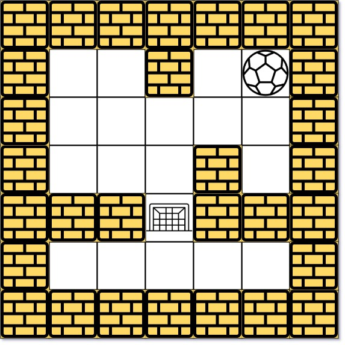

# [490. The Maze](https://leetcode.com/problems/the-maze/)

| Category | Difficulty | Likes | Dislikes |
| :------: | :--------: | :---: | :------: |
| Algorithms | Medium | 1900 | 198 |

**Tags:** [`array`](https://leetcode.com/tag/array), [`depth-first-search`](https://leetcode.com/tag/depth-first-search), [`breadth-first-search`](https://leetcode.com/tag/breadth-first-search), [`matrix`](https://leetcode.com/tag/matrix)

**Companies:** `facebook`, `bloomberg`, `walmart-labs`, `uber`, `square`, `amazon`, `tiktok`, `pinterest`, `nvidia`, `google`

## Description

There is a ball in a `maze` with empty spaces (represented as `0`) and walls (represented as `1`). The ball can go through the empty spaces by rolling **up, down, left or right**, but it won't stop rolling until hitting a wall. When the ball stops, it could choose the next direction.

Given the `m x n` `maze`, the ball's `start` position and the `destination`, where `start = [start_row, start_col]` and `destination = [destination_row, destination_col]`, return `true` if the ball can stop at the destination, otherwise return `false`.

You may assume that **the borders of the maze are all walls** (see examples).

 

**Example 1:**


```

Input: maze = [[0,0,1,0,0],[0,0,0,0,0],[0,0,0,1,0],[1,1,0,1,1],[0,0,0,0,0]], start = [0,4], destination = [4,4]
Output: true
Explanation: One possible way is : left -&gt; down -&gt; left -&gt; down -&gt; right -&gt; down -&gt; right.

```

**Example 2:**


```

Input: maze = [[0,0,1,0,0],[0,0,0,0,0],[0,0,0,1,0],[1,1,0,1,1],[0,0,0,0,0]], start = [0,4], destination = [3,2]
Output: false
Explanation: There is no way for the ball to stop at the destination. Notice that you can pass through the destination but you cannot stop there.

```

**Example 3:**

```

Input: maze = [[0,0,0,0,0],[1,1,0,0,1],[0,0,0,0,0],[0,1,0,0,1],[0,1,0,0,0]], start = [4,3], destination = [0,1]
Output: false

```

 

**Constraints:**

	- `m == maze.length`

	- `n == maze[i].length`

	- `1 <= m, n <= 100`

	- `maze[i][j]` is `0` or `1`.

	- `start.length == 2`

	- `destination.length == 2`

	- `0 <= start_row, destination_row < m`

	- `0 <= start_col, destination_col < n`

	- Both the ball and the destination exist in an empty space, and they will not be in the same position initially.

	- The maze contains **at least 2 empty spaces**.

---

**Links:** [Submissions](https://leetcode.com/problems/the-maze/) | [Solutions](https://leetcode.com/problems/the-maze/)
