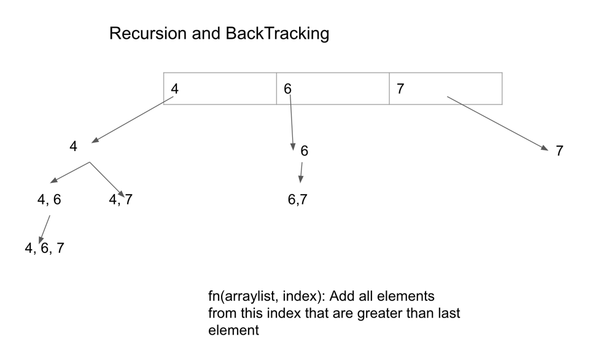
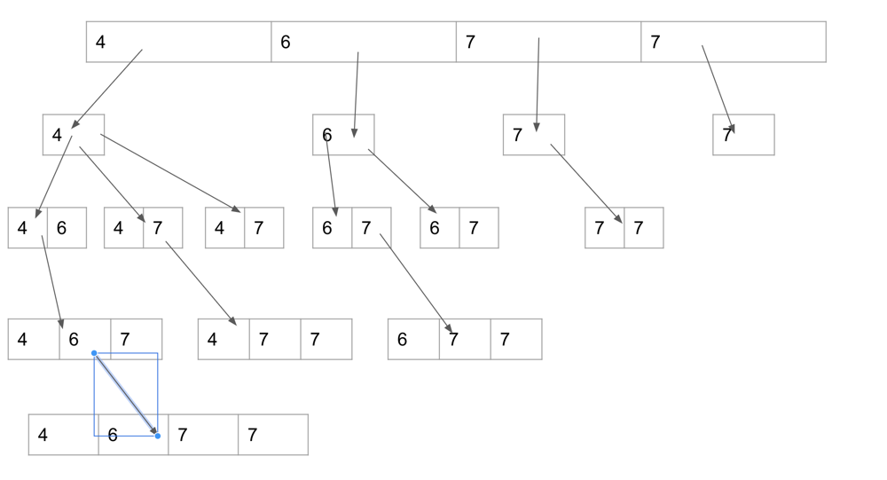

# 🔥Easy Explanation🔥 for Beginners with Video| Java

**Author:** jeevankumar159
**Votes:** 106
**Link:** [https://leetcode.com/problems/non-decreasing-subsequences/solutions/3074895/](https://leetcode.com/problems/non-decreasing-subsequences/solutions/3074895/)

---

# Intuition
<!-- Describe your first thoughts on how to solve this problem. -->


Recursion might be a difficult concept to understand, but let me try to explain very easily.

Think there is a magical function to which you can pass an arraylist and it fills elements from this index that are greater than the last elemnt of the arraylist. say you have <4,6> -- magical function will add 7 to it.

So at first we will pass an empty array list to this function, it will add single elements i.e 4     6     7
we pass them again, in case of 6 it will give only 6,7 because we are asking it to add elemnts next/further to the index 2.

We will be passing arraylist again recursively to obtain all the arraylist that are possible.

Since we want unique arraylists we are adding to hashSet.

# Approach
<!-- Describe your approach to solving the problem. -->
Keep the hashSet and the given array outside the function, it will make things easier.

RecursionFunction: (arrayList, index)
ex (<4>,1) it will add from index 1 to end all > 4 i.e 4,6 and 4,7

Now call the same function with
<4,6>, 2    and <4,7>, 3




https://youtu.be/b3z5g_ORbpI


# Complexity
- Time complexity:
<!-- Add your time complexity here, e.g. $$O(n)$$ -->

- Space complexity:
<!-- Add your space complexity here, e.g. $$O(n)$$ -->

# Code
```
class Solution {
    int[] arr;
    HashSet<List<Integer>> hashSet = new HashSet<>();
    public List<List<Integer>> findSubsequences(int[] nums) {
        arr = nums;
        List<Integer> arrayList = new ArrayList<>();
        recursion(arrayList,0);
        List<List<Integer>> result = new ArrayList<>(hashSet);
        return result;
    }

    public void recursion(List<Integer> arrayList, int index){
        if(arrayList.size()>=2) hashSet.add(new ArrayList(arrayList));

        for(int i = index;i<arr.length;i++){
            if(arrayList.size() == 0 || arr[i]>= arrayList.get(arrayList.size()-1)){
                arrayList.add(arr[i]);
                recursion(arrayList,i+1);
                arrayList.remove(arrayList.size()-1);
            }
        }

    }
}
```