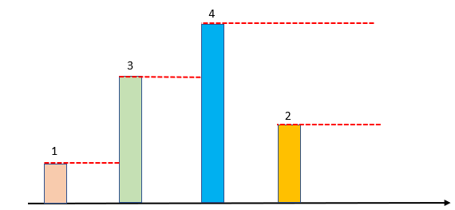

# C#/Java solution (monotonic stack)

**Author:** newbiecoder1
**Votes:** 18
**Link:** [https://leetcode.com/problems/next-greater-element-i/solutions/1243857/](https://leetcode.com/problems/next-greater-element-i/solutions/1243857/)

---

# Intuition
In order to find the next greater element, we should compare the current element with the elements in the stack. 
* If current element > top element of the stack, current element is the next greater element of top element. We should also pop the top element because the current element could also be the next greater element of top element\u2019s previous element.
*  If current element <= top element of the stack, current element is not the next greater element. In this case, we push it into the stack and keep looking for the next greater elements.


# Complexity
- Time O(n + m) where n and n are the lengths of nums1 and nums2 respectively.
- Space: O(m)

# Implementation
```C# []
public class Solution {
    public int[] NextGreaterElement(int[] nums1, int[] nums2) {
        
        if(nums1 == null || nums1.Length == 0)
            return new int[0];

        Dictionary<int,int> dic = new Dictionary<int,int>();
        Stack<int> stack = new Stack<int>();

        foreach(var num in nums2)
        {
            while(stack.Count > 0 && stack.Peek() < num)
            {
                dic.Add(stack.Pop(), num);
            }

            stack.Push(num);
        }

        int[] res = new int[nums1.Length];
        for(int i = 0; i < res.Length; i++)
        {
            res[i] = dic.ContainsKey(nums1[i])? dic[nums1[i]] : -1;
        }

        return res;
    }
}
```
```Java []
class Solution {
    public int[] nextGreaterElement(int[] nums1, int[] nums2) {
        
        if(nums1 == null || nums1.length == 0)
            return new int[0];

        HashMap<Integer,Integer> map = new HashMap<Integer,Integer>();
        Stack<Integer> stack = new Stack<Integer>();

        for(var num : nums2)
        {
            while(stack.size() > 0 && stack.peek() < num)
            {
                map.put(stack.pop(), num);
            }

            stack.push(num);
        }

        int[] res = new int[nums1.length];
        for(int i = 0; i < res.length; i++)
        {
            res[i] = map.containsKey(nums1[i])? map.get(nums1[i]) : -1;
        }

        return res;
    }
}
```

