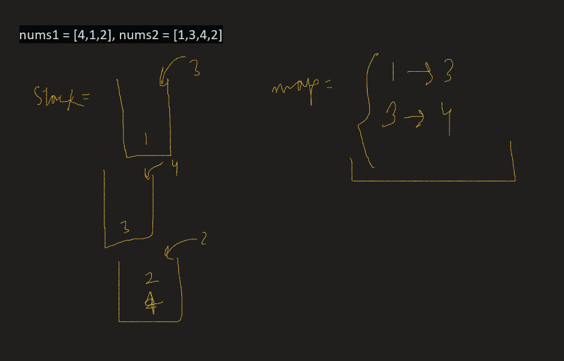
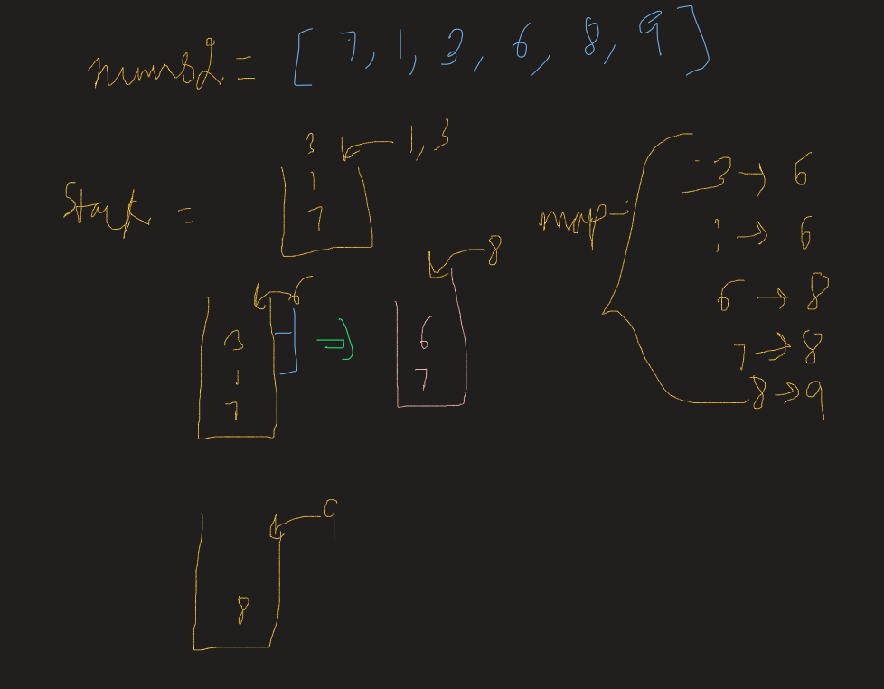

# Java easy solution || Brute and optimal || Stack || Diagrammatic explanation

**Author:** Chaitanya31612
**Votes:** 134
**Link:** [https://leetcode.com/problems/next-greater-element-i/solutions/1579935/](https://leetcode.com/problems/next-greater-element-i/solutions/1579935/)

---

# Brute
Time - **O(n^2)**

**Code**

```java
public int[] nextGreaterElementBrute(int[] nums1, int[] nums2) {
	int[] ans = new int[nums1.length];

	for(int i = 0; i < nums1.length; i++) {
		int greaterIdx = -1, j = nums2.length - 1;
		while(j >= 0 && nums2[j] != nums1[i]) {
			if(nums2[j] > nums1[i]){
				greaterIdx = nums2[j];
			}
			j--;
		}
		ans[i] = greaterIdx;
	}

	return ans;
}
```

**Explanation**
This is actually a bit modified brute force, in this the logic is to start searching backwards until `nums2[j] != nums1[i]` check fails, and update `greaterIdx` to `nums2[j]` if `nums2[j] > nums1[i]`. 
Then update ans[i] to greaterIdx, it will be -1 in case no greater element and value if exists.
Then return ans


# Optimal
Time - **O(n)** where n is length of nums2 as it is equal to or greater than nums1, 

**Code**
```java
public int[] nextGreaterElement(int[] nums1, int[] nums2) {
	int[] ans = new int[nums1.length];

	Stack<Integer> stack = new Stack<>();
	HashMap<Integer, Integer> map = new HashMap<>();

	// find out all the next greater elements in nums2 array
	for(int num: nums2) {
		// if num is greater than top elements in stack then it is the next greater element in nums2
		while(!stack.isEmpty() && num > stack.peek()) {
			map.put(stack.pop(), num);
		}
		// then add num to stack
		stack.add(num);
	}

	int i = 0;
	for(int num : nums1) {
		ans[i++] = map.getOrDefault(num, -1);
	}

	return ans;
}
```

**Explanation**
This approach uses stack, the main point is to store next greater element for all the elements in `nums2` array. It does that by following steps:-
- In this we traverse `nums2` array and add the element to stack if either stack is empty or the element is smaller than the top element.
- If case occurs when the element is greater then top in the stack then that means current element is the next greater element for that top element in stack, remove that and add it's entry in map.
- Repeat this until either stack becomes empty or that element is no longer larger than top in stack.
- Now iterate through nums1 and put entries in ans array by fetching it from map.
- return ans

Here are some examples for better understanding






Hope it helps
Do upvote
Thanks