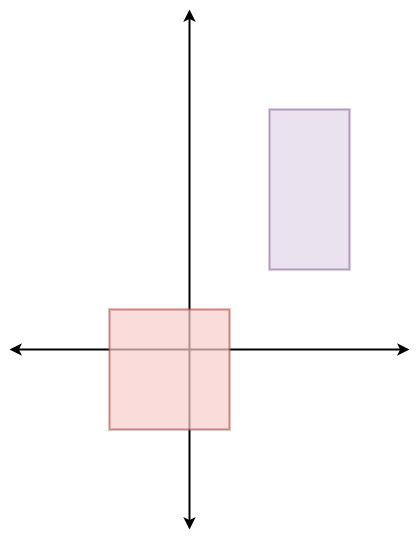

# [497. Random Point in Non-overlapping Rectangles](https://leetcode.com/problems/random-point-in-non-overlapping-rectangles/)

| Category | Difficulty | Likes | Dislikes |
| :------: | :--------: | :---: | :------: |
| Algorithms | Medium | 515 | 688 |

**Tags:** [`array`](https://leetcode.com/tag/array), [`math`](https://leetcode.com/tag/math), [`binary-search`](https://leetcode.com/tag/binary-search), [`reservoir-sampling`](https://leetcode.com/tag/reservoir-sampling), [`prefix-sum`](https://leetcode.com/tag/prefix-sum), [`ordered-set`](https://leetcode.com/tag/ordered-set), [`randomized`](https://leetcode.com/tag/randomized)

**Companies:** `uber`, `google`

## Description

You are given an array of non-overlapping axis-aligned rectangles `rects` where `rects[i] = [a_i, b_i, x_i, y_i]` indicates that `(a_i, b_i)` is the bottom-left corner point of the `i^th` rectangle and `(x_i, y_i)` is the top-right corner point of the `i^th` rectangle. Design an algorithm to pick a random integer point inside the space covered by one of the given rectangles. A point on the perimeter of a rectangle is included in the space covered by the rectangle.

Any integer point inside the space covered by one of the given rectangles should be equally likely to be returned.

**Note** that an integer point is a point that has integer coordinates.

Implement the `Solution` class:

	- `Solution(int[][] rects)` Initializes the object with the given rectangles `rects`.

	- `int[] pick()` Returns a random integer point `[u, v]` inside the space covered by one of the given rectangles.

 

**Example 1:**


```

Input
[&quot;Solution&quot;, &quot;pick&quot;, &quot;pick&quot;, &quot;pick&quot;, &quot;pick&quot;, &quot;pick&quot;]
[[[[-2, -2, 1, 1], [2, 2, 4, 6]]], [], [], [], [], []]
Output
[null, [1, -2], [1, -1], [-1, -2], [-2, -2], [0, 0]]

Explanation
Solution solution = new Solution([[-2, -2, 1, 1], [2, 2, 4, 6]]);
solution.pick(); // return [1, -2]
solution.pick(); // return [1, -1]
solution.pick(); // return [-1, -2]
solution.pick(); // return [-2, -2]
solution.pick(); // return [0, 0]

```

 

**Constraints:**

	- `1 <= rects.length <= 100`

	- `rects[i].length == 4`

	- `-10^9 <= a_i < x_i <= 10^9`

	- `-10^9 <= b_i < y_i <= 10^9`

	- `x_i - a_i <= 2000`

	- `y_i - b_i <= 2000`

	- All the rectangles do not overlap.

	- At most `10^4` calls will be made to `pick`.

---

**Links:** [Submissions](https://leetcode.com/problems/random-point-in-non-overlapping-rectangles/) | [Solutions](https://leetcode.com/problems/random-point-in-non-overlapping-rectangles/)
