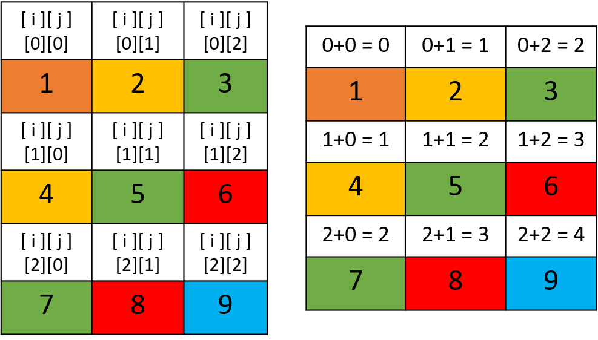

# Easy PHP solution. No Direction.

**Author:** nikolay_dev
**Votes:** 1
**Link:** [https://leetcode.com/problems/diagonal-traverse/solutions/3343075/](https://leetcode.com/problems/diagonal-traverse/solutions/3343075/)

---

# Approach
For an explanation, please check out this solution:
https://leetcode.com/problems/diagonal-traverse/solutions/581868/easy-python-no-direction-checking/



The picture is taken from: https://leetcode.com/problems/diagonal-traverse/editorial/comments/702348

# Complexity
- Time complexity: O(m*n)

- Space complexity: O(m*n)

# Code
```
class Solution {

    /**
     * @param Integer[][] $mat
     * @return Integer[]
     */
    function findDiagonalOrder($mat) {
        $m = count($mat); // get number of rows in matrix
        $n = count($mat[0]); // get number of columns in matrix
        $result = []; // initialize empty result array to store output
        $temp = []; // initialize empty temporary array to store diagonal elements

        // loop through each element of the matrix and store it in the corresponding diagonal array
        for($i = 0; $i < $m; $i++) {
            for($j = 0; $j < $n; $j++) {
                // add element to the diagonal array with key = i+j
                $temp[$i+$j][] = $mat[$i][$j]; 
            }
        }

        // loop through each diagonal array and append its elements to the result array
        foreach($temp as $key => $array) {
            if($key % 2 == 0) { // if key is even, append the reversed array
                $result = array_merge($result, array_reverse($array));
            } else { // if key is odd, append the array as is
                $result = array_merge($result, $array);
            }
        }

        return $result;
    }
}
```