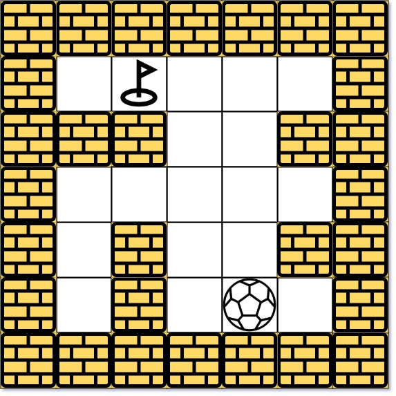
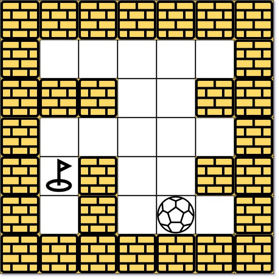

# [499. The Maze III](https://leetcode.com/problems/the-maze-iii/)

| Category | Difficulty | Likes | Dislikes |
| :------: | :--------: | :---: | :------: |
| Algorithms | Hard | 508 | 75 |

**Tags:** [`array`](https://leetcode.com/tag/array), [`string`](https://leetcode.com/tag/string), [`depth-first-search`](https://leetcode.com/tag/depth-first-search), [`breadth-first-search`](https://leetcode.com/tag/breadth-first-search), [`graph`](https://leetcode.com/tag/graph), [`heap-priority-queue`](https://leetcode.com/tag/heap-priority-queue), [`matrix`](https://leetcode.com/tag/matrix), [`shortest-path`](https://leetcode.com/tag/shortest-path)

**Companies:** `google`

## Description

There is a ball in a `maze` with empty spaces (represented as `0`) and walls (represented as `1`). The ball can go through the empty spaces by rolling **up, down, left or right**, but it won't stop rolling until hitting a wall. When the ball stops, it could choose the next direction (must be different from last chosen direction). There is also a hole in this maze. The ball will drop into the hole if it rolls onto the hole.

Given the `m x n` `maze`, the ball's position `ball` and the hole's position `hole`, where `ball = [ball_row, ball_col]` and `hole = [hole_row, hole_col]`, return *a string *`instructions`* of all the instructions that the ball should follow to drop in the hole with the **shortest distance** possible*. If there are multiple valid instructions, return the **lexicographically minimum** one. If the ball can't drop in the hole, return `"impossible"`.

If there is a way for the ball to drop in the hole, the answer `instructions` should contain the characters `'u'` (i.e., up), `'d'` (i.e., down), `'l'` (i.e., left), and `'r'` (i.e., right).

The **distance** is the number of **empty spaces** traveled by the ball from the start position (excluded) to the destination (included).

You may assume that **the borders of the maze are all walls** (see examples).

 

**Example 1:**


```

Input: maze = [[0,0,0,0,0],[1,1,0,0,1],[0,0,0,0,0],[0,1,0,0,1],[0,1,0,0,0]], ball = [4,3], hole = [0,1]
Output: &quot;lul&quot;
Explanation: There are two shortest ways for the ball to drop into the hole.
The first way is left -&gt; up -&gt; left, represented by &quot;lul&quot;.
The second way is up -&gt; left, represented by &#39;ul&#39;.
Both ways have shortest distance 6, but the first way is lexicographically smaller because &#39;l&#39; &lt; &#39;u&#39;. So the output is &quot;lul&quot;.

```

**Example 2:**


```

Input: maze = [[0,0,0,0,0],[1,1,0,0,1],[0,0,0,0,0],[0,1,0,0,1],[0,1,0,0,0]], ball = [4,3], hole = [3,0]
Output: &quot;impossible&quot;
Explanation: The ball cannot reach the hole.

```

**Example 3:**

```

Input: maze = [[0,0,0,0,0,0,0],[0,0,1,0,0,1,0],[0,0,0,0,1,0,0],[0,0,0,0,0,0,1]], ball = [0,4], hole = [3,5]
Output: &quot;dldr&quot;

```

 

**Constraints:**

	- `m == maze.length`

	- `n == maze[i].length`

	- `1 <= m, n <= 100`

	- `maze[i][j]` is `0` or `1`.

	- `ball.length == 2`

	- `hole.length == 2`

	- `0 <= ball_row, hole_row <= m`

	- `0 <= ball_col, hole_col <= n`

	- Both the ball and the hole exist in an empty space, and they will not be in the same position initially.

	- The maze contains **at least 2 empty spaces**.

---

**Links:** [Submissions](https://leetcode.com/problems/the-maze-iii/) | [Solutions](https://leetcode.com/problems/the-maze-iii/)
