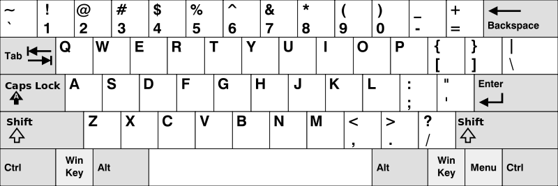

# [500. Keyboard Row](https://leetcode.com/problems/keyboard-row/)

| Category | Difficulty | Likes | Dislikes |
| :------: | :--------: | :---: | :------: |
| Algorithms | Easy | 1783 | 1157 |

**Tags:** [`array`](https://leetcode.com/tag/array), [`hash-table`](https://leetcode.com/tag/hash-table), [`string`](https://leetcode.com/tag/string)

**Companies:** `google`, `microsoft`, `mathworks`

## Description

Given an array of strings `words`, return *the words that can be typed using letters of the alphabet on only one row of American keyboard like the image below*.

**Note** that the strings are **case-insensitive**, both lowercased and uppercased of the same letter are treated as if they are at the same row.

In the **American keyboard**:

	- the first row consists of the characters `"qwertyuiop"`,

	- the second row consists of the characters `"asdfghjkl"`, and

	- the third row consists of the characters `"zxcvbnm"`.

 

**Example 1:**

**Input:** words = ["Hello","Alaska","Dad","Peace"]

**Output:** ["Alaska","Dad"]

**Explanation:**

Both `"a"` and `"A"` are in the 2nd row of the American keyboard due to case insensitivity.

**Example 2:**

**Input:** words = ["omk"]

**Output:** []

**Example 3:**

**Input:** words = ["adsdf","sfd"]

**Output:** ["adsdf","sfd"]

 

**Constraints:**

	- `1 <= words.length <= 20`

	- `1 <= words[i].length <= 100`

	- `words[i]` consists of English letters (both lowercase and uppercase).

---

**Links:** [Submissions](https://leetcode.com/problems/keyboard-row/) | [Solutions](https://leetcode.com/problems/keyboard-row/)
