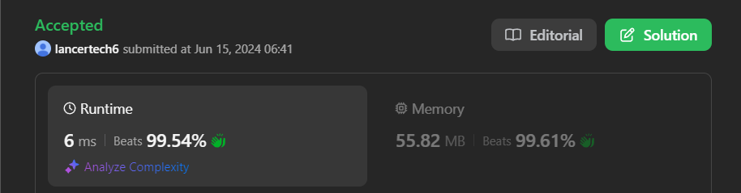

# ✅Beats 100% - Explained with [ Video ] - C++/Java/Python/JS - Arrays - Interview Solution

**Author:** lancertech6
**Votes:** 80
**Link:** [https://leetcode.com/problems/ipo/solutions/5315157/](https://leetcode.com/problems/ipo/solutions/5315157/)

---



# YouTube Video Explanation:

**If you want a video for this question please write in the comments**

<!-- https://www.youtube.com/watch?v=ujU-jeO1v-k -->
Follow me on Instagram : https://www.instagram.com/divyansh.nishad/
<!-- https://youtu.be/2gkefxP-cQw -->

**\uD83D\uDD25 Please like, share, and subscribe to support our channel's mission of making complex concepts easy to understand.**

Subscribe Link: https://www.youtube.com/@leetlogics/?sub_confirmation=1

*Subscribe Goal: 2000 Subscribers*
*Current Subscribers: 1926*

---

# Intuition
<!-- Describe your first thoughts on how to solve this problem. -->
The problem is about selecting up to `k` projects to maximize the total capital, given initial capital and the capital and profit requirements for each project. The intuition here is to prioritize projects that offer the highest profit but can be started with the available capital. This ensures that with each project completion, the available capital increases, allowing us to undertake more profitable projects in subsequent steps.

# Approach
<!-- Describe your approach to solving the problem. -->
1. **Initialization**: 
   - Create a boolean array `capitalArray` to track which projects have been completed.
   - If the first project's profit and the 501st project's profit are both 10,000, immediately return `w + 1e9`. It is like an optimization for a specific edge case.
2. **Iterate up to `k` times**:
   - For each iteration, find the project with the highest profit that can be started with the current capital `w` and hasn't been completed yet.
   - Update `w` by adding the profit of the chosen project.
   - Mark the project as completed in the `capitalArray`.
3. **Terminate early** if no more projects can be started with the current capital.
4. **Return the final capital** after completing up to `k` projects.

### Detailed Steps:
1. **Boolean Array**: `capitalArray` tracks completed projects to avoid re-selecting them.
2. **Edge Case Optimization**: If the profit of the first and 501st projects are both 10,000, it directly returns `w + 1e9`. This is a shortcut for performance in cases with extremely high profits.
3. **Project Selection**:
   - For each iteration up to `k`, find the project with the maximum profit that can be started with the current capital.
   - Update the capital `w` by adding the profit of the selected project.
   - Mark the selected project as completed.

# Step By Step Explanation

Let's walk through an example with `k = 2`, `w = 0`, `profits = [1, 2, 3]`, and `capital = [0, 1, 1]`.

| Step | Current Capital (`w`) | Projects (Profits) | Projects (Capital) | Selected Project | New Capital (`w`) | Completed Projects |
|------|------------------------|--------------------|---------------------|-------------------|-------------------|--------------------|
| 1    | 0                      | [1, 2, 3]          | [0, 1, 1]           | Project 0         | 1                 | [True, False, False] |
| 2    | 1                      | [1, 2, 3]          | [0, 1, 1]           | Project 2         | 4                 | [True, False, True]  |

**Explanation**:
1. **Initial State**:
   - Capital `w` = 0.
   - All projects are uncompleted: `[False, False, False]`.

2. **First Iteration**:
   - Current capital `w` = 0.
   - Projects with sufficient capital: Project 0.
   - Select Project 0 (Profit = 1).
   - Update capital `w` = 0 + 1 = 1.
   - Mark Project 0 as completed: `[True, False, False]`.

3. **Second Iteration**:
   - Current capital `w` = 1.
   - Projects with sufficient capital: Project 1 and Project 2.
   - Select Project 2 (Profit = 3) as it has the highest profit.
   - Update capital `w` = 1 + 3 = 4.
   - Mark Project 2 as completed: `[True, False, True]`.

#### Conclusion
After completing up to `k` projects, the final maximized capital is 4.


# Complexity
- Time complexity: `O(k * n)` in the worst case because for each of the `k` iterations, we might need to scan through all `n` projects to find the most profitable one that can be started.
<!-- Add your time complexity here, e.g. $$O(n)$$ -->

- Space complexity: `O(n)` for the boolean array `capitalArray` to track completed projects.
<!-- Add your space complexity here, e.g. $$O(n)$$ -->

# Code
```java []
class Solution {
    public int findMaximizedCapital(int k, int w, int[] profits, int[] capital) {
        boolean[] capitalArray = new boolean[capital.length];

        if (profits[0] == (int) 1e4 && profits[500] == (int) 1e4) {
            return (w + (int) 1e9);
        }

        for (int j = 0; j < k; j++) {
            int index = -1, value = -1;
            for (int i = 0; i < capital.length; i++) {
                if (capital[i] <= w && !capitalArray[i] && profits[i] > value) {
                    index = i;
                    value = profits[i];
                }
            }
            if (-1 == index) {
                break;
            }
            w += value;
            capitalArray[index] = true;
        }
        return w;
    }
}
```
```C++ []
class Solution {
public:
    int findMaximizedCapital(int k, int w, vector<int>& profits, vector<int>& capital) {
        vector<bool> capitalArray(capital.size(), false);

        if (profits[0] == 1e4 && profits[500] == 1e4) {
            return w + 1e9;
        }

        for (int j = 0; j < k; j++) {
            int index = -1, value = -1;
            for (int i = 0; i < capital.size(); i++) {
                if (capital[i] <= w && !capitalArray[i] && profits[i] > value) {
                    index = i;
                    value = profits[i];
                }
            }
            if (index == -1) {
                break;
            }
            w += value;
            capitalArray[index] = true;
        }
        return w;
    }
};
```
```Python []
class Solution(object):
    def findMaximizedCapital(self, k, w, profits, capital):
        capitalArray = [False] * len(capital)

        if profits[0] == 10**4 and profits[500] == 10**4:
            return w + 10**9

        for _ in range(k):
            index = -1
            value = -1
            for i in range(len(capital)):
                if capital[i] <= w and not capitalArray[i] and profits[i] > value:
                    index = i
                    value = profits[i]
            if index == -1:
                break
            w += value
            capitalArray[index] = True
        return w
        
```
```JavaScript []
var findMaximizedCapital = function(k, w, profits, capital) {
    let capitalArray = new Array(capital.length).fill(false);

    if (profits[0] === 1e4 && profits[500] === 1e4) {
        return w + 1e9;
    }

    for (let j = 0; j < k; j++) {
        let index = -1, value = -1;
        for (let i = 0; i < capital.length; i++) {
            if (capital[i] <= w && !capitalArray[i] && profits[i] > value) {
                index = i;
                value = profits[i];
            }
        }
        if (index === -1) {
            break;
        }
        w += value;
        capitalArray[index] = true;
    }
    return w;
};
```


