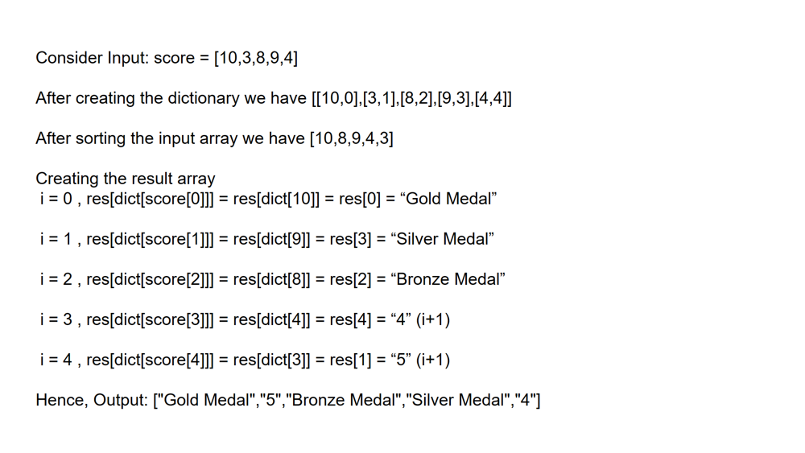

# Simpler || Faster || Fully Explained

**Author:** priyasmb24
**Votes:** 12
**Link:** [https://leetcode.com/problems/relative-ranks/solutions/5128039/](https://leetcode.com/problems/relative-ranks/solutions/5128039/)

---

# Intuition
<!-- Describe your first thoughts on how to solve this problem. -->
we need to create a string array which contains the result in the same order as the input array.

So we need a dictionary or a hashmap to map the index and their values.

we sort the input array from highest to the lowest

Finally we create a string array and iterate from 0 to input array length, storing "gold, silver and bronze" for first 3 indices in the sorted array and index + 1 (since index start from 0) for the rest of the indices.

# Approach
<!-- Describe your approach to solving the problem. -->




# Complexity
- Time complexity: O(nlogn) Since we are sorting
<!-- Add your time complexity here, e.g. $$O(n)$$ -->

- Space complexity: O(n)
<!-- Add your space complexity here, e.g. $$O(n)$$ -->

# Code
```C# []
public class Solution {
    public string[] FindRelativeRanks(int[] score) {
        var scoreDict = new Dictionary<int,int>();
        //store the indices and the values in the dictionary
        for(int i = 0; i<score.Length;i++){
            scoreDict[score[i]] = i;
        }
        ///sort the input array in descending order
        Array.Sort(score,(x,y)=>y.CompareTo(x));
        string[] result = new string[score.Length];
        // traverse from 0 to input length to store the ranks
        for(int i = 0;i<score.Length;i++){
            //assign rank based on the position after the sorting
            if(i == 0){
                result[scoreDict[score[i]]] = "Gold Medal";
            }
            else if(i == 1){
                result[scoreDict[score[i]]] = "Silver Medal";
            }
            else if(i == 2){
                result[scoreDict[score[i]]] = "Bronze Medal";
            }
            else{
                result[scoreDict[score[i]]] = (i+1).ToString();
            }
        }
        return result;
    }
}
```
```Java []
public class Solution {
    public String[] findRelativeRanks(int[] score) {
        // Create a map to store each score's original index
        Map<Integer, Integer> scoreMap = new HashMap<>();
        for (int i = 0; i < score.length; i++) {
            scoreMap.put(score[i], i);
        }

        // Sort the scores in descending order
        Arrays.sort(score);

        // Create a result array to store the ranks
        String[] result = new String[score.length];
        for (int i = score.length - 1; i >= 0; i--) {
            // Assign ranks based on the position of each score in the sorted array
            int rank = score.length - i;
            if (rank == 1) {
                result[scoreMap.get(score[i])] = "Gold Medal";
            } else if (rank == 2) {
                result[scoreMap.get(score[i])] = "Silver Medal";
            } else if (rank == 3) {
                result[scoreMap.get(score[i])] = "Bronze Medal";
            } else {
                result[scoreMap.get(score[i])] = String.valueOf(rank);
            }
        }

        return result;
    }
}
```
```python []
class Solution(object):
    def findRelativeRanks(self, score):
        # Create a dictionary to store each score's original index
        score_map = {score[i]: i for i in range(len(score))}

        # Sort the scores in descending order
        score.sort(reverse=True)

        # Create a result list to store the ranks
        result = ["" for _ in range(len(score))]
        for i in range(len(score)):
            # Assign ranks based on the position of each score in the sorted list
            if i == 0:
                result[score_map[score[i]]] = "Gold Medal"
            elif i == 1:
                result[score_map[score[i]]] = "Silver Medal"
            elif i == 2:
                result[score_map[score[i]]] = "Bronze Medal"
            else:
                result[score_map[score[i]]] = str(i + 1)

        return result
```

