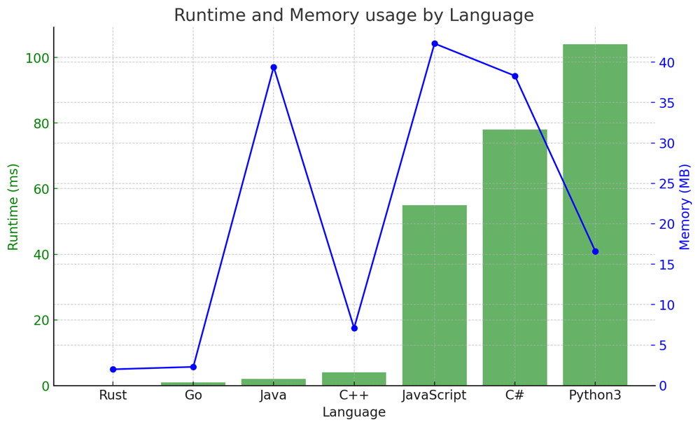

# ✅ 100% Dynamic Programming [VIDEO] - Optimal Solution

**Author:** vanAmsen
**Votes:** 126
**Link:** [https://leetcode.com/problems/coin-change-ii/solutions/3892702/](https://leetcode.com/problems/coin-change-ii/solutions/3892702/)

---

# Problem Understanding

In the "Coin Change II" problem, we are given coins of various denominations and a specific amount. Our task is to determine the number of different ways we can make up that amount using the coins. Unlike other coin change problems where we need to minimize or maximize the number of coins, here we need to find the total number of possible combinations.

For instance, with coins [1,2,5] and amount 5, we have the following combinations:

1. 5 = 5
2. 5 = 2 + 2 + 1
3. 5 = 2 + 1 + 1 + 1
4. 5 = 1 + 1 + 1 + 1 + 1

Hence, there are 4 ways to make up the amount 5 using the coins [1,2,5].

---

# Live Coding & Explenation:
https://youtu.be/7V3FiGBEThg

## Live coding in:
- [Python: \uD83D\uDC0D](https://youtu.be/7V3FiGBEThg)
- [Rust: \uD83E\uDD80](https://youtu.be/fm80-oJGTUw)
- [Go: \uD83D\uDC39](https://youtu.be/aJw_5d1CiwE)

# Approach

The intuitive way to approach this problem is by leveraging dynamic programming. We can envision a solution where, for each coin, we update the number of ways to create every amount from 0 to the given amount.

## Using a 1D Dynamic Programming Array

To find the solution in an optimized manner, we use a one-dimensional array, `dp`, of size `amount + 1`, where `dp[i]` represents the number of ways to make up the amount `i` using the coins considered so far.

1. Initialize `dp` with all zeros and set `dp[0]` to 1 since there's only one way to make up amount 0, which is by not choosing any coin.
2. For each coin in `coins`, update the array `dp` from the coin value to the total amount.
3. For each amount `i` from the coin value to the total amount, increment `dp[i]` by `dp[i - coin_value]`.
4. The final answer will be `dp[amount]`.

## Example

Given the sample example with coins \\([1,2,5]\\) and amount \\(5\\), let's visualize how the `dp` array changes with each iteration:

1. Initialization:
   - `dp = [1, 0, 0, 0, 0, 0]`

2. Processing coin \\(1\\):
   - For each \\(j\\) from \\(1\\) to \\(5\\), add `dp[j - 1]` to `dp[j]`
   - After this step: `dp = [1, 1, 1, 1, 1, 1]`

3. Processing coin \\(2\\):
   - For each \\(j\\) from \\(2\\) to \\(5\\), add `dp[j - 2]` to `dp[j]`
   - After this step: `dp = [1, 1, 2, 2, 3, 3]`

4. Processing coin \\(5\\):
   - For \\(j = 5\\), add `dp[0]` to `dp[5]`
   - After this step: `dp = [1, 1, 2, 2, 3, 4]`

Now, let's visualize these iterations using a table.

Here's a tabular representation of the algorithm's progression for the given example:

| Iteration | 0 | 1 | 2 | 3 | 4 | 5 |
|-----------|---|---|---|---|---|---|
| Initial   | 1 | 0 | 0 | 0 | 0 | 0 |
| Coin 1    | 1 | 1 | 1 | 1 | 1 | 1 |
| Coin 2    | 1 | 1 | 2 | 2 | 3 | 3 |
| Coin 5    | 1 | 1 | 2 | 2 | 3 | 4 |

- The "Initial" row indicates the state of the `dp` array right after initialization.
- Each subsequent row represents the state of the `dp` array after processing the respective coin.
  
From the table, we can trace how the algorithm calculates the number of combinations for each amount using the available coins. The final value in the `dp` array, `dp[5]`, gives the total number of ways to make up the amount 5 using the coins [1,2,5], which is 4 in this case.

## Rationale

The solution's efficiency comes from its bottom-up construction. By building upon previously computed solutions for smaller amounts, we avoid redundant calculations. This method ensures that by the time we want to compute the number of ways for a particular amount, we've already determined the number of ways for all smaller amounts using the current set of coins.

# Complexity

**Time Complexity:** $$O(\	ext{amount} \	imes \	ext{len(coins)})$$

**Space Complexity:** $$O(\	ext{amount})$$

This optimized solution ensures that we're using both time and space resources efficiently.

# Performance

This implementation performs competitively on LeetCode, often beating a significant portion of other submissions in terms of runtime and memory usage.

Language    | Runtime (ms) | Runtime Beat (%) | Memory (MB) | Memory Beat (%)
------------|--------------|------------------|-------------|-----------------
Rust        | 0            | 100%             | 2.0         | 64.29%
Go          | 1            | 74.57%           | 2.3         | 100%
Java        | 2            | 100%             | 39.4        | 99.94%
C++         | 4            | 97.86%           | 7.1         | 90.15%
JavaScript  | 55           | 95.24%           | 42.3        | 77.78%
C#          | 78           | 90.96%           | 38.3        | 90.36%
Python3     | 104          | 99.40%           | 16.6        | 77.13%




# Code
``` Python []
class Solution:
    def change(self, amount: int, coins: List[int]) -> int:
        dp = [0] * (amount + 1)
        dp[0] = 1
        
        for coin in coins:
            for j in range(coin, amount + 1):
                dp[j] += dp[j - coin]
        
        return dp[amount]
```
``` C++ []
class Solution {
public:
    int change(int amount, vector<int>& coins) {
        vector<int> dp(amount + 1, 0);
        dp[0] = 1;
        
        for (int coin : coins) {
            for (int j = coin; j <= amount; j++) {
                dp[j] += dp[j - coin];
            }
        }
        
        return dp[amount];
    }
};
```
``` Rust []
impl Solution {
    pub fn change(amount: i32, coins: Vec<i32>) -> i32 {
        let mut dp = vec![0; (amount + 1) as usize];
        dp[0] = 1;
        
        for coin in &coins {
            for j in *coin..=amount {
                dp[j as usize] += dp[(j - coin) as usize];
            }
        }
        
        dp[amount as usize]
    }
}
```
``` Go []
func change(amount int, coins []int) int {
    dp := make([]int, amount+1)
    dp[0] = 1
    
    for _, coin := range coins {
        for j := coin; j <= amount; j++ {
            dp[j] += dp[j - coin]
        }
    }
    
    return dp[amount]
}
```
``` Java []
public class Solution {
    public int change(int amount, int[] coins) {
        int[] dp = new int[amount + 1];
        dp[0] = 1;
        
        for (int coin : coins) {
            for (int j = coin; j <= amount; j++) {
                dp[j] += dp[j - coin];
            }
        }
        
        return dp[amount];
    }
}
```
``` C# []
public class Solution {
    public int Change(int amount, int[] coins) {
        int[] dp = new int[amount + 1];
        dp[0] = 1;
        
        foreach (int coin in coins) {
            for (int j = coin; j <= amount; j++) {
                dp[j] += dp[j - coin];
            }
        }
        
        return dp[amount];
    }
}
```
``` JavaScript []
/**
 * @param {number} amount
 * @param {number[]} coins
 * @return {number}
 */
var change = function(amount, coins) {
    let dp = new Array(amount + 1).fill(0);
    dp[0] = 1;
    
    for (let coin of coins) {
        for (let j = coin; j <= amount; j++) {
            dp[j] += dp[j - coin];
        }
    }
    
    return dp[amount];
};
```

---

# Conclusion

The "Coin Change II" problem is an excellent demonstration of the power and efficiency of dynamic programming. By breaking down the problem into smaller subproblems and building the solution from the ground up, we're able to solve a seemingly complex problem in a computationally efficient manner.

Whether you're preparing for interviews or just honing your algorithmic skills, problems like this reinforce the importance of understanding the underlying principles of dynamic programming and applying them in various scenarios. Keep practicing, and never stop learning!

# Live Coding in Rust & Go
https://youtu.be/fm80-oJGTUw
https://youtu.be/aJw_5d1CiwE