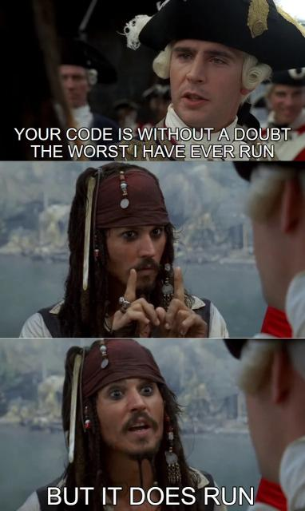

# 🥇 C++ | PYTHON  ||  EXPLAINED  ||  ; ]

**Author:** karan_8082
**Votes:** 69
**Link:** [https://leetcode.com/problems/continuous-subarray-sum/solutions/2744281/](https://leetcode.com/problems/continuous-subarray-sum/solutions/2744281/)

---

**UPVOTE IF HELPFuuL**

**APPROACH**

If ```sum(nums[i:j]) % k == 0``` for some ```i < j```,
* Then ```sum(nums[:j]) % k == sum(nums[:i]) % k```
* We just need to use a dictionary to keep track of ```sum(nums[:i]) % k``` and the corresponding index i.
* Whenever ```sum(nums[:i']) % k == sum(nums[:i]) % k and i' - i > 1```, we return True.

**MATHS**

```( s + (n * k)) % k <==> (s % k)```

For e.g. in case of the array ```[23,2,6,4,7]``` the running sum is ```[23,25,31,35,42]``` .
The remainders are ```[5,1,1,5,0]```. 
We got remainder 5 at index 0 and at index 3. 
That means, in between these two indexes we must have added a number which is multiple of the k.

**PYTHON CODE**

```
class Solution:
    def checkSubarraySum(self, nums: List[int], k: int) -> bool:
        d , s = {0:-1} , 0
        for i, n in enumerate(nums):
            if k != 0:
                s = (s + n) % k
            else:
                s += n
            if s not in d:
                d[s] = i
            else:
                if i - d[s] >= 2:
                    return True
        return False
```

**C++ CODE**
```
class Solution {
public:
    bool checkSubarraySum(vector<int>& nums, int k) {
        unordered_map<int, int> d;
        int s=0;
        d[0]=-1;
        
        for(int i=0 ; i<nums.size() ; i++){
            s += nums[i];
            
            if(k!=0) s %= k;
            
            if(d.find(s) != d.end())
            {
                if(i-d[s] > 1) return true;
            }
            else d[s]=i;         
        }
        return false;
    }
};
```

Time   -> **O ( N )**
Space -> **O ( min ( K, N ) )**

**UPVOTE IF HELPFuuL**



