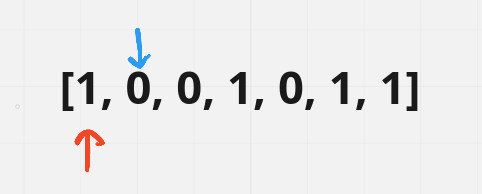
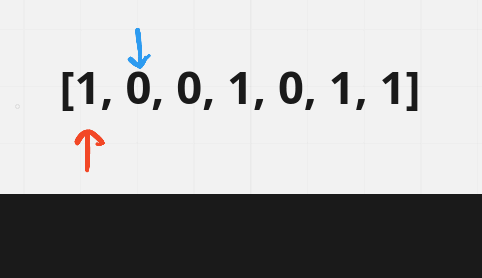
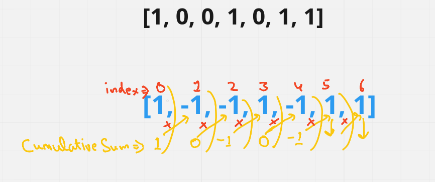
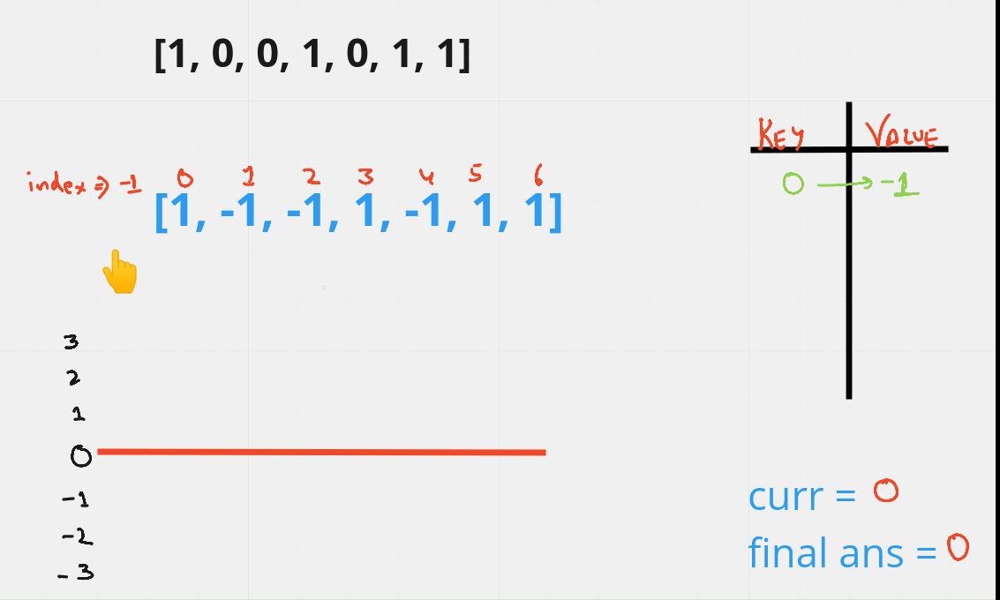

# A highly detailed EXPLANATION ever exists [Java/C++]

**Author:** hi-malik
**Votes:** 172
**Link:** [https://leetcode.com/problems/contiguous-array/solutions/1743431/](https://leetcode.com/problems/contiguous-array/solutions/1743431/)

---

```
What the question is saying,
we  have given binary 1-D array and we have to count maximum possible subarrays who has equal no. 0's & 1's
```
***Let's understand this problem with an,***
Example :-
**Input** :- [1, 0, 0, 1, 0, 1, 1]
**Output** :- 6

First, brute-force comes in mind. So, what we do is create 2 pointer's **blue pointer & red pointer**. And moving **blue pointer** we will find all the possible subarrays of having equal no. of 1's & 0's & update the count with that





And we get equal no. of 0's & 1's subarray, we will update our count as well. But this gives us **time complexity of O(N^2)**. Give us, `time limit exceed`

**Java**
```
class Solution {
    public int findMaxLength(int[] nums) {
        int count = 0;
        for (int i = 0; i < nums.length; i++) {
            int zeros = 0, ones = 0;
            for (int j = i; j < nums.length; j++) {
                if (nums[j] == 0) {
                    zeros++;
                } else {
                    ones++;
                }
                if (zeros == ones) {
                    count = Math.max(count, j - i + 1);
                }
            }
        }
        return count;
    }
}
```
**C++**
```
class Solution {
public:
    int findMaxLength(vector<int>& nums) {
        int count = 0;
        for (int i = 0; i < nums.size(); i++) {
            int zeros = 0, ones = 0;
            for (int j = i; j < nums.size(); j++) {
                if (nums[j] == 0) {
                    zeros++;
                } else {
                    ones++;
                }
                if (zeros == ones) {
                    count = max(count, j - i + 1);
                }
            }
        }
        return count;
    }
};
```
ANALYSIS :-
* **Time Complexity :-** BigO(N^2) as We consider every possible subarray by traversing over the complete array for every start point possible.

* **Space Complexity :-** BigO(1) as Only two variables zeros and ones are required
```
Let's solve this problem in BigO(N).
```

Now what we will do is, convert all the **"0" to "-1"**  in the example, so what we get something like :-  [1, **-1**, **-1**, 1, **-1**, 1, 1]. If you see this, problem is somewhat like return the longest subarray length whose sum is **"ZERO"**
Because equal no. of 1's & 0's, so we had replace 0 with -1. So, that means the same as well there will be equal no. of 1 & -1.

That's the thing, if in any subarray there is equal no. of 1 & -1 there sum will be 0. We have to return that subarray length, whose sum is 0. And we have to find the longest subarray. 

Let just see how we will solve this problem using **HashMap**
We will use help of cumulative sum, which means what is the sum from 0th index till 6th index. `Let's look at visually`



Using this cumulative sum, we will solve this problem in O(N). 
In our hashMap we will have key & value. 

* Intially let's assume our gain is 0 & we are standing at index -1

* We move forward and get a gain of 1. And in our hashmap for reference we put **key 0 -> -1 value**. Why this because intially we are at no-where & what our gain is 0 & our **final-ans is 0 at index -1**. `Just hold on you will understand`
* At index 0 we get 1. And if we look in our HashMap, do we have key value pair for 1? No, then we will create **key 1 -> 0 value** pair in hashmap. `Our cumulative sum is 0 + 1 = 1`
* Now moving to index 1 we get gain of -1 & lose of 1. Now our gain become 0 because `Our cumulative sum is 1 + (-1) = 0`  so what does it represent is in the Journey from -1th index to 1st index, we found an subarray i.e. [1, 0]. The subarray has equal no. of 0s & 1s. Now to calculate it's length is we started the journey from index -1 to index 1. `Thus, 1 - (-1) = 2`. 
* So, to trace this **2** we put our intial **key 0 & value -1**. *Now hope you got an idea a bit, anyways*. We will update it's `current & final-ans with 2`
* Now moving further & at index 2 we got gain of -1 as `Our cumulative sum is 0 + (-1) = -1` And if we look at hashmap -1 is not present we will make **key-value pair of -1 -> 2**. 
* Now moving further & at index 3 we get 1 & our gain become 0 as `Our cumulative sum is 1 + (-1) = 0`. And if we look at hashmap 0 is present with value of -1. Now to calculate it's length is we started the journey from index 2 to index 3. `Thus, 3 - (-1) = 4`, then update our `current & final-ans with 4` And  Till now we have found an **subarray of size 4**
* Now moving further & at index 4 we got gain of -1 as `Our cumulative sum is 0 + (-1) = -1`.  And if we look at hashmap -1 is present at **key-value pair of -1 -> 2**. We got one more subarray in the Journey from 3rd index to 4th index. But, if we calculate it's length, it will be `4 - (+2) = 2` & update our **current with 2** and compare with **final-ans i.e. 4** which is less, we will not consider it.
* Now moving further & at index 5 we ge 1 & our gain becomes 0 as `Our cumulative sum is 1 + (-1) = 0`. We got one more subarray in the Journey from 4th index to 5th index. calculate it's length, it will be `5 - (-1) = 6`, then update our `current & final-ans with 6`. 
* Finall moving at index 6th, we get 1 & our gain becomes 1 as `Our cumulative sum is 0 + 1 = 1` . And if we look at hashmap 1 is present at **key-value pair of 1 -> 0**. We got one more subarray in the Journey from 5ht index to 6th index. As we calculate it's length, it will be `6 - (0) = 6` & compare with **current & final-ans i.e. 6** which is equal to it.
* In the end we get 2 big subarrays having equal no. of 1s & 0s
* * **[1,0,0,1,0,1]**
* * **[0,0,1,0,1,1]**



*I hope you understood the approach*, **let's code it up :-**

**Java**
```
class Solution {
    public int findMaxLength(int[] nums) {
        if (nums == null || nums.length == 0) { // Base Case
            return 0;
        }
        // Converting all 0 to -1
        for(int i = 0; i < nums.length; i++){
            if(nums[i] == 0) nums[i] = -1;
        }
        int sum = 0; // current
        int max = 0; // final-ans
        Map<Integer, Integer> map = new HashMap<>();
        map.put(0, -1); // put reference in the starting of 0 & -1, as i have tell you in the starting  
        for(int i = 0; i < nums.length; i++){
            sum += nums[i]; // cumulative sum
            if(map.containsKey(sum)){ // if cumulative sum key :- 0, -1, 1 already present
                int last = map.get(sum); // we get it's value
                max = Math.max(max, i - last); // and update max
            }
            else{ // if it's not present then create it's key-value pair
                map.put(sum, i);
            }
        }
        return max; // finally return it
    }
}
```
**C++** `by :-` [@KodeYash](https://leetcode.com/KodeYash/)
```
class Solution {
public:
    int findMaxLength(vector<int>& nums) {
        unordered_map<int,int> mp; //map of <gain,index> form
        mp[0]=-1; //add starting index with default gain of 0 at -1
        //change all zeros to -1
        for(int i=0;i<nums.size();i++){
            nums[i]==0?nums[i]=-1:nums[i]=1;
        }
        int sum=0,res=0;
        for(int i=0;i<nums.size();i++){
            //cumulative sum
            sum+=nums[i];
            
            //check if value already exists in the map
            if(mp.find(sum)!=mp.end()){
                //finding the length of possible subarray and comparing with the max result
                res=max(res,i-mp[sum]);
            }
            else{
                //adding value to our map
                mp[sum]=i;
            }
        }
        return res;
    }
};
```

ANALYSIS :-
* **Time Complexity :-** BigO(N) as The entire array is traversed only once.

* **Space Complexity :-** BigO(N) as size of the HashMap map will be N