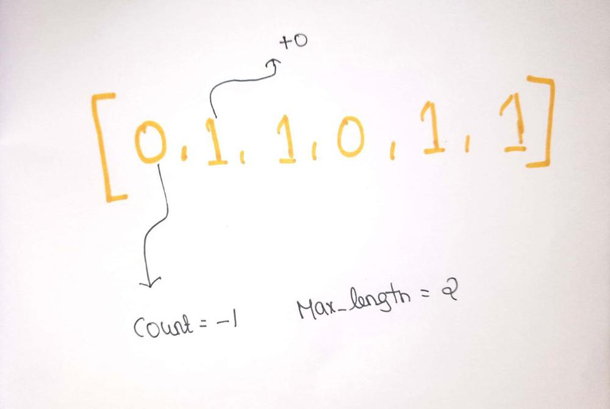
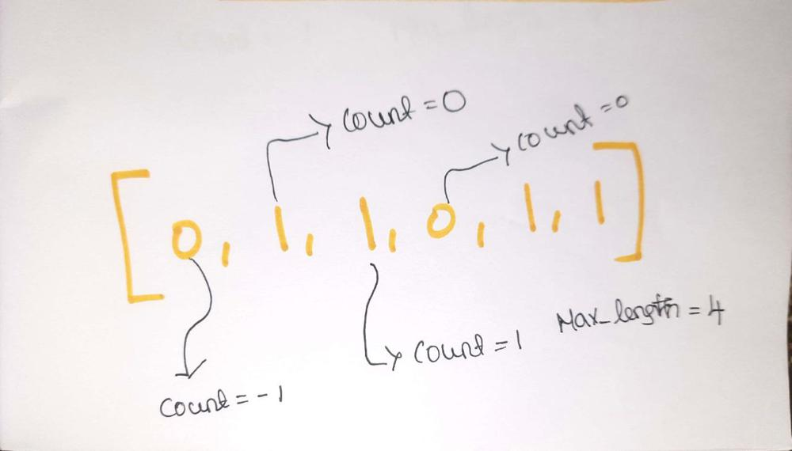
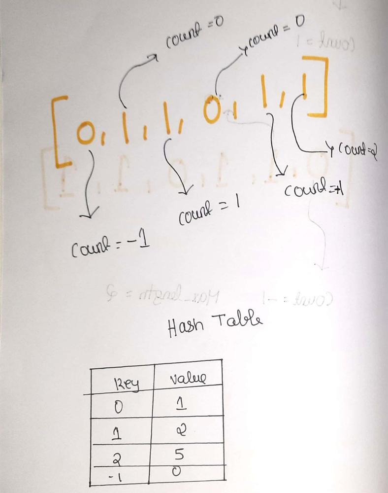

# [Python , Javascript]  Easy solution with very clear Explanation

**Author:** mageshyt
**Votes:** 133
**Link:** [https://leetcode.com/problems/contiguous-array/solutions/1743720/](https://leetcode.com/problems/contiguous-array/solutions/1743720/)

---

` What the question is saying, 
    Given a binary array nums, return the maximum length of a contiguous subarray with an equal number of 0 and 1.
    binary array --> we will get only 0 and 1 in our array 
`

```
      let me explain you the approach \uD83D\uDE04 :
        1.we are going to use hash map  to store the count of 0 and 1
        2.we are going to declare a variable max_len and count assign it to 0
        3.we are going to use a for loop to iterate through the array
        4.if the current number is 0 then we will decrement the count by 1
        5.if the current number is 1 then we will increment the count by 1
        6. we are going to check that our count is equal to 0  are not if it 0 then we will make our max_len equal to i+1 .let me explain you why so keep following the logic \uD83D\uDE04.

        7. we are going to update our count to our hash .if it was already in the hash we will compare the value of the hash with max_len and if it is greater than max_len then we will update max_len to the value of the hash
        if it was not there we will add the count to the hash
            key --> count
            value --> index
        8. we are going to return max_len

        let me break down the logic \uD83D\uDE04
                hash={}
                max_len=0
                count=0
                nums=[0,1,1,0,1,1]

                our loop starts \uD83D\uDE0A
                first iteration:
                    i=0
                    current_num=nums[i] -->0
                    here our current_num is 0 so count=count-1
                    count=-1
                    -1 is not in our hash so we are going to add in our hash
                    hash={ '-1': 0 }
                second iteration:
                    i=1
                    count=-1
                    current_num=nums[i] -->1
                    here our current_num is 1 so count=count+1
                    count=-1+1 = 0
                    --> we got our count is equal to 0 so we will update our max_len to i+1 so max_len is 2
                         let me explain you why :
                            initially we declared our count to 0
                            we will increment our count when current_num is 1 and decrement when current_num is 0
                            then will update our max_len to i+1
                        Note:
                            when even we get out count is equal to 0 it mean we have equal number of 0 and 1
                    0 is not in our hash so we are going to add in our hash
                    hash={ '0': 1, '-1': 0 }
```



```
 third iteration:
                    i=2
                    count=0
                    current_num=nums[i] -->1
                    here our current_num is 1 so count=count+1
                    count=0+1 = 1
                    1 is not in our hash so we are going to add in our hash
                    hash={ '0': 1, '-1': 0, '1': 2 }
                fourth iteration:
                    i=3
                    count=1
                    current_num=nums[i] -->0
                    here our current_num is 0 so count=count-1
                    count=1-1 = 0
                    we got our count is 0 its time to update our max_len \uD83E\uDD73
                        our max_len=2
                        max_length=i+1  so max_len wil be 4
                    here 0 is already in our hash
                    hash[0]=1
                    so max_len=(max_len,i-hash[0]) --> max(4,2) = 4

```



```
                fifth iteration:
                    i=4
                    count=0
                    current_num=nums[i] --> 1
                    here our current_num is 1 so count=count+1
                    count=0+1=1
                    here 1 is in our hash
                        hash[1]=2
                        so max_len=(max_len,i-hash[1]) --> max(4,2)=4
                sixth iteration:
                    i=5
                    count=1
                    current_num=nums[i] -->1
                    here our current_num is 1 so count=count+1
                    count=1+1=2
                    its time to update our new count in our hash \uD83E\uDD20
                    hash={ '0': 1, '1': 2, '2': 5, '-1': 0 }
            finally we have to return our max_len  \uD83D\uDE01
	Big O:
		n--> length of the array
		Time Complexity:O(n) 
		Space Complexity:O(n) 
```



`Javascript`
```
const findMaxLength = (nums) => {
  const hash = {};
  let max_length = 0;
  let count = 0;
  for (let i = 0; i < nums.length; i++) {
    const current = nums[i];
    if (current === 0) {
        // if the current element is 0, then we decrement the count
      count--;
    } else if (current === 1) {
        // if the current element is 1, then we increment the count
      count++;
    }

    if (count === 0) {
        // if the count is equal to o then we have a contiguous subarray of length equal to i+1
      max_length = i + 1;
    }
    if (count in hash) {
    
      max_length = Math.max(max_length, i - hash[count]); // update our max length
    } else {
      hash[count] = i;
    }

  }
  return max_length;
};

```
`python`
```
class Solution:
    def findMaxLength(self, nums: List[int]) -> int:
        max_length =0
        hash={}
        count=0
        for i in range(len(nums)):
            current=nums[i]
            if current==0:
                count-=1 # decrement our count if our current element is 0
            else:
                # increment our count if current element is 1
             count+=1

            if count==0:
                # if count is 0, we have a new subarray with length+1
                max_length=i+1
            if count in hash:
                max_length=max(max_length,i-hash[count]) 
            else:
                hash[count]=i
        return max_length
```
`UPVOTE if you like \uD83D\uDE03 , If you have any question, feel free to ask.`


