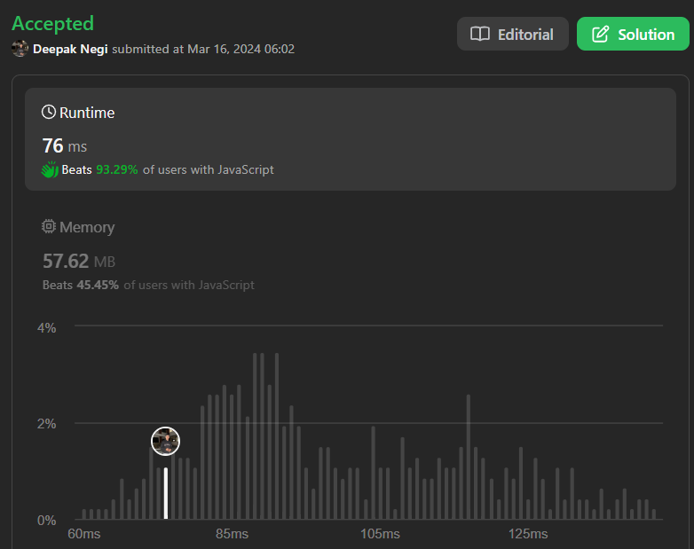

# Easy Explanation | | HashMap | | Beats 93.29% | | C++ | | Java | | Python3 | | Kotlin | | ✅✅✅🔥🔥🔥

**Author:** Hunter_0718
**Votes:** 122
**Link:** [https://leetcode.com/problems/contiguous-array/solutions/4881359/](https://leetcode.com/problems/contiguous-array/solutions/4881359/)

---



### Intuition
To find the maximum length of a contiguous subarray with an equal number of 0s and 1s, we can use the concept of prefix sum. Whenever we encounter a 0, we decrement the sum by 1, and whenever we encounter a 1, we increment the sum by 1. If the prefix sum at two indices is the same, it means that the number of 0s and 1s between those two indices is the same. We store these prefix sums along with their indices in a hash map. Then, for each prefix sum encountered, we check if we have seen this sum before. If so, it means that the subarray between the current index and the index where this sum was last encountered has an equal number of 0s and 1s. We calculate the length of this subarray and update the maximum length accordingly.

### Approach
1. Initialize a hash map to store prefix sums along with their indices.
2. Initialize variables for sum, maximum subarray length, and iterate through the input array.
3. For each element in the array, update the sum according to the element (decrement by 1 for 0, increment by 1 for 1).
4. If the sum becomes zero at any index, update the maximum length to the current index plus one.
5. If the sum is encountered again (which means there is a subarray with equal 0s and 1s between the previous occurrence and the current index), update the maximum length if the current subarray length is greater than the previously stored maximum length.
6. Return the maximum subarray length.

### Complexity Analysis
- Time complexity: \\(O(n)\\), where \\(n\\) is the length of the input array. We traverse the array only once.
- Space complexity: \\(O(n)\\), in the worst case, when all elements are distinct and the sum becomes distinct for each index, we would need to store all prefix sums in the hash map.

### Code
```C++ []
class Solution {
public:
    int findMaxLength(vector<int>& nums) {
        int n = nums.size();
        unordered_map<int, int> mp;
        int sum = 0;
        int subArray_length = 0;
        for (int i = 0; i < n; i++) {
            sum += nums[i] == 0 ? -1 : 1; 
            if (sum == 0) {
                subArray_length = i + 1;
            } else if (mp.find(sum) != mp.end()) {
                subArray_length = max(subArray_length, i - mp[sum]);
            } else {
                mp[sum] = i;
            }
        }
        return subArray_length;
    }
};

```
```Java []
class Solution {
    public int findMaxLength(int[] nums) {
        int n = nums.length;
        Map<Integer, Integer> mp = new HashMap<>();
        int sum = 0;
        int subArrayLength = 0;
        for (int i = 0; i < n; i++) {
            sum += nums[i] == 0 ? -1 : 1;
            if (sum == 0) {
                subArrayLength = i + 1;
            } else if (mp.containsKey(sum)) {
                subArrayLength = Math.max(subArrayLength, i - mp.get(sum));
            } else {
                mp.put(sum, i);
            }
        }
        return subArrayLength;
    }
}

```
```Python3 []
class Solution:
    def findMaxLength(self, nums: List[int]) -> int:
        mp = {}
        sum_val = 0
        max_len = 0
        for i, num in enumerate(nums):
            sum_val += 1 if num == 1 else -1
            if sum_val == 0:
                max_len = i + 1
            elif sum_val in mp:
                max_len = max(max_len, i - mp[sum_val])
            else:
                mp[sum_val] = i
        return max_len

```
```Kotlin []
class Solution {
    fun findMaxLength(nums: IntArray): Int {
        val mp = HashMap<Int, Int>()
        var sum = 0
        var subArrayLength = 0
        for (i in nums.indices) {
            sum += if (nums[i] == 0) -1 else 1
            if (sum == 0) {
                subArrayLength = i + 1
            } else if (mp.containsKey(sum)) {
                subArrayLength = maxOf(subArrayLength, i - mp[sum]!!)
            } else {
                mp[sum] = i
            }
        }
        return subArrayLength
    }
}

```
```JavaScript []
var findMaxLength = function(nums) {
    let mp = new Map();
    let sum = 0;
    let subArrayLength = 0;
    for (let i = 0; i < nums.length; i++) {
        sum += nums[i] === 0 ? -1 : 1;
        if (sum === 0) {
            subArrayLength = i + 1;
        } else if (mp.has(sum)) {
            subArrayLength = Math.max(subArrayLength, i - mp.get(sum));
        } else {
            mp.set(sum, i);
        }
    }
    return subArrayLength;
};

```


### Dry Run on Test Case
Let's dry run the provided test case `[0,0,1,0,0,0,1,1]`:

Sure, let's do a step-by-step dry run of the provided code with the input `[0,0,1,0,0,0,1,1]`.

 **Here's a dry run of the code with the test case [0,0,1,0,0,0,1,1]:**

**Iteration | Index (i) | nums[i] | sum | mp | subArray_length**
------- | -------- | -------- | -------- | -------- | ----------
1 | 0 | 0 | -1 | {} | 0
2 | 1 | 0 | -2 | {-2: 1} | 0
3 | 2 | 1 | -1 | {-2: 1} | 0
4 | 3 | 0 | -2 | {-2: 1, -1: 3} | 2 (updated due to sum = -2 found earlier)
5 | 4 | 0 | -3 | {-2: 1, -1: 3} | 2
6 | 5 | 0 | -4 | {-2: 1, -1: 3} | 2
7 | 6 | 1 | -3 | {-2: 1, -1: 3, -3: 6} | 2
8 | 7 | 1 | -2 | {-2: 1, -1: 3, -3: 6} | 6 (updated due to sum = -2 found earlier)

**The output for this test case would be 6, as the longest subarray with equal numbers of 0s and 1s is [0,0,1,0,0,0,1] with a length of 6.**

**Explanation of the code's logic:**

1. **Initialize variables:**
   - `n`: Stores the size of the input vector `nums`.
   - `mp`: An unordered_map to store the first occurrence of each cumulative sum.
   - `sum`: Keeps track of the cumulative sum of 0s and 1s (-1 for 0, +1 for 1).
   - `subArray_length`: Stores the maximum length of the subarray with equal numbers of 0s and 1s found so far.

2. **Iterate through the vector `nums`:**
   - For each element `nums[i]`:
     - Update `sum`: Add -1 for a 0 and +1 for a 1.
     - If `sum` is 0:
       - It means we have an equal number of 0s and 1s up to this point.
       - Update `subArray_length` if the current subarray is longer.
     - If `sum` already exists in `mp`:
       - It means we've found a subarray with the same cumulative sum.
       - Calculate the length of this subarray and update `subArray_length` if it's longer.
     - Otherwise, store the first occurrence of `sum` in `mp`.

3. **Return `subArray_length`:**
   - The final value of `subArray_length` holds the length of the longest subarray with an equal number of 0s and 1s.
