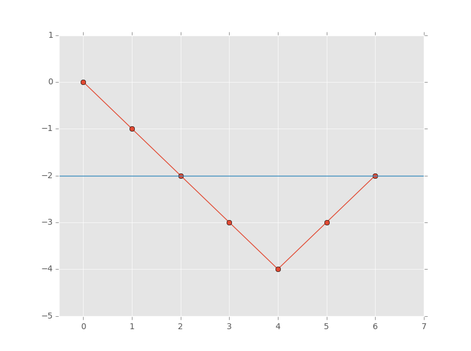
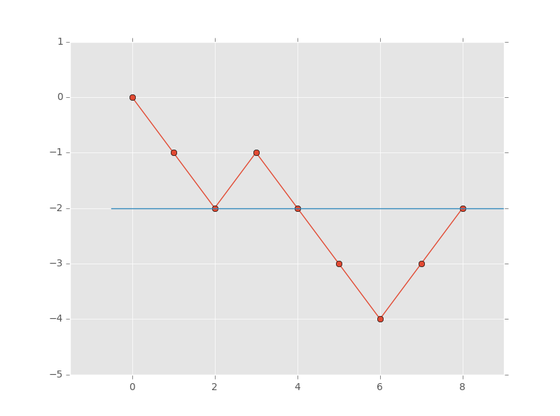
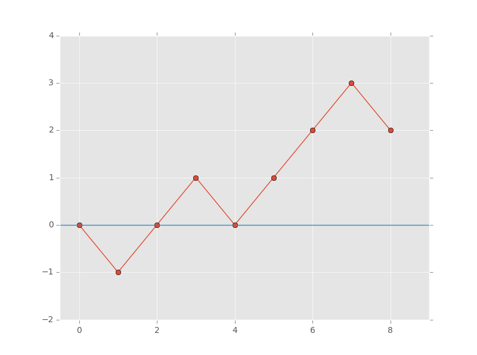

# Beats 100% 🚀||Full Explained With Graph💯||[Java/C++/JavaScript/Python/Rust/Go]

**Author:** Shivansu_7
**Votes:** 33
**Link:** [https://leetcode.com/problems/contiguous-array/solutions/4882496/](https://leetcode.com/problems/contiguous-array/solutions/4882496/)

---

# Explanation
1. Start with a variable `count` initialized to `0` and traverse through the `nums` array.
2. Whenever encountering a `0`, decrement count by `1`, and increment it by `1` for each `1` encountered.
3. When count equals `0`, it signifies the presence of a contiguous subarray with an equal number of `0s` and `1s`.
4. Consider an example sequence like `[0, 0, 0, 0, 1, 1]`.
5. In this sequence, the maximum length of a subarray with an equal number of `0s` and `1s` is `4`.
6. If we track the changes in count, we observe that it starts from `0` and decreases to `-4`, but doesn't return to `0` immediately.
7. However, upon closer examination, we notice that the longest subarray starts and ends when count equals `-2`.
8. We can visualize these changes in count on a graph, with the initial point `(0,0)` indicating the starting value of count.
9. This graph helps us identify the longest subarray, which in this case, spans from index `2` to `6` in the sequence.

***From the explanation provided, it's clear that when two points on the graph share the same y-axis value, it signifies that the sequence between these points contains an equal number of 0s and 1s.***

#### Consider another example sequence: [0, 0, 1, 0, 0, 0, 1, 1]. Graph of this is depected below.

1. In the sequence `[0, 0, 1, 0, 0, 0, 1, 1]`, there are 3 points on the graph where the y-axis value is `-2`.
2. This indicates that the subarray from index `2` to `4` has an equal number of `0s` and `1s`, as well as the subarray from index `4` to `8`.
3. By combining these two subarrays, we can form the longest subarray from index `2` to `8`.
4. Therefore, the maximum length of the subarray is calculated as `8- 2 = 6`.


#### Consider one more example sequence: `[0, 1, 1, 0, 1, 1, 1, 0]`. In this sequence, the longest subarray has a y-axis value of 0 on the graph.


Now it's clear how to approach this problem, let's move towards the code.
# Approach
1. **Initialization:**
    - Initialize a hashmap map to store the cumulative count of 0s and 1s encountered along with their respective indices.
    - Initialize two variables: count to track the cumulative count of 0s and 1s encountered, and ans to store the length of the longest contiguous subarray with an equal number of 0s and 1s.
    - Put an initial entry into the map with key 0 and value -1. This indicates that when no elements are encountered, the count of 0s and 1s is 0.
2. **Traversing the Array nums:**
    - For each element `nums[i]`, if it's equal to `1`, increment the `count` by `1`; otherwise, decrement `count` by `1`.
3. **Updating Answer:**
    - Check if the map contains the current value of `count`.
        - If it does, update ans by taking the maximum of the current value of ans and the difference between the current index i and the index stored in the map for the current count.
        - If the map doesn't contain the current value of count, insert a new entry into the map with the current count as the key and the current index i as the value.
4. **Return Answer:**
    - After traversing the entire array, return the value stored in `ans`, representing the length of the longest contiguous subarray with an equal number of `0s` and `1s`.
<!-- Describe your approach to solving the problem. -->

# Complexity
- Time complexity: $$O(n)$$
<!-- Add your time complexity here, e.g. $$O(n)$$ -->

- Space complexity: $$O(n)$$
<!-- Add your space complexity here, e.g. $$O(n)$$ -->

# Code
```Java []
class Solution {
    public int findMaxLength(int[] nums) {
        HashMap<Integer, Integer> map = new HashMap<>();
        int count = 0;
        int ans = 0;
        map.put(0, -1);

        for(int i=0; i<nums.length; i++) {
            if(nums[i]==1) {
                count++;
            }
            else{
                count--;
            }

            if(map.containsKey(count)) {
                ans = Math.max(ans, i-map.get(count));
            }
            else {
                map.put(count, i);
            }
        }
        return ans;
    }
}
```
```C++ []
class Solution {
public:
    int findMaxLength(vector<int>& nums) {
        unordered_map<int, int> map;
        int count = 0;
        int ans = 0;
        map[0] = -1;

        for(int i = 0; i < nums.size(); i++) {
            if(nums[i] == 1) {
                count++;
            } else {
                count--;
            }

            if(map.find(count) != map.end()) {
                ans = std::max(ans, i - map[count]);
            } else {
                map[count] = i;
            }
        }
        return ans;
    }
};
```
```Python3 []
class Solution:
    def findMaxLength(self, nums: List[int]) -> int:
        hashmap = {0: -1}
        count = 0
        ans = 0
        
        for i, num in enumerate(nums):
            count += 1 if num == 1 else -1
            
            if count in hashmap:
                ans = max(ans, i - hashmap[count])
            else:
                hashmap[count] = i
        
        return ans
```
```Rust []
impl Solution {
    pub fn find_max_length(nums: Vec<i32>) -> i32 {
        let mut map: HashMap<i32, i32> = HashMap::new();
        let mut count = 0;
        let mut ans = 0;
        map.insert(0, -1);

        for (i, &num) in nums.iter().enumerate() {
            count += if num == 1 { 1 } else { -1 };

            if let Some(&prev_index) = map.get(&count) {
                ans = ans.max(i as i32 - prev_index);
            } else {
                map.insert(count, i as i32);
            }
        }

        ans
    }
}
```
```Go []
func findMaxLength(nums []int) int {
    hashmap := make(map[int]int)
    hashmap[0] = -1
    count := 0
    ans := 0

    for i, num := range nums {
        if num == 1 {
            count++
        } else {
            count--
        }

        if index, ok := hashmap[count]; ok {
            ans = max(ans, i-index)
        } else {
            hashmap[count] = i
        }
    }

    return ans
}

func max(a, b int) int {
    if a > b {
        return a
    }
    return b
}
```
```C# []
public class Solution {
    public int FindMaxLength(int[] nums) {
        Dictionary<int, int> map = new Dictionary<int, int>();
        int count = 0;
        int ans = 0;
        map[0] = -1;

        for (int i = 0; i < nums.Length; i++) {
            if (nums[i] == 1) {
                count++;
            } else {
                count--;
            }

            if (map.ContainsKey(count)) {
                ans = Math.Max(ans, i - map[count]);
            } else {
                map[count] = i;
            }
        }
        return ans;
    }
}
```
```Ruby []
# Assuming `nums` is an array of integers
def find_max_length(nums)
    hashmap = {0 => -1}
    count = 0
    ans = 0
    
    nums.each_with_index do |num, i|
        count += num == 1 ? 1 : -1
        
        if hashmap.key?(count)
            ans = [ans, i - hashmap[count]].max
        else
            hashmap[count] = i
        end
    end
    
    ans
end
```
```Swift []
class Solution {
    func findMaxLength(_ nums: [Int]) -> Int {
        var hashmap = [Int: Int]()
        hashmap[0] = -1
        var count = 0
        var ans = 0
        
        for (i, num) in nums.enumerated() {
            count += num == 1 ? 1 : -1
            
            if let prevIndex = hashmap[count] {
                ans = max(ans, i - prevIndex)
            } else {
                hashmap[count] = i
            }
        }
        
        return ans
    }
}
```
```JavaScript []
/**
 * @param {number[]} nums
 * @return {number}
 */
var findMaxLength = function(nums) {
    let hashmap = new Map();
    let count = 0;
    let ans = 0;
    hashmap.set(0, -1);

    for (let i = 0; i < nums.length; i++) {
        if (nums[i] === 1) {
            count++;
        } else {
            count--;
        }

        if (hashmap.has(count)) {
            ans = Math.max(ans, i - hashmap.get(count));
        } else {
            hashmap.set(count, i);
        }
    }
    return ans;
};
```

---


---


