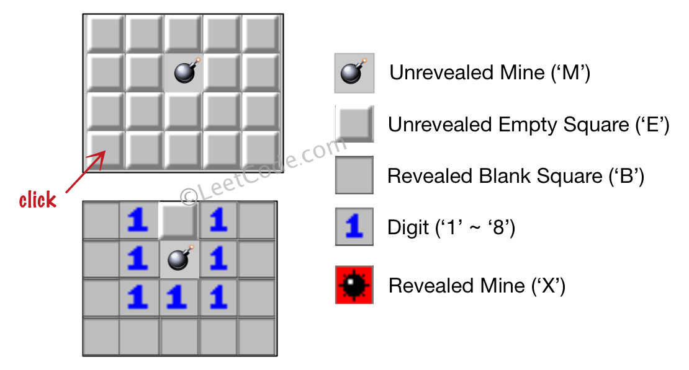
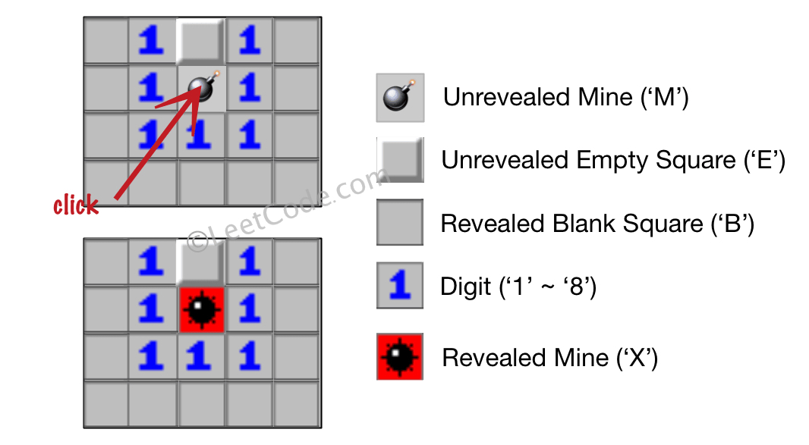

# [529. Minesweeper](https://leetcode.com/problems/minesweeper/)

| Category | Difficulty | Likes | Dislikes |
| :------: | :--------: | :---: | :------: |
| Algorithms | Medium | 2070 | 1088 |

**Tags:** [`array`](https://leetcode.com/tag/array), [`depth-first-search`](https://leetcode.com/tag/depth-first-search), [`breadth-first-search`](https://leetcode.com/tag/breadth-first-search), [`matrix`](https://leetcode.com/tag/matrix)

**Companies:** `facebook`, `robinhood`, `google`, `amazon`

## Description

Let's play the minesweeper game (Wikipedia, online game)!

You are given an `m x n` char matrix `board` representing the game board where:

	- `'M'` represents an unrevealed mine,

	- `'E'` represents an unrevealed empty square,

	- `'B'` represents a revealed blank square that has no adjacent mines (i.e., above, below, left, right, and all 4 diagonals),

	- digit (`'1'` to `'8'`) represents how many mines are adjacent to this revealed square, and

	- `'X'` represents a revealed mine.

You are also given an integer array `click` where `click = [click_r, click_c]` represents the next click position among all the unrevealed squares (`'M'` or `'E'`).

Return *the board after revealing this position according to the following rules*:

	- If a mine `'M'` is revealed, then the game is over. You should change it to `'X'`.

	- If an empty square `'E'` with no adjacent mines is revealed, then change it to a revealed blank `'B'` and all of its adjacent unrevealed squares should be revealed recursively.

	- If an empty square `'E'` with at least one adjacent mine is revealed, then change it to a digit (`'1'` to `'8'`) representing the number of adjacent mines.

	- Return the board when no more squares will be revealed.

 

**Example 1:**


```

Input: board = [[&quot;E&quot;,&quot;E&quot;,&quot;E&quot;,&quot;E&quot;,&quot;E&quot;],[&quot;E&quot;,&quot;E&quot;,&quot;M&quot;,&quot;E&quot;,&quot;E&quot;],[&quot;E&quot;,&quot;E&quot;,&quot;E&quot;,&quot;E&quot;,&quot;E&quot;],[&quot;E&quot;,&quot;E&quot;,&quot;E&quot;,&quot;E&quot;,&quot;E&quot;]], click = [3,0]
Output: [[&quot;B&quot;,&quot;1&quot;,&quot;E&quot;,&quot;1&quot;,&quot;B&quot;],[&quot;B&quot;,&quot;1&quot;,&quot;M&quot;,&quot;1&quot;,&quot;B&quot;],[&quot;B&quot;,&quot;1&quot;,&quot;1&quot;,&quot;1&quot;,&quot;B&quot;],[&quot;B&quot;,&quot;B&quot;,&quot;B&quot;,&quot;B&quot;,&quot;B&quot;]]

```

**Example 2:**


```

Input: board = [[&quot;B&quot;,&quot;1&quot;,&quot;E&quot;,&quot;1&quot;,&quot;B&quot;],[&quot;B&quot;,&quot;1&quot;,&quot;M&quot;,&quot;1&quot;,&quot;B&quot;],[&quot;B&quot;,&quot;1&quot;,&quot;1&quot;,&quot;1&quot;,&quot;B&quot;],[&quot;B&quot;,&quot;B&quot;,&quot;B&quot;,&quot;B&quot;,&quot;B&quot;]], click = [1,2]
Output: [[&quot;B&quot;,&quot;1&quot;,&quot;E&quot;,&quot;1&quot;,&quot;B&quot;],[&quot;B&quot;,&quot;1&quot;,&quot;X&quot;,&quot;1&quot;,&quot;B&quot;],[&quot;B&quot;,&quot;1&quot;,&quot;1&quot;,&quot;1&quot;,&quot;B&quot;],[&quot;B&quot;,&quot;B&quot;,&quot;B&quot;,&quot;B&quot;,&quot;B&quot;]]

```

 

**Constraints:**

	- `m == board.length`

	- `n == board[i].length`

	- `1 <= m, n <= 50`

	- `board[i][j]` is either `'M'`, `'E'`, `'B'`, or a digit from `'1'` to `'8'`.

	- `click.length == 2`

	- `0 <= click_r < m`

	- `0 <= click_c < n`

	- `board[click_r][click_c]` is either `'M'` or `'E'`.

---

**Links:** [Submissions](https://leetcode.com/problems/minesweeper/) | [Solutions](https://leetcode.com/problems/minesweeper/)
