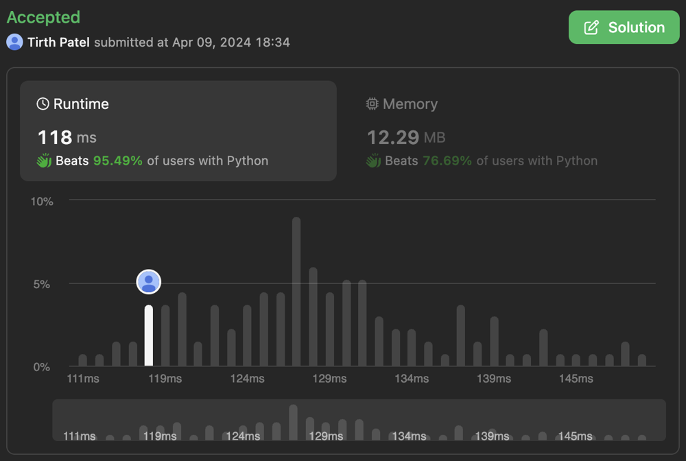

# Minesweeper: Clean Implementation with Explanations | BFS Approach

**Author:** TIRTH325
**Votes:** 17
**Link:** [https://leetcode.com/problems/minesweeper/solutions/4998731/](https://leetcode.com/problems/minesweeper/solutions/4998731/)

---

# Intuition
The core idea behind your solution lies in simulating the way a real Minesweeper game is played. Here's the thought process:

* **Click Handling:** You start by checking the clicked cell. If it's a mine, game over! If not, you need to figure out if it should be revealed as a number or as a blank space.
* **Revealing Blank Spaces:** If the clicked cell has no adjacent mines, you trigger a recursive process similar to flood fill. It reveals all connected empty cells and keeps expanding until it hits the boundaries or cells with adjacent mines.
* **Revealing Numbers:** If a cell has adjacent mines, you simply display the count of those mines on the board.
<!-- Describe your first thoughts on how to solve this problem. -->

# Approach
Solution implements this intuition using the following steps:

1. **Base Case - Mine:** If the clicked cell is a mine ('M'), mark it as 'X' and end.

2. **Calculate Adjacent Mines:** Count the number of mines in neighboring cells.

3. **Reveal Number:**  If there are adjacent mines, display the count on the current cell.

4. **Recursive Expansion:** If the current cell has no adjacent mines:
   * Mark it as 'B' (blank).
   * Use a queue (`deque`) to explore its neighbors in all directions (similar to Breadth-First Search).
   * Recursively process valid neighbors that haven't been visited.
<!-- Describe your approach to solving the problem. -->

# Complexity
- Time complexity: In the worst case, you might need to visit all the cells on the board. Therefore the time complexity is **O(mn)**, where 'm' and 'n' are dimensions of the board.
<!-- Add your time complexity here, e.g. $$O(n)$$ -->

- Space complexity:  The queue and the `visited` set are used to track explored cells.  In the worst case, they can store all the cells of the board, leading to **O(mn)** space complexity.
<!-- Add your space complexity here, e.g. $$O(n)$$ -->

# Code
```
class Solution(object):
    def updateBoard(self, board, click):
        """
        :type board: List[List[str]]
        :type click: List[int]
        :rtype: List[List[str]]
        """
        if board[click[0]][click[1]] == 'M':
            board[click[0]][click[1]] = 'X'
            return board
        m = len(board)
        n = len(board[0])
        q = deque()
        q.append(click)
        visited = set()
        visited.add(tuple(click))
        while q:
            # print(q)
            for _ in range(len(q)):
                curr = q.popleft()
                x, y = curr[0], curr[1]
                
                
                count_mine = 0
                for a,b in [(0,1),(1,0),(0,-1),(-1,0),(-1,-1),(-1,1),(1,1),(1,-1)]:
                    nx, ny = x+a, y+b

                    if 0 <= nx < m and 0 <= ny < n:
                        if board[nx][ny] == 'M':
                            count_mine += 1
                if count_mine > 0:
                    board[x][y] = str(count_mine)
                else:
                    board[x][y] = 'B'
                    for a, b in [(0,1),(1,0),(0,-1),(-1,0),(-1,-1),(-1,1),(1,1),(1,-1)]:
                        nx, ny = x+a, y+b

                        if 0 <= nx < m and 0 <= ny < n and (nx,ny) not in visited:
                            q.append([nx,ny])
                            visited.add((nx,ny))
        return board
```

**Let me know if you would like me to elaborate on any specific part of the explanation!** 

# Results

.
.
.
.
.

