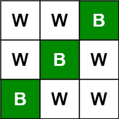
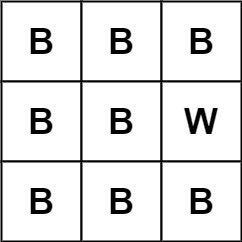

# [531. Lonely Pixel I](https://leetcode.com/problems/lonely-pixel-i/)

| Category | Difficulty | Likes | Dislikes |
| :------: | :--------: | :---: | :------: |
| Algorithms | Medium | 451 | 41 |

**Tags:** [`array`](https://leetcode.com/tag/array), [`hash-table`](https://leetcode.com/tag/hash-table), [`matrix`](https://leetcode.com/tag/matrix)

**Companies:** `google`

## Description

Given an `m x n` `picture` consisting of black `'B'` and white `'W'` pixels, return *the number of black lonely pixels*.

A black lonely pixel is a character `'B'` that located at a specific position where the same row and same column don't have **any other** black pixels.

 

**Example 1:**


```

Input: picture = [[&quot;W&quot;,&quot;W&quot;,&quot;B&quot;],[&quot;W&quot;,&quot;B&quot;,&quot;W&quot;],[&quot;B&quot;,&quot;W&quot;,&quot;W&quot;]]
Output: 3
Explanation: All the three &#39;B&#39;s are black lonely pixels.

```

**Example 2:**


```

Input: picture = [[&quot;B&quot;,&quot;B&quot;,&quot;B&quot;],[&quot;B&quot;,&quot;B&quot;,&quot;W&quot;],[&quot;B&quot;,&quot;B&quot;,&quot;B&quot;]]
Output: 0

```

 

**Constraints:**

	- `m == picture.length`

	- `n == picture[i].length`

	- `1 <= m, n <= 500`

	- `picture[i][j]` is `'W'` or `'B'`.

---

**Links:** [Submissions](https://leetcode.com/problems/lonely-pixel-i/) | [Solutions](https://leetcode.com/problems/lonely-pixel-i/)
