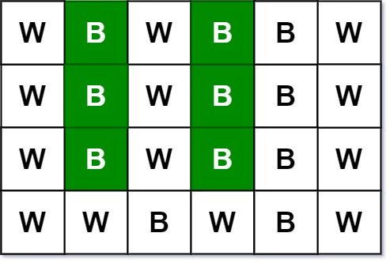
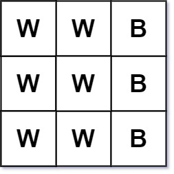

# [533. Lonely Pixel II](https://leetcode.com/problems/lonely-pixel-ii/)

| Category | Difficulty | Likes | Dislikes |
| :------: | :--------: | :---: | :------: |
| Algorithms | Medium | 91 | 787 |

**Tags:** [`array`](https://leetcode.com/tag/array), [`hash-table`](https://leetcode.com/tag/hash-table), [`matrix`](https://leetcode.com/tag/matrix)

**Companies:** `google`

## Description

Given an `m x n` `picture` consisting of black `'B'` and white `'W'` pixels and an integer target, return *the number of black lonely pixels*.

A black lonely pixel is a character `'B'` that located at a specific position `(r, c)` where:

	- Row `r` and column `c` both contain exactly `target` black pixels.

	- For all rows that have a black pixel at column `c`, they should be exactly the same as row `r`.

 

**Example 1:**


```

Input: picture = [[&quot;W&quot;,&quot;B&quot;,&quot;W&quot;,&quot;B&quot;,&quot;B&quot;,&quot;W&quot;],[&quot;W&quot;,&quot;B&quot;,&quot;W&quot;,&quot;B&quot;,&quot;B&quot;,&quot;W&quot;],[&quot;W&quot;,&quot;B&quot;,&quot;W&quot;,&quot;B&quot;,&quot;B&quot;,&quot;W&quot;],[&quot;W&quot;,&quot;W&quot;,&quot;B&quot;,&quot;W&quot;,&quot;B&quot;,&quot;W&quot;]], target = 3
Output: 6
Explanation: All the green &#39;B&#39; are the black pixels we need (all &#39;B&#39;s at column 1 and 3).
Take &#39;B&#39; at row r = 0 and column c = 1 as an example:
 - Rule 1, row r = 0 and column c = 1 both have exactly target = 3 black pixels. 
 - Rule 2, the rows have black pixel at column c = 1 are row 0, row 1 and row 2. They are exactly the same as row r = 0.

```

**Example 2:**


```

Input: picture = [[&quot;W&quot;,&quot;W&quot;,&quot;B&quot;],[&quot;W&quot;,&quot;W&quot;,&quot;B&quot;],[&quot;W&quot;,&quot;W&quot;,&quot;B&quot;]], target = 1
Output: 0

```

 

**Constraints:**

	- `m == picture.length`

	- `n == picture[i].length`

	- `1 <= m, n <= 200`

	- `picture[i][j]` is `'W'` or `'B'`.

	- `1 <= target <= min(m, n)`

---

**Links:** [Submissions](https://leetcode.com/problems/lonely-pixel-ii/) | [Solutions](https://leetcode.com/problems/lonely-pixel-ii/)
