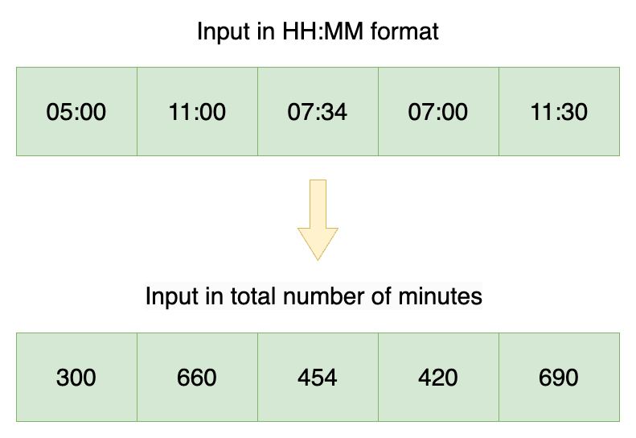

# ✅1440 Mins in 1 Day  -Explained with [ Video ] -C++/Java/Python/JS - Count Total Minutes- Explained

**Author:** lancertech6
**Votes:** 197
**Link:** [https://leetcode.com/problems/minimum-time-difference/solutions/5792274/](https://leetcode.com/problems/minimum-time-difference/solutions/5792274/)

---




# YouTube Video Explanation:

### To watch the video please click on "Watch On Youtube" option  available the left bottom corner of the thumbnail.

<!-- **If you want a video for this question please write in the comments** -->


https://youtu.be/5ojhfhrKzV0


**\uD83D\uDD25 Please like, share, and subscribe to support our channel's mission of making complex concepts easy to understand.**

Subscribe Link: https://www.youtube.com/@leetlogics/?sub_confirmation=1

*Subscribe Goal: 2900 Subscribers*
*Current Subscribers: 2841*

Follow me on Instagram : https://www.instagram.com/divyansh.nishad/

---

# Intuition
<!-- Describe your first thoughts on how to solve this problem. -->
The problem is to find the minimum difference between any two time points in a list of times given in "HH:MM" format. To solve this problem, you need to consider that the times wrap around from "23:59" to "00:00" (effectively forming a circular timeline).

# Approach
<!-- Describe your approach to solving the problem. -->
1. **Convert Time to Minutes:**
   Convert each time point from "HH:MM" format to the number of minutes since midnight. This simplifies the comparison of time differences to just integer subtraction.

2. **Sort the Time Points:**
   After converting times to minutes, sort these minutes. The reason for sorting is that the minimum difference between any two times in a circular timeline will be between adjacent elements in the sorted list.

3. **Calculate Differences:**
   Compute the difference between each pair of adjacent elements in the sorted list. This step finds the minimum difference between consecutive times.

4. **Consider Circular Nature:**
   Since the times are on a 24-hour circular clock, you must also consider the difference between the last time and the first time (after wrapping around midnight).

5. **Return Minimum Difference:**
   The result is the smallest difference found among adjacent pairs and the circular wrap-around difference.

# Step By Step Explanation


### Example: Time Points

Let's use the time points `["23:59", "00:00", "12:34"]` as an example to explain the solution.


#### 1. **Convert Time to Minutes**

First, convert each time point to the total number of minutes since midnight.

| Time Point | Hours (H) | Minutes (M) | Total Minutes (H * 60 + M) |
|------------|-----------|-------------|----------------------------|
| 23:59      | 23        | 59          | 23 * 60 + 59 = 1439        |
| 00:00      | 0         | 0           | 0 * 60 + 0 = 0             |
| 12:34      | 12        | 34          | 12 * 60 + 34 = 754         |

So, the minutes array will be `[1439, 0, 754]`.

#### 2. **Sort the Minutes**

Sort the minutes array in ascending order:

| Sorted Minutes |
|----------------|
| 0              |
| 754            |
| 1439           |

#### 3. **Calculate Differences Between Adjacent Elements**

Compute the difference between each pair of adjacent times in the sorted list:

| Pair         | Difference (Next - Current) |
|--------------|------------------------------|
| (0, 754)     | 754 - 0 = 754                |
| (754, 1439)  | 1439 - 754 = 685             |

#### 4. **Consider the Circular Difference**

Calculate the circular difference between the last and first element:

| Circular Difference Calculation  |
|----------------------------------|
| 24 * 60 - Last + First            |
| 1440 - 1439 + 0 = 1               |

Here\u2019s how this is calculated:
- Total minutes in a day = 1440
- Circular difference = 1440 - 1439 + 0 = 1

#### 5. **Find the Minimum Difference**

The minimum difference is the smallest value among the differences calculated:

| Differences           |
|-----------------------|
| 754 (between 0 and 754)    |
| 685 (between 754 and 1439) |
| 1 (circular difference)    |

So, the minimum difference is `1`.


# Complexity
1. **Time Complexity:**
   - **Conversion to Minutes:** O(n) where n is the number of time points. Each time point is processed once to convert it to minutes.
   - **Sorting:** O(n log n). Sorting the list of time points in minutes.
   - **Finding Minimum Difference:** O(n). After sorting, you need to find the minimum difference by checking adjacent elements in the sorted list and the circular wrap-around difference.
   
   Overall, the time complexity is dominated by the sorting step, which is O(n log n).

2. **Space Complexity:**
   - **Storage for Minutes:** O(n). Storing the converted minutes in an array.
   - **Other Variables:** Constant space for variables used in computation.

   Overall, the space complexity is O(n) due to the array used to store the minutes.


# Code
```java []
class Solution {

    public int findMinDifference(List<String> timePoints) {
        // convert input to minutes
        int[] minutes = new int[timePoints.size()];
        for (int i = 0; i < timePoints.size(); i++) {
            String time = timePoints.get(i);
            int h = Integer.parseInt(time.substring(0, 2));
            int m = Integer.parseInt(time.substring(3));
            minutes[i] = h * 60 + m;
        }

        // sort times in ascending order
        Arrays.sort(minutes);

        // find minimum difference across adjacent elements
        int ans = Integer.MAX_VALUE;
        for (int i = 0; i < minutes.length - 1; i++) {
            ans = Math.min(ans, minutes[i + 1] - minutes[i]);
        }

        // consider difference between last and first element
        return Math.min(
            ans,
            24 * 60 - minutes[minutes.length - 1] + minutes[0]
        );
    }
}
```
```C++ []
class Solution {
public:
    int findMinDifference(vector<string>& timePoints) {
        vector<int> minutes(timePoints.size());
        
        // Convert times to minutes
        for (int i = 0; i < timePoints.size(); ++i) {
            int h = stoi(timePoints[i].substr(0, 2));
            int m = stoi(timePoints[i].substr(3));
            minutes[i] = h * 60 + m;
        }

        // Sort times in ascending order
        sort(minutes.begin(), minutes.end());

        // Find minimum difference across adjacent elements
        int minDiff = INT_MAX;
        for (int i = 0; i < minutes.size() - 1; ++i) {
            minDiff = min(minDiff, minutes[i + 1] - minutes[i]);
        }

        // Consider the circular difference between last and first element
        minDiff = min(minDiff, 24 * 60 - minutes.back() + minutes.front());

        return minDiff;
    }
};
```
```Python []
class Solution(object):
    def findMinDifference(self, timePoints):
        # Convert times to minutes
        minutes = []
        for time in timePoints:
            h, m = map(int, time.split(':'))
            minutes.append(h * 60 + m)
        
        # Sort times in ascending order
        minutes.sort()
        
        # Find minimum difference across adjacent elements
        min_diff = float('inf')
        for i in range(len(minutes) - 1):
            min_diff = min(min_diff, minutes[i + 1] - minutes[i])
        
        # Consider the circular difference between last and first element
        min_diff = min(min_diff, 24 * 60 - minutes[-1] + minutes[0])
        
        return min_diff
        
```
``` JavaScript []
/**
 * @param {string[]} timePoints
 * @return {number}
 */
var findMinDifference = function(timePoints) {
    // Convert times to minutes
    let minutes = timePoints.map(time => {
        let [h, m] = time.split(':').map(Number);
        return h * 60 + m;
    });

    // Sort times in ascending order
    minutes.sort((a, b) => a - b);

    // Find minimum difference across adjacent elements
    let minDiff = Infinity;
    for (let i = 0; i < minutes.length - 1; i++) {
        minDiff = Math.min(minDiff, minutes[i + 1] - minutes[i]);
    }

    // Consider the circular difference between last and first element
    minDiff = Math.min(minDiff, 24 * 60 - minutes[minutes.length - 1] + minutes[0]);

    return minDiff;
};
```


