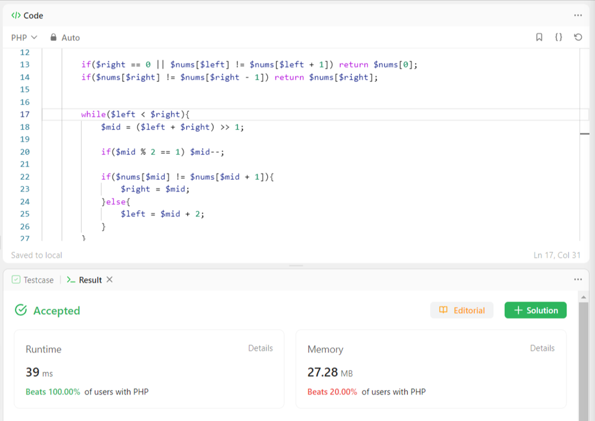

# PHP Solution - Beats 100%

**Author:** muneebshoukat60
**Votes:** 0
**Link:** [https://leetcode.com/problems/single-element-in-a-sorted-array/solutions/4168796/](https://leetcode.com/problems/single-element-in-a-sorted-array/solutions/4168796/)

---

# Intuition
This problem requires to find a element which appears exactly once in a sorted array `nums`.

# Approach
We can solve this problem efficiently with the binary search.

# Complexity
- Time complexity: **O(logN)**

Binary search reduces the search range by half in each step, leading to logarithmic time complexity.

- Space complexity **O(N)**:

The algorithm uses a constant amount of extra space for the pointers and variables, resulting in constant space complexity.

# Code
```
class Solution {
    
    /**
     * @param Integer[] $nums
     * @return Integer
     */
    function singleNonDuplicate($nums) {
        $left = 0;
        $right = count($nums) - 1;

        if($right == 0 || $nums[$left] != $nums[$left + 1]) return $nums[0];
        if($nums[$right] != $nums[$right - 1]) return $nums[$right];

        while($left < $right){
            $mid = ($left + $right) >> 1;

            if($mid % 2 == 1) $mid--;

            if($nums[$mid] != $nums[$mid + 1]){
                $right = $mid;
            }else{
                $left = $mid + 2;
            }
        }
       
        return $nums[$left];
    }
}
```

# Result - Beats 100%




# Upvote

Please **upvote** if you find helpful.