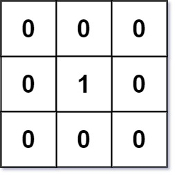
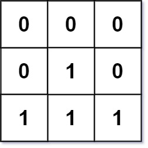

# [542. 01 Matrix](https://leetcode.com/problems/01-matrix/)

| Category | Difficulty | Likes | Dislikes |
| :------: | :--------: | :---: | :------: |
| Algorithms | Medium | 10541 | 444 |

**Tags:** [`array`](https://leetcode.com/tag/array), [`dynamic-programming`](https://leetcode.com/tag/dynamic-programming), [`breadth-first-search`](https://leetcode.com/tag/breadth-first-search), [`matrix`](https://leetcode.com/tag/matrix)

**Companies:** `amazon`, `google`, `microsoft`, `facebook`, `doordash`, `bloomberg`, `linkedin`, `uber`, `tiktok`, `apple`, `adobe`, `flipkart`, `accenture`

## Description

Given an `m x n` binary matrix `mat`, return *the distance of the nearest *`0`* for each cell*.

The distance between two cells sharing a common edge is `1`.

 

**Example 1:**


```

Input: mat = [[0,0,0],[0,1,0],[0,0,0]]
Output: [[0,0,0],[0,1,0],[0,0,0]]

```

**Example 2:**


```

Input: mat = [[0,0,0],[0,1,0],[1,1,1]]
Output: [[0,0,0],[0,1,0],[1,2,1]]

```

 

**Constraints:**

	- `m == mat.length`

	- `n == mat[i].length`

	- `1 https://leetcode.com/problems/map-of-highest-peak/

---

**Links:** [Submissions](https://leetcode.com/problems/01-matrix/) | [Solutions](https://leetcode.com/problems/01-matrix/)
