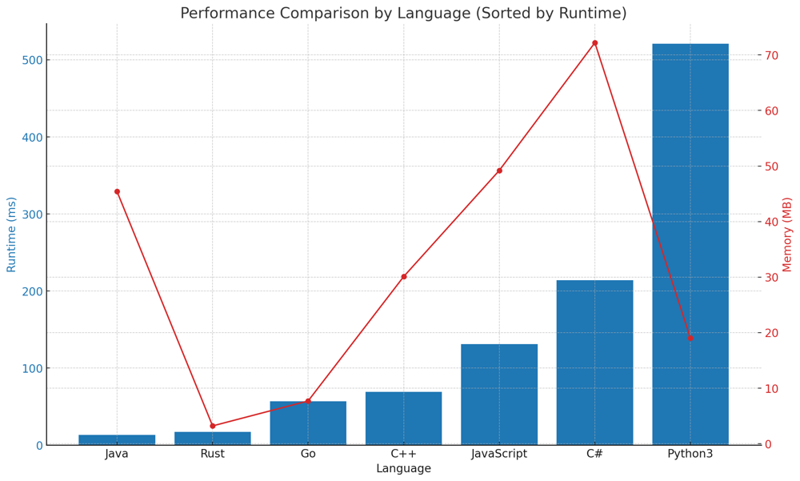

# ✅ 94.87% Multi-source BFS + Queue

**Author:** vanAmsen
**Votes:** 136
**Link:** [https://leetcode.com/problems/01-matrix/solutions/3920110/](https://leetcode.com/problems/01-matrix/solutions/3920110/)

---

# Problem Understanding

In the "01 Matrix Distance" problem, we are given a binary matrix, where each cell contains either a 0 or a 1. The task is to transform this matrix such that each cell contains the shortest distance to a cell with a 0.

For instance, given the matrix:

$$
\	ext{mat} = 
\\begin{bmatrix}
0 & 0 & 0 \\\\
0 & 1 & 0 \\\\
1 & 1 & 1 \\\\
\\end{bmatrix}
$$

The output should be:

$$
\	ext{output} = 
\\begin{bmatrix}
0 & 0 & 0 \\\\
0 & 1 & 0 \\\\
1 & 2 & 1 \\\\
\\end{bmatrix}
$$

---

# Live Coding BFS?
https://youtu.be/HuZ3u2sRIPY

# Approach: Multi-source BFS

To solve the "01 Matrix Distance" problem, we employ a multi-source BFS approach, starting our traversal from all the cells containing 0s and updating the distances of all adjacent cells.

## Key Data Structures:
- **Matrix**: Represents the given binary matrix.
- **Queue**: Used to hold cells for BFS traversal.
  
## Enhanced Breakdown:

1. **Initialization**:
   - Create a queue and initialize it with all cells containing 0s. These will be our BFS starting points. 
   - Set all cells containing 1s to a large value which acts as a placeholder indicating that the cell hasn't been visited yet.

2. **BFS Traversal**:
   - Dequeue a cell and explore its neighboring cells (top, down, left, right).
   - If the distance to the current cell plus one is less than the value in the neighboring cell, update the neighboring cell's distance and enqueue it for further processing.

3. **Wrap-up**:
   - Once all cells have been visited and updated, return the transformed matrix.

---

# Example:

We'll use the example:

$$
\	ext{mat} = 
\\begin{bmatrix}
0 & 0 & 0 \\\\
0 & 1 & 0 \\\\
1 & 1 & 1 \\\\
\\end{bmatrix}
$$

We want to debug the function to visualize how the matrix gets updated at each step.

### Initialization:

First, we determine the size of the matrix:

$$ m = 3 $$ (rows) and $$ n = 3 $$ (columns).

`MAX_VALUE` is set to $$ m \	imes n = 9 $$.

Next, we iterate over the matrix. For every cell that has a `1`, we set it to `MAX_VALUE` (i.e., 9). Every cell with a `0` gets appended to the queue.

At this point, the matrix looks like:

$$
\\begin{bmatrix}
0 & 0 & 0 \\\\
0 & 9 & 0 \\\\
9 & 9 & 9 \\\\
\\end{bmatrix}
$$

And the queue contains: `[(0,0), (0,1), (0,2), (1,0), (1,2)]`.

### BFS Traversal:

We start the BFS traversal by dequeuing the first element in the queue, which is `(0,0)`.

We then check its neighboring cells in the directions `[(1, 0), (-1, 0), (0, 1), (0, -1)]`.

For `(0,0)`, the valid neighbors are `(1,0)` and `(0,1)`.

Since `(1,0)` has a value of `0`, we don't need to update its value or enqueue it. Similarly, `(0,1)` already has a value of `0`, so it's not enqueued or updated either.

The matrix, at this point, looks like:

$$
\\begin{bmatrix}
0 & 0 & 0 \\\\
0 & 9 & 0 \\\\
9 & 9 & 9 \\\\
\\end{bmatrix}
$$

And the queue is: `[(0,1), (0,2), (1,0), (1,2)]`.

The process continues, dequeuing `(0,1)` and checking its neighbors. 

`(1,1)` will be updated to `1` (from `9`) and enqueued.

This BFS process continues until the queue is empty.

### Final State:

After processing all the elements in the queue, the matrix is transformed to:

$$
\\begin{bmatrix}
0 & 0 & 0 \\\\
0 & 1 & 0 \\\\
1 & 2 & 1 \\\\
\\end{bmatrix}
$$

This matrix represents the shortest distance of each cell to the nearest 0.

---

# Complexity:

**Time Complexity:** 
- $$O(m \	imes n)$$ - Since each cell in the matrix is processed once.

**Space Complexity:** 
- $$O(m \	imes n)$$ - In the worst case, all cells might be added to the queue.

---

# Performance:

Here's a performance table sorted by runtime (ms):

| Language   | Runtime (ms) | Runtime Beat (%) | Memory (MB) | Memory Beat (%) |
|------------|--------------|------------------|-------------|-----------------|
| **Java**       | 13           | 82.79%           | 45.4        | 85.31%          |
| **Rust**       | 17           | 94.87%           | 3.2         | 48.72%          |
| **Go**         | 57           | 79.72%           | 7.7         | 50.35%          |
| **C++**        | 69           | 81.1%            | 30.1        | 90.12%          |
| **JavaScript** | 131          | 90.56%           | 49.2        | 94.94%          |
| **C#**         | 214          | 71.30%           | 72.2        | 11.57%          |
| **Python3**    | 521          | 88.62%           | 19          | 84.36%          |


This table provides a quick glance at the performance of different implementations. 




# Code

``` python []
class Solution:
    def updateMatrix(self, mat: List[List[int]]) -> List[List[int]]:
        if not mat or not mat[0]:
            return []

        m, n = len(mat), len(mat[0])
        queue = deque()
        MAX_VALUE = m * n
        
        # Initialize the queue with all 0s and set cells with 1s to MAX_VALUE.
        for i in range(m):
            for j in range(n):
                if mat[i][j] == 0:
                    queue.append((i, j))
                else:
                    mat[i][j] = MAX_VALUE
        
        directions = [(1, 0), (-1, 0), (0, 1), (0, -1)]
        
        while queue:
            row, col = queue.popleft()
            for dr, dc in directions:
                r, c = row + dr, col + dc
                if 0 <= r < m and 0 <= c < n and mat[r][c] > mat[row][col] + 1:
                    queue.append((r, c))
                    mat[r][c] = mat[row][col] + 1
        
        return mat
```
``` C++ []
class Solution {
public:
    vector<vector<int>> updateMatrix(vector<vector<int>>& mat) {
        if (mat.empty() || mat[0].empty())
            return {};

        int m = mat.size(), n = mat[0].size();
        queue<pair<int, int>> queue;
        int MAX_VALUE = m * n;
        
        for (int i = 0; i < m; i++) {
            for (int j = 0; j < n; j++) {
                if (mat[i][j] == 0) {
                    queue.push({i, j});
                } else {
                    mat[i][j] = MAX_VALUE;
                }
            }
        }
        
        vector<pair<int, int>> directions = {{1, 0}, {-1, 0}, {0, 1}, {0, -1}};
        
        while (!queue.empty()) {
            auto [row, col] = queue.front(); queue.pop();
            for (auto [dr, dc] : directions) {
                int r = row + dr, c = col + dc;
                if (r >= 0 && r < m && c >= 0 && c < n && mat[r][c] > mat[row][col] + 1) {
                    queue.push({r, c});
                    mat[r][c] = mat[row][col] + 1;
                }
            }
        }
        
        return mat;
    }
};
```
``` Rust []
use std::collections::VecDeque;

impl Solution {
    pub fn update_matrix(mat: Vec<Vec<i32>>) -> Vec<Vec<i32>> {
        let m = mat.len();
        let n = mat[0].len();
        let mut queue = VecDeque::new();
        let max_value = m * n as usize;
        let mut result = mat.clone();
        
        for i in 0..m {
            for j in 0..n {
                if mat[i][j] == 0 {
                    queue.push_back((i, j));
                } else {
                    result[i][j] = max_value as i32;
                }
            }
        }
        
        let directions = [(1, 0), (-1, 0), (0, 1), (0, -1)];
        
        while let Some((row, col)) = queue.pop_front() {
            for (dr, dc) in &directions {
                let r = row as i32 + dr;
                let c = col as i32 + dc;
                if r >= 0 && r < m as i32 && c >= 0 && c < n as i32 && result[r as usize][c as usize] > result[row][col] + 1 {
                    queue.push_back((r as usize, c as usize));
                    result[r as usize][c as usize] = result[row][col] + 1;
                }
            }
        }
        
        result
    }
}
```
``` Go []
func updateMatrix(mat [][]int) [][]int {
    if mat == nil || len(mat) == 0 || len(mat[0]) == 0 {
        return [][]int{}
    }

    m, n := len(mat), len(mat[0])
    queue := make([][]int, 0)
    MAX_VALUE := m * n

    for i := 0; i < m; i++ {
        for j := 0; j < n; j++ {
            if mat[i][j] == 0 {
                queue = append(queue, []int{i, j})
            } else {
                mat[i][j] = MAX_VALUE
            }
        }
    }

    directions := [][]int{{1, 0}, {-1, 0}, {0, 1}, {0, -1}}

    for len(queue) > 0 {
        cell := queue[0]
        queue = queue[1:]
        for _, dir := range directions {
            r, c := cell[0]+dir[0], cell[1]+dir[1]
            if r >= 0 && r < m && c >= 0 && c < n && mat[r][c] > mat[cell[0]][cell[1]]+1 {
                queue = append(queue, []int{r, c})
                mat[r][c] = mat[cell[0]][cell[1]] + 1
            }
        }
    }

    return mat
}
```
``` Java []
class Solution {
    public int[][] updateMatrix(int[][] mat) {
        if (mat == null || mat.length == 0 || mat[0].length == 0)
            return new int[0][0];

        int m = mat.length, n = mat[0].length;
        Queue<int[]> queue = new LinkedList<>();
        int MAX_VALUE = m * n;
        
        for (int i = 0; i < m; i++) {
            for (int j = 0; j < n; j++) {
                if (mat[i][j] == 0) {
                    queue.offer(new int[]{i, j});
                } else {
                    mat[i][j] = MAX_VALUE;
                }
            }
        }
        
        int[][] directions = {{1, 0}, {-1, 0}, {0, 1}, {0, -1}};
        
        while (!queue.isEmpty()) {
            int[] cell = queue.poll();
            for (int[] dir : directions) {
                int r = cell[0] + dir[0], c = cell[1] + dir[1];
                if (r >= 0 && r < m && c >= 0 && c < n && mat[r][c] > mat[cell[0]][cell[1]] + 1) {
                    queue.offer(new int[]{r, c});
                    mat[r][c] = mat[cell[0]][cell[1]] + 1;
                }
            }
        }
        
        return mat;
    }
}
```
``` C# []
public class Solution {
    public int[][] UpdateMatrix(int[][] mat) {
        if (mat == null || mat.Length == 0 || mat[0].Length == 0)
            return new int[0][];

        int m = mat.Length, n = mat[0].Length;
        Queue<(int, int)> queue = new Queue<(int, int)>();
        int MAX_VALUE = m * n;
        
        for (int i = 0; i < m; i++) {
            for (int j = 0; j < n; j++) {
                if (mat[i][j] == 0) {
                    queue.Enqueue((i, j));
                } else {
                    mat[i][j] = MAX_VALUE;
                }
            }
        }
        
        (int, int)[] directions = {(1, 0), (-1, 0), (0, 1), (0, -1)};
        
        while (queue.Count > 0) {
            (int row, int col) = queue.Dequeue();
            foreach (var (dr, dc) in directions) {
                int r = row + dr, c = col + dc;
                if (r >= 0 && r < m && c >= 0 && c < n && mat[r][c] > mat[row][col] + 1) {
                    queue.Enqueue((r, c));
                    mat[r][c] = mat[row][col] + 1;
                }
            }
        }
        
        return mat;
    }
}
```
``` JavaScript []
/**
 * @param {number[][]} mat
 * @return {number[][]}
 */
var updateMatrix = function(mat) {
    if (!mat || mat.length === 0 || mat[0].length === 0)
        return [];

    let m = mat.length, n = mat[0].length;
    let queue = [];
    let MAX_VALUE = m * n;
    
    for (let i = 0; i < m; i++) {
        for (let j = 0; j < n; j++) {
            if (mat[i][j] === 0) {
                queue.push([i, j]);
            } else {
                mat[i][j] = MAX_VALUE;
            }
        }
    }
    
    let directions = [[1, 0], [-1, 0], [0, 1], [0, -1]];
    
    while (queue.length > 0) {
        let [row, col] = queue.shift();
        for (let [dr, dc] of directions) {
            let r = row + dr, c = col + dc;
            if (r >= 0 && r < m && c >= 0 && c < n && mat[r][c] > mat[row][col] + 1) {
                queue.push([r, c]);
                mat[r][c] = mat[row][col] + 1;
            }
        }
    }
    
    return mat;
};
```


This problem beautifully showcases the power and elegance of the multi-source BFS technique. Employing BFS in such scenarios ensures efficient and optimal computation, turning intricate challenges into tractable tasks. Dive deep, explore, and let the waves of algorithms guide you through the complexities of the coding world! \uD83D\uDCA1\uD83C\uDF20\uD83D\uDC69\u200D\uD83D\uDCBB\uD83D\uDC68\u200D\uD83D\uDCBB
