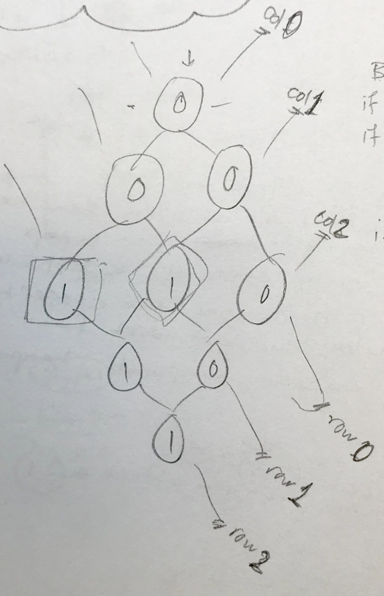

# BFS python explained and commneted (two approaches)

**Author:** Hieroglyphs
**Votes:** 276
**Link:** [https://leetcode.com/problems/01-matrix/solutions/363902/](https://leetcode.com/problems/01-matrix/solutions/363902/)

---

## Approach -1-
## Naive BFS invoked multiple times (Slow) 
**Idea**
- Iterate over the matrix with a nested for-loop to find cells conatining 1
- Apply BFS algo on those cells -> pass those cells to a BFS helper to find distance to closest 0 
- update the matrix cell with the distance

**Visuals**



**Code**
```
def updateMatrix(self, matrix: List[List[int]]) -> List[List[int]]:
        # BFS helper #
        def bfs(node):
            from collections import deque
            q = deque()
            i, j = node
            q.append(((i,j), 0)) # d (dist to a zero) = 0 initially 
            visited = set()
            dirs = [(1,0), (-1,0), (0,1), (0,-1)]
            while q:
                for i in range(len(q)):
                    coor, d = q.popleft()
                    x, y = coor
                    # if a zero nei is found
                    if matrix[x][y] == 0:
                        return d
                    visited.add(coor)
                    # investiagte neighbours
                    for dir in dirs:
                        newX, newY = x+dir[0], y+dir[1]
                        # within bounds:
                        if newX >= 0 and newX <= len(matrix)-1 and \\
                            newY >= 0 and newY <= len(matrix[0])-1:
                            # not seen:
                            if (newX, newY) not in visited:
                                q.append(((newX, newY), d+1))
            return -1
        
        # main logic #
		'''
        steps:
            - itertate over matrix to find cells = 1
            - pass cells equaling 1 to a bfs to find the closest 0 to them
            - update matrix
        '''
        for i in range(len(matrix)):
            for j in range(len(matrix[0])):
                if matrix[i][j] == 1:
                    d = bfs((i,j)) # d = closest dist to a 0
                    matrix[i][j] = d # update M with d
        return matrix
```

## Approach -2- 
## Optimized BFS invoked only once (Fast) 

**Idea**
- Instead of invoking BFS for each land cell to see how far we can get away from that source, we flip the problem.
- The flipped problem is to start from target (sea) and to figure our the closest source (land)
- This allows us to run a single BFS search that emerges from different places (all the targets aka all the zero cells) in the grid 
- Add all the targets (all zero cells) into the queue. While you're at it, also mark those targets as visited (add to a visited set)
- Run a single BFS on the pre-processed queue and investigate neighbours.
- if neighbiour cell has not been visited --> then it must bea land cell (since all the sea cells have been marked visited):
	- append the neighbour cell into the queue and mutate the gird 

**Code**
```
visited = set()
        from collections import deque
        q = deque()
        for i in range(len(matrix)):
            for j in range(len(matrix[0])):
                if matrix[i][j] == 0:
                    visited.add((i,j))
                    q.append((i,j))
        
        while q:
            x,y = q.popleft()
            for dirr in [(1,0), (-1,0), (0,1), (0,-1)]:
                newX, newY = x+dirr[0], y+dirr[1]
                if newX >= 0 and newX <= len(matrix)-1 and newY >= 0 and newY <= len(matrix[0])-1 and (newX, newY) not in visited:
                        matrix[newX][newY] = matrix[x][y] + 1
                        visited.add((newX, newY))
                        q.append((newX, newY))
        return matrix
```

**Similar problem:**
	- 1162. As Far from Land as Possible