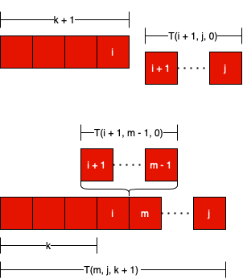

# [Java] Explanation with Illustration

**Author:** onepercenteveryday
**Votes:** 23
**Link:** [https://leetcode.com/problems/remove-boxes/solutions/1402639/](https://leetcode.com/problems/remove-boxes/solutions/1402639/)

---

### Explanation

- **From the explanation of for4LeetCode [here](https://leetcode.com/problems/remove-boxes/discuss/101310/Java-top-down-and-bottom-up-DP-solutions), I explained the core idea again here with illustration.**
- Define `T(i, j, k)` as the maximum points you can get by removing the boxes of subarray `(i, j)` (included) with `k` boxes attached to its left of the same color with box at index `i`.
- For a box at index `i`:
    - By removing box at index `i` (box `i`), we can get `(k + 1) * (k + 1) + T(i + 1, j, 0)` points. Because:
        - We have `k` boxes attached to the left of box `i`, so by remove box `i`, we'll get `(k + 1) * (k + 1) points.
        - Because we removed box `i`, we have the subarray `(i + 1, j)`, which has the points of `T(i + 1, j, 0)`, `k = 0` because we have 0 box attached to the left of box `i + 1`.
    - By attaching box `i` to box `m` which has the same color, we can get `T(i + 1, m - 1, 0) + T(m, j, k + 1)` points. Because:
        - Because by attaching box `i` to box `m`, we have to remove subarray `(i + 1, m - 1)`, so we'll get `T(i + 1, m - 1, 0)` points.
        - Because we have attached box `i` to box `m`, box `m` will have `k + 1` box with the same color attached to its left, so we can get `T(m, j, k + 1)` points by removing subarray `(m, j)`.



### Implementation

```java
class Solution {
    public int removeBoxes(int[] boxes) {
        int n = boxes.length;
        int[][][] memo = new int[n][n][n];
        return removeBoxesSub(boxes, 0, n - 1, 0, memo);
    }

    private int removeBoxesSub(int[] boxes, int i, int j, int k, int[][][] memo) {
        if (i > j) return 0;
        if (memo[i][j][k] > 0) return memo[i][j][k];
    
        int tmpi = i, tmpk = k;
        while (i + 1 <= j && boxes[i + 1] == boxes[i]) {
            i++;
            k++;
        }
        
        int res = (k + 1) * (k + 1) + removeBoxesSub(boxes, i + 1, j, 0, memo);

        for (int m = i + 1; m <= j; m++) {
            if (boxes[i] == boxes[m]) {
                res = Math.max(res, removeBoxesSub(boxes, i + 1, m - 1, 0, memo) + removeBoxesSub(boxes, m, j, k + 1, memo));
            }
        }

        memo[tmpi][j][tmpk] = res;
        return res;
    }
}
```