# Intuitive explanation in C++, JAVA, Python w/ Pictures w/ Comments

**Author:** kunal-chand
**Votes:** 489
**Link:** [https://leetcode.com/problems/brick-wall/solutions/888577/](https://leetcode.com/problems/brick-wall/solutions/888577/)

---

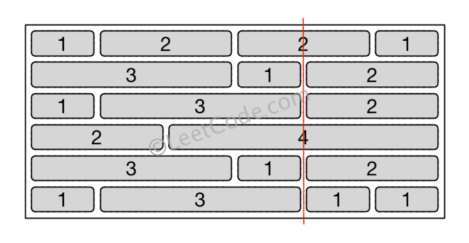

***Intuition:-***
The above wall is represented in a 2D Array where each element is the **size** of the respective brick :
[[1,2,2,1],
[3,1,2],
[1,3,2],
[2,4],
[3,1,2],
[1,3,1,1]]

Note : Size of each brick is at least 1 unit.

So to mininize the number of bricks crossed by line, we want the line to pass through as many edges as possible.
For this approach the edge postion will be defined with respect to the leftmost edge.
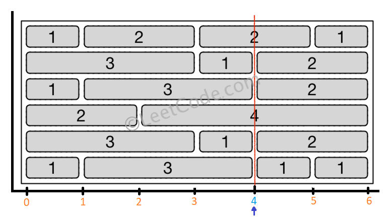

In the above picture, the leftmost edge is conscidered to be at *0th* postion. Hence the optimal line crosses from the edge "**4**".

But how do we figure out that the line which passes from the edge 4 is optimal ?
We can do that by storing each brick's edge & looking out for common edges through which the line can pass.

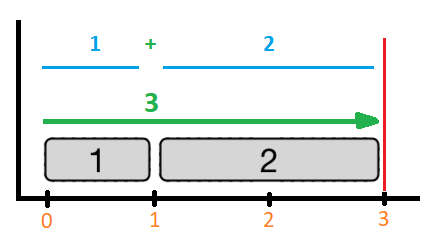

Any edge position can be calculated by the sum of the lenghts of bricks observed till that edge.
Like in the above diagram :
Edge Position = Length of 1st Brick + Length of 2nd Brick
=> Edge Position = 1 + 2
=> Edge Position = 3

NOTE: ***You cannot draw a line just along one of the two vertical edges of the wall, in which case the line will obviously cross no bricks.***
Because of this note we won't consider the ***edge 0*** & ***edge 6*** to solve the question.
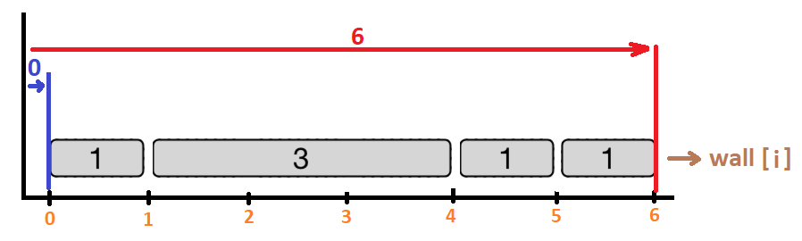

One interesting observation is that for calculating next edge position, we don't have to start adding the lengths from the very first brick of the row. Instead, we can add the "Sum of lengths of bricks obervered till the previous edge" + current brick's length.
So,
Next Edge Position = (Sum of lengths of bricks observered till the previous edge) + Current Brick's Length.
=> **Next Edge Position = Previous Edge Position + Current Brick's Length**
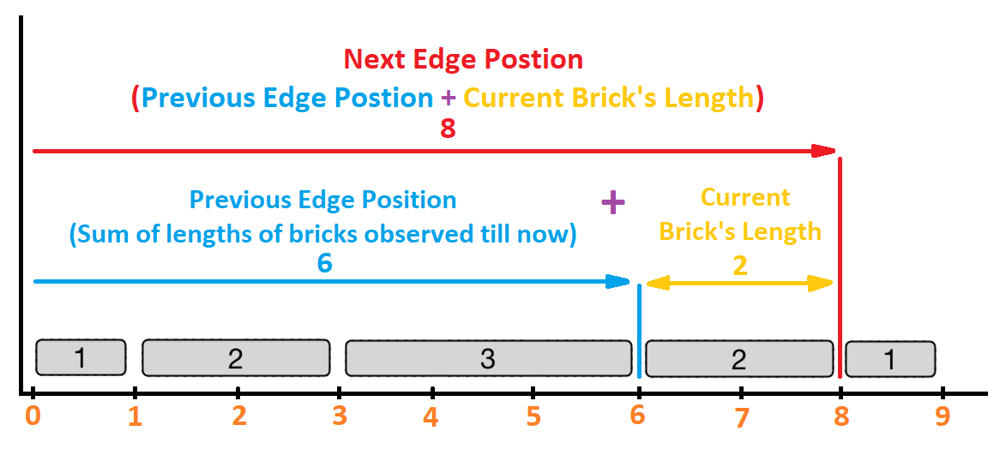


Using the same logic, we can calculate every edge's position in the wall
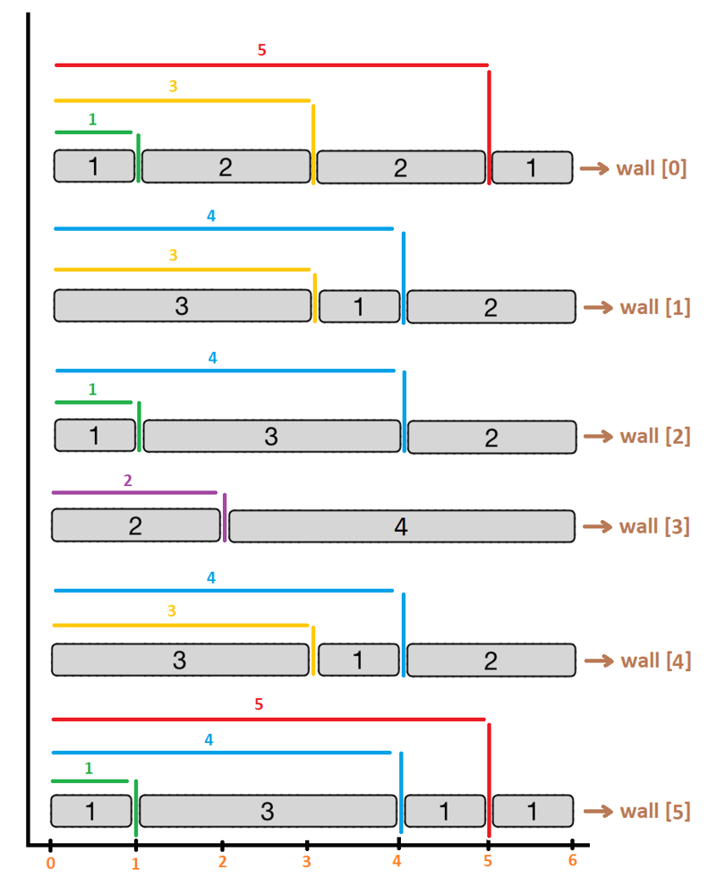

**The edge which happens to be in multiple rows will contribute to the optimal solution as the line passing through that common edge will result in minimun crossing/cutting of bricks.**
Hence we wanna find the edge that has higest frequency in the wall.

Now comes an important question, which data structure should we use and why?
**Suggestion :**
*How about using a data-structure that stores the 2-dimentional grid information via which we can access any position's info (whether its a brick or an edge) in a constant time?*
**Analysis of Suggestion :** 
*The problem of using a 2D grid is that we will be storing the edge's positions as well as the brick's positions. So we are wasting space in storing all the brick's coordinates.*
**Optimizing the Suggestion :**
*So if we look into our requirement, we are only concerned with the pair of "position of the edge" & "its frequency in the wall". We don't care about the brick's position. HashMap seems like a perfect data structure to store the pair*

Hence we will store every calculated edge in a HashMap.
Structure of the HashMap :
**Key of HashMap = Edge Position**
**Value of HashMap = Frequency of Edge in the Entire Wall**
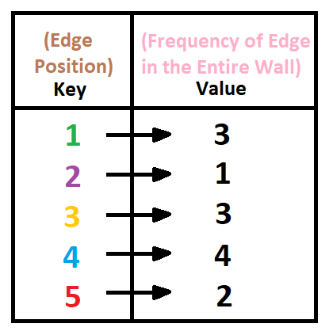

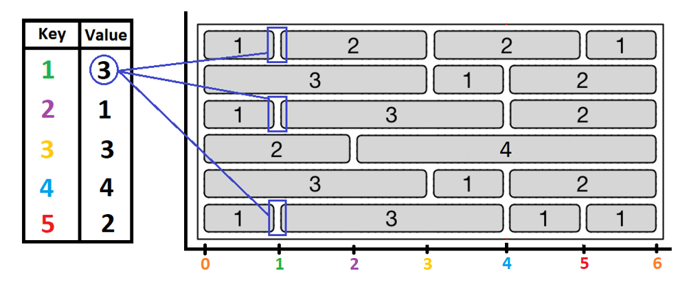
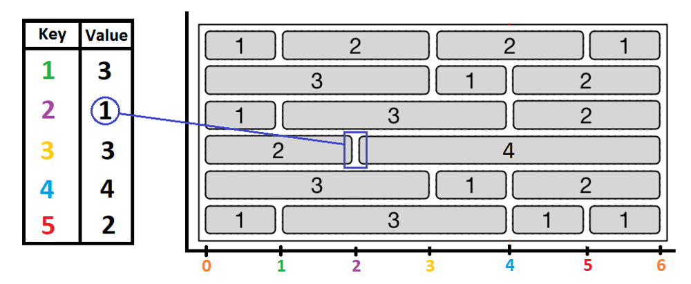
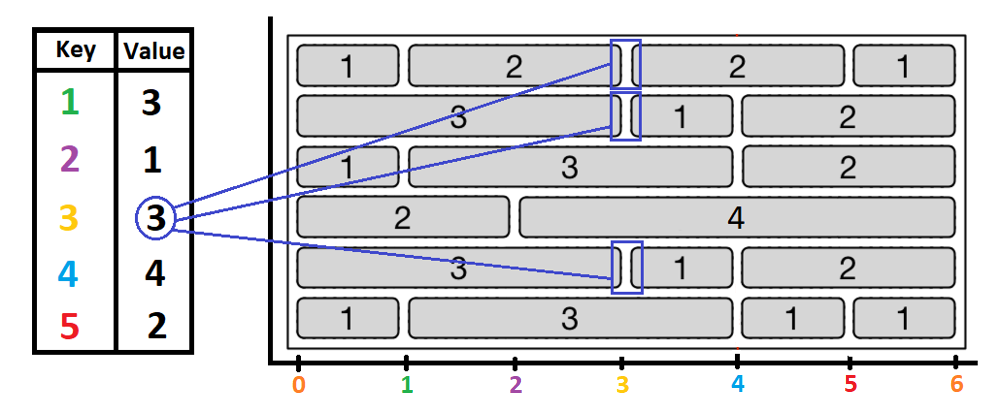
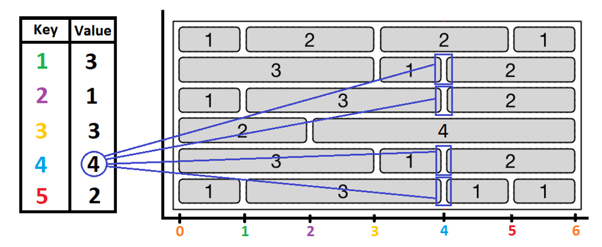
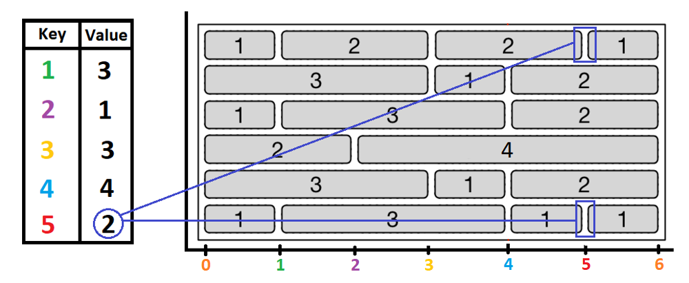

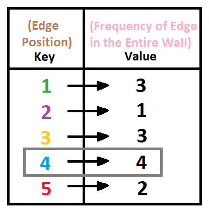

From the hashmap we can clearly see that **edge 4** is the edge having maximum frequency.
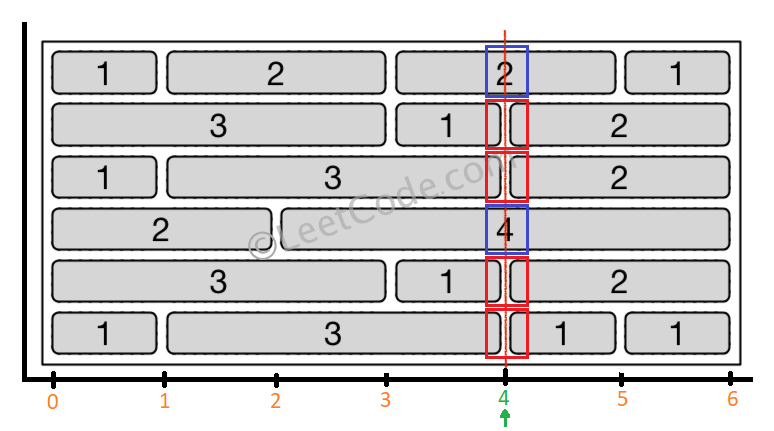

Now we are sure that the line passing from edge 4 will result in minimum crossing of bricks.
But we need to return the number of crossing the line makes.
In the above diagram,
*Red Box = Line passing through an edge*
*Blue Box = Line crossing through a brick*

Hence a fomulae can be derived:
Number of Blue Boxes+ Number of Red Boxes = Number of Rows in Wall
=> Number of Blue Boxes + (Frequency of Most Occuring Edge) = Number of Rows in Wall
=> (Number of Bricks Crossed by Line) + (Frequency of Most Occuring Edge) = Number of Rows in Wall
=> (Number of Bricks Crossed by Line) = Number of Rows in Wall - (Frequency of Most Occuring Edge)

***Number of Bricks Crossed by Line* = *Number of Rows in Wall* - *Frequency of Most Occuring Edge***

Hence
Number of Bricks Crossed by Line = Number of Rows in Wall - Frequency of Most Occuring Edge
=> Number of Bricks Crossed by Line = 6 - 4
=> Number of Bricks Crossed by Line = **2** (We return this answer)

Code in **C++/Java/Python** with comments:

```cpp []
class Solution {
public:
    int leastBricks(vector<vector<int>>& wall) 
    {
        unordered_map<int, int> edge_frequency; // HashMap to store the number of common edges among the rows
        int max_frequency = 0; // Variable to store the frequency of most occuring edge
        
        for(int row=0; row<wall.size(); row++) // Iterating through each row
        {
            int edge_postion = 0; // Variable to store different edge postion
            
            for(int brick_no=0; brick_no< wall[row].size() -1; brick_no++) // Iterating through each brick inside a row
            { 
                int current_brick_length = wall[row][brick_no]; // Length of the current brick
                edge_postion = edge_postion + current_brick_length; // Next Edge Position = Previous Edge Position + Current Brick's Length
                edge_frequency[edge_postion]++; // Incrementing the Frequency of just calculated Edge Postion
                max_frequency = max(edge_frequency[edge_postion],max_frequency); // Comparing the "Frequency of just calculated Edge Postion" with "Max Frequency seen till now" & storing whichever is greater.
            }
        }
        return wall.size() - max_frequency; // returning (Number of Bricks Crossed by Line) i.e. (Number of Rows in Wall - Frequency of Most Occuring Edge) 
    }
};
```
```java []
class Solution {
    public int leastBricks(List<List<Integer>> wall) 
    {
        HashMap<Integer, Integer> edge_frequency = new HashMap<>(); // HashMap to store the number of common edges among the rows
        int max_frequency = 0; // Variable to store the frequency of most occuring edge
        
        for(int row=0; row<wall.size(); row++) // Iterating through each row
        {
            int edge_postion = 0; // Variable to store different edge postion
            
            for(int brick_no=0; brick_no<wall.get(row).size()-1; brick_no++) // Iterating through each brick inside a row
            {
                int current_brick_length = wall.get(row).get(brick_no); // Length of the current brick
                edge_postion = edge_postion + current_brick_length; // Next Edge Position = Previous Edge Position + Current Brick's Length
                edge_frequency.put(edge_postion,edge_frequency.getOrDefault(edge_postion,0)+1); // Incrementing the Frequency of just calculated Edge Postion
                max_frequency = Math.max(edge_frequency.get(edge_postion), max_frequency); // Comparing the "Frequency of just calculated Edge Postion" with "Max Frequency seen till now" & storing whichever is greater.
            }
        }
        return wall.size() - max_frequency; // returning (Number of Bricks Crossed by Line) i.e. (Number of Rows in Wall - Frequency of Most Occuring Edge)
    }
}
```
```python []
class Solution:
    def leastBricks(self, wall: List[List[int]]) -> int:
        edge_frequency = {} # HashMap to store the number of common edges among the rows
        max_frequency = 0 # Variable to store the frequency of most occuring edge
        
        for row in range(len(wall)): # Iterating through each row
            edge_postion = 0 # Variable to store different edge postion
            
            for brick_no in range(len(wall[row])-1): # Iterating through each brick inside a row
                current_brick_length = wall[row][brick_no] # Length of the current brick
                edge_postion = edge_postion + current_brick_length # Next Edge Position = Previous Edge Position + Current Brick's Length
                edge_frequency[edge_postion] = edge_frequency.get(edge_postion, 0) + 1 # Incrementing the Frequency of just calculated Edge Postion
                max_frequency = max(edge_frequency[edge_postion], max_frequency) # Comparing the "Frequency of just calculated Edge Postion" with "Max Frequency seen till now" & storing whichever is greater.
                
        return len(wall) - max_frequency # returning (Number of Bricks Crossed by Line) i.e. (Number of Rows in Wall - Frequency of Most Occuring Edge)
```

**Time Complexity : O(N * M)**, 
*where N = hieght of the wall OR number of rows in wall
where M = approx width of each row OR approx number of bricks in each row
where N * M = Total number of bricks in the wall*
[Since we iterated through each brick once to calucluate the edge postion hence the time complexity would be equal to the total number of bricks.]

**Space Complexity :  O(M)**,
*where M = Total number of possible edges in a row*
[Since each edge corresponds to a key-value entry in the map, the size of hashmap will be proportional to the total number of possible edges in the brick wall. And because we are using a HashMap to store the number frequency of each edge postion, the space complexity would be equal to the maximum number of edges possible in the wall. 
Note that the number of bricks in each row doesn't relate to the space complexity, the number of possible edges does.]

**Edge Case 1 : wall = [ [1], [1], [1] ]**
**Expected Output : 3**
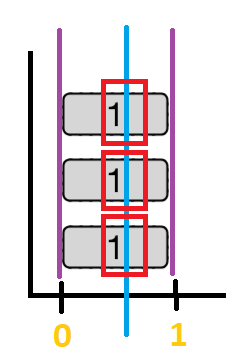
Since we can't cross the walls via *purple* lines (i.e. We can't cross via the leftmost & the rightmost edge).
The only option left is to cross via the *blue* line (i.e. Cross the wall by cutting through each brick).
Hence the number of bricks crossed is 3. (Encircled by Red Box)
In our code the second "for" loop won't run, due to which the maximum frequency remains zero.
Hence we
return "wall.size() - max_frequency"
=> return "wall.size() - 0"
=> return "3 - 0"
That is "3" is returned as the answer.

**Edge Case 2 : wall = [ [1,1,1,1], [1,1,1,1], [1,1,1,1], [1,1,1,1] ]**
**Expected Output : 0**
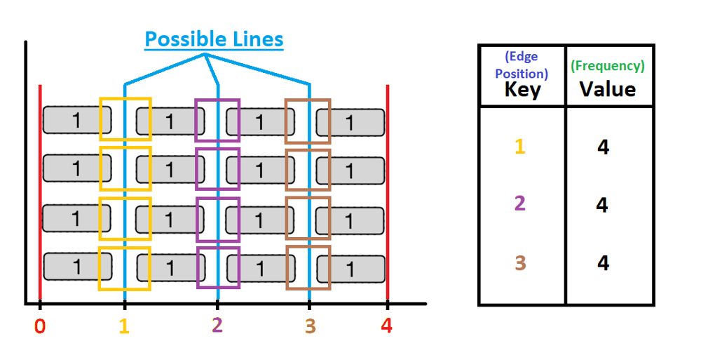
Just like the previous edge case, we can't cross the walls via *red* lines (i.e. We can't cross via the leftmost & the rightmost edge).
In this case, we do find some edges (Enrciled in yellow/purple/brown boxes), hence we don't need to cut through the bricks like we did in the previous edge case. Note that the occurence of each edge is equal to the number of rows. (Its visible in the hashmap)
But since there are multiple maximum frequency present in the hashmap (Three 4s), hence we can select any one of the edges.
Which gives us 3 possible lines to draw (blue lines in the diagram)
So "edge frequency = number of rows" means that there exists an edge that is aligned in each row from top to bottom such that the line can pass without cutting any brick. Hence the number of bricks cutted is 0. (Clearly visible in the diagram)
In our code, the maximum frequency will be setted to "4" (Which is retrived via hashmap)
Hence we
return "wall.size() - max_frequency"
=> return "wall.size() - 4"
=> return "4 - 4"
That is "0" is returned as the answer.

****************************************** THE END ******************************************

**Doubt (by @astroash):**
I think that the space complexity will be O(mn) and not O(m). You mentioned "the space complexity would be equal to the maximum number of edges possible in the wall". In the worst case (staggered arrangement of bricks), this value will be equal to the total number of bricks in the wall which is mn. You assumed that this value will be equal to the maximum number of bricks in a single row, but all the bricks might account for a new edge distance too.

**Clarification of space complexity analysis confusion:**
	I understand your confusion. Let me elaborate on the same. The worst-case scenario (staggered arrangement of bricks) is covered in **Edge Case 2**.

**1st Doubt:** "*You assumed that this value will be equal to the maximum number of bricks in a single row*"
**My Response:** As per your understanding, I'm assuming that space complexity will be equal to the maximum number of bricks in a SINGLE row. That is incorrect, I'm looking for DIFFERENT TYPES of edges in the ENTIRE wall. So doesn't matter which row I look into.

**2nd Doubt:** "*but all the bricks might account for a new edge distance too.*"
**My Response:** Does it really account for a new edge distance? And only because the bricks are in a different row?

Imagine every row in the wall has an edge distance of 1 unit only. And total rows are 3.
		1) So the hashmap <edge, frequency> will have an entry as <(1,3)>. Meaning the ENTIRE wall has only an edge distance of 1 and that occurred 3 times. Now Add a 4th row, with an edge distance of 1 in it.
		2) Hashmap <edge, frequency> will now look something like <(1,4)>. Meaning the ENTIRE wall has only an edge distance of 1 and that occurred 4 times. Now Add a 5th row, with an edge distance of 2 in it.
		3) Hashmap <edge, frequency> will now look something like <(1,4), (2,1)>. Meaning the ENTIRE wall has an edge distance of 1 that occurred 4 times & an edge distance of 2 that occurred 1 time.

So what increased the size of the hashmap? Adding the 4th row or the 5th row? 
5th row, right? It was because the 5th row came along with a NEW edge distance that resulted in a new key-value pair in the hashmap.

Now coming back to your question, "won't the same edge in a different row account for a new edge distance?"
Look at what happened when you added the 4th row in the example, the hashmap went from <(1,3)> to <(1,4)>. The edge in the new row was the same as that in all the other rows. Because of which the value of an EXISTING pair in the hashmap changed from 3 to 4 and no new pair was added to the hashmap.

So m * n will result in counting the same edge multiple times and that is not the actual size of the hashmap. The size of the hashmap is determined by the number of different key-value pairs in it. The MAGNITUDE of the value has NOTHING to do with the space complexity. I hope this answers your question.