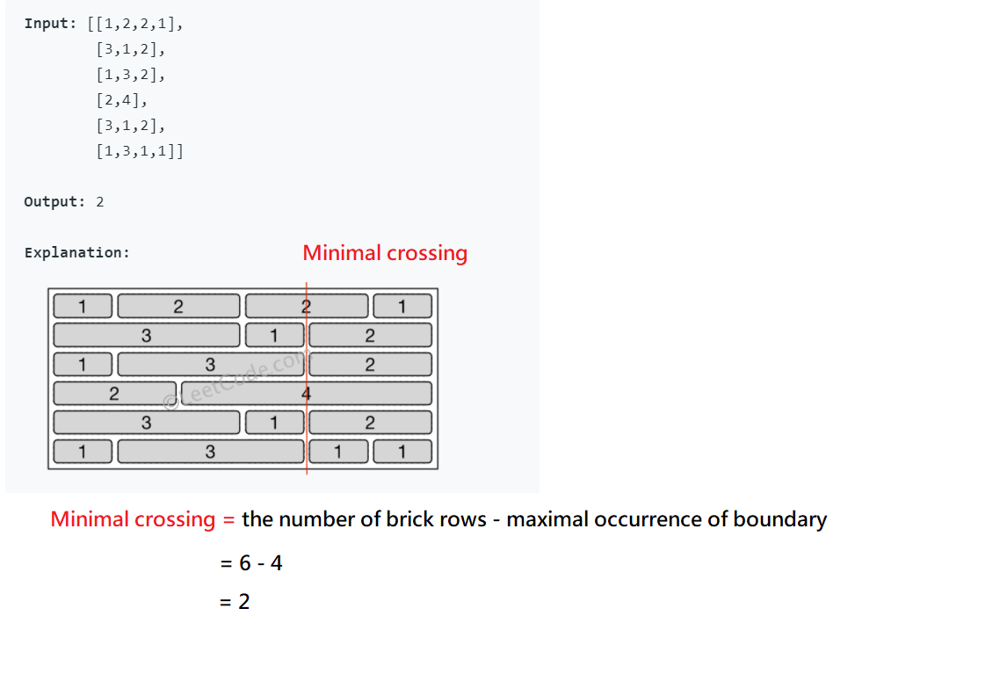

# Python/Go O(mn) by dictionary [w/ Visualization]

**Author:** brianchiang_tw
**Votes:** 6
**Link:** [https://leetcode.com/problems/brick-wall/solutions/1171054/](https://leetcode.com/problems/brick-wall/solutions/1171054/)

---

**Hint**:

1. Build a **dictionary** where **key** is **boundary**, as well as **value** is **occurrence of boundary**

2. Scan each brick rows and **update brick boundary** into **dictionary**

3. Compute **minimal crossing** based on **maximal occurrence of boundary**

---

**Visualization**:



---

**Implementation** by dictionary in Python:

```
class Solution:
    def leastBricks(self, wall: List[List[int]]) -> int:
        
        ## dictioanry
        # key: boundary
        # value: occurrence of boundary
        boundary_occ_dict = defaultdict(int)
        
        brick_rows = len(wall)
        
        # sacn each brick row
        for cur_brick_row in wall:
            
            # reset current bounary to zero
            cur_boundary = 0
            
            # update boundary into dictionary
            # Take care that final boundary is excluded to satisfy definition
            for cur_brick_length in cur_brick_row[:-1]:
            
                cur_boundary += cur_brick_length
            
                boundary_occ_dict[cur_boundary] += 1
        
        # get occurrence of boundary
        boundary_occurrence = boundary_occ_dict.values()
        
        
        # compute minimal crossing by occurrence of boundary
        
        if boundary_occurrence:
            # general cases: mutiple bricks on each row
            min_crossing = brick_rows - max(boundary_occurrence)
            
        else:
            # corner case: only one brick on each row
            min_crossing = brick_rows
        
        return min_crossing
            
```

---

**Implementation** by map (so-called dictionary) in Go:

```
func Max(x, y int) int{
    if x > y {
        return x
    }
    return y
}

func leastBricks(wall [][]int) int {
    
    //// dictioanry
    // key: bounday
    // value: occurrence of boundary
    
    boundaryOccDict := make(map[int]int)
    
    brickRows := len(wall)
    
    // scan each brick row
    for _, curBrickRow := range wall{
        
        // reset current boundary to zero for each row
        curBoundary := 0
        
        // update boundary into dictionary
        // Take care that final boundary is excluded to satisfy definition
        for _, curBrickLength := range curBrickRow[:len(curBrickRow)-1]{
            
            curBoundary += curBrickLength
            
            boundaryOccDict[curBoundary] += 1
            
        }
        
    }
    
    // get occurrence of boundary
    maxBoundaryOccurrence := -1
    
    for _, curBoundaryOccurrence := range boundaryOccDict{
        maxBoundaryOccurrence = Max(maxBoundaryOccurrence, curBoundaryOccurrence)
    }
    
    // compute minimal crossing by occurrence of boundary
    minCrossing := 0
    
    if maxBoundaryOccurrence != -1{
        // general cases: mutiple bricks on each row
        minCrossing = brickRows - maxBoundaryOccurrence
        
    }else{
        // corner case: only one brick on each row
        minCrossing = brickRows
    }
    
    return minCrossing
}
```

---

Reference:

[1] [Python official docs about dictionary](https://docs.python.org/3/tutorial/datastructures.html#dictionaries)

[2] [Python official docs about defaultdict( ... )](https://docs.python.org/3/library/collections.html#collections.defaultdict)

[3] [Golang official docs about map[]](https://blog.golang.org/maps)