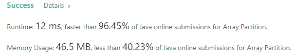
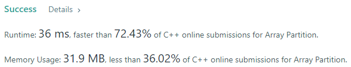
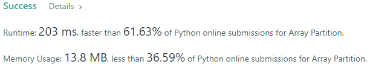
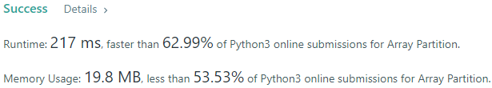
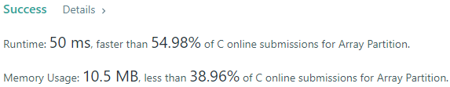
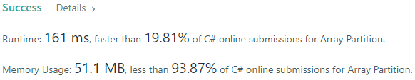
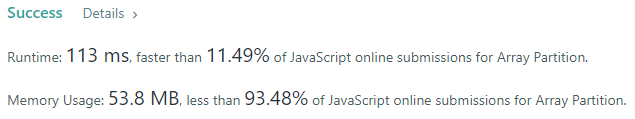

# 💢☠💫Easiest👾Faster✅💯 Lesser🧠 🎯 C++✅Python3🐍✅Java✅C✅Python🐍✅C#✅💥🔥💫Explained☠💥🔥 Beats 💯

**Author:** Edwards310
**Votes:** 6
**Link:** [https://leetcode.com/problems/array-partition/solutions/5602420/](https://leetcode.com/problems/array-partition/solutions/5602420/)

---

# Intuition








```javascript []
/**
 * @param {number[]} nums
 * @return {number}
 */
var arrayPairSum = function(nums) {
    var ans = 0
    var n = nums.length
    nums.sort((a, b) => {
        return a - b;
    })
    for(let i = 0; i < n; i += 2)
        ans += nums[i]
    
    return ans
};
```
```C++ []
class Solution {
public:
    int arrayPairSum(vector<int>& nums) {
        int n = nums.size();
        int res = 0;
        sort(nums.begin(), nums.end());
        for(int i = 0; i < n; i += 2)
            res += nums[i];
        return res;
    }
};
```
```Python3 []
class Solution:
    def arrayPairSum(self, nums: List[int]) -> int:
        return sum(sorted(nums)[: : 2])
```
```Java []
class Solution {
    public int arrayPairSum(int[] nums) {
        Arrays.sort(nums);
        int n = nums.length;
        int ans = 0;
        for(int i = 0; i < n; i += 2)
            ans += nums[i];
        return ans;
    }
}
```
```C []
int cmp(const void* a, const void* b){
    return *(int*)a - *(int*)b;
}
int arrayPairSum(int* nums, int numsSize) {
    int res = 0;
    qsort(nums, numsSize, sizeof(int), cmp);
    for(int i = 0; i < numsSize; i += 2)
        res += nums[i];
    return res;
}
```
```Python []
class Solution(object):
    def arrayPairSum(self, nums):
        """
        :type nums: List[int]
        :rtype: int
        """
        n = len(nums)
        nums.sort()
        res = 0
        for i in range(0, n, 2):
            res += nums[i]
            
        return res
```
```C# []
public class Solution {
    public int ArrayPairSum(int[] nums) {
        int n = nums.Length;
        Array.Sort(nums);
        int res = 0;
        for(var i = 0; i < n; i += 2)
            res += nums[i];
        return res;
    }
}
```
<!-- Describe your first thoughts on how to solve this problem. -->

# Approach
<!-- Describe your approach to solving the problem. -->

# Complexity
- Time complexity:
<!-- Add your time complexity here, e.g. $$O(n)$$ -->
    O(N * logN)
- Space complexity:
<!-- Add your space complexity here, e.g. $$O(n)$$ -->
    O(1)
# Code

